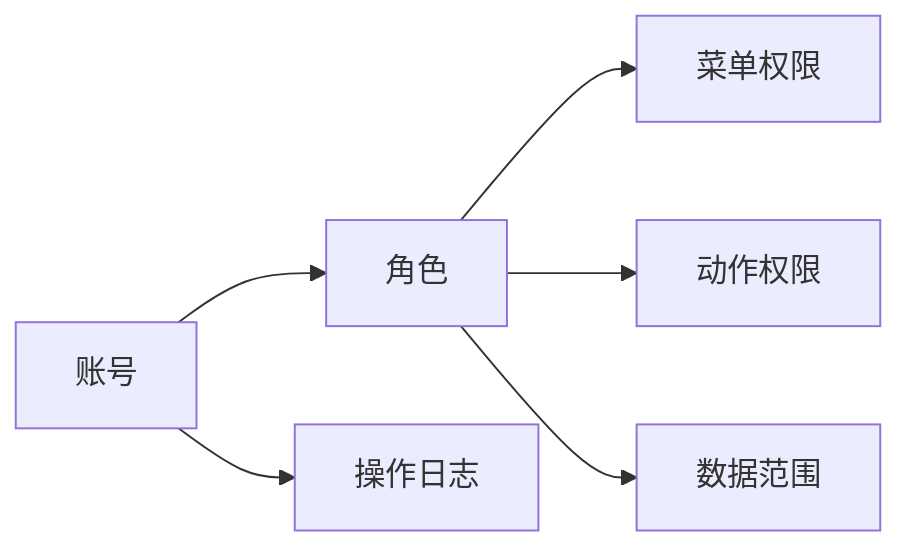

## 用户要求
补齐货灵ERP、仓网管理端、单仓端与PDA的账号、角色、权限与操作日志，形成可演示的完整链路。仍为自包含HTML原型，不做真实后端、SSO、密码体系与审批流。

## 产品概述
统一账号模型，按部署内主体分三类：运营方账号、货主账号、仓内账号。角色由菜单权限、动作权限、数据范围三部分组成。仓网端集中管理运营方与仓内账号，货灵ERP管理本货主账号，单仓端人员档案关联账号，PDA展示岗位权限，商城端不建第二套账号。

## 核心功能
- 账号管理：新增、编辑、停用、重置密码、查看日志；按账号类型与数据范围隔离。
- 角色权限：角色列表、权限抽屉（菜单、动作、数据范围）、复制、停用；系统内置角色与自定义角色并存。
- 操作日志：登录、账号变更、角色变更、导出、审核、发货、退款等；支持按端、模块、动作、时间筛选并查看详情。
- 单仓端人员关联账号，支持开通账号与查看权限；PDA我的页展示角色、仓库范围与权限入口。
- 货主账号不能跨货主，仓内账号不能跨仓库，运营方账号可跨货主与仓库；继续不出现SaaS多租户、套餐、订阅痕迹。


## 技术栈
- 沿用现有 Node 原生 ESM 构建，产物为五份自包含HTML，不新增依赖。
- 渲染层复用 `prototypes/shared/ui.mjs` 的 `ListPage`、`FormDrawer`、`DrawerDetail`、`StatusTag`、`Tag`，不新增骨架类型。
- 样式只取 `prototypes/shared/tokens.css.mjs` 的 `var(--wx-*)`，不写 hex。
- 装配以 `prototypes/shared/modules.json` 为唯一源；页面数据放各模块 `data/*.json`。
- 交互用 `data-*`、`live`、`sessionStorage`；页面模块不写 `script`。

## 实现策略
1. 先定账号与权限模型、页面文案、数据字典，再改共享层与页面。
2. 账号集中管理：运营方与仓内账号在仓网端建，货主账号在货灵ERP建，单仓端不建独立账号页，避免同一账号两处维护。
3. RBAC 简化为「账号 → 单角色 → 菜单权限 + 动作权限 + 数据范围」；角色分系统内置与自定义，按归属分运营方角色、货主角色、仓内角色。
4. 原型权限粒度按一级菜单、动作、数据范围演示；页面级 key 保留在字典，角色抽屉不逐个页面勾选，避免30多个复选项。
5. 操作日志用演示数据与筛选表达，页面动作不动态新增日志行；这是原型边界，交付说明写清。
6. 货主隔离沿用现有机制：货灵ERP按登录身份过滤 `rows[].owner`，不出现货主下拉与货主筛选。

## 权限模型
| 维度 | 取值 | 说明 |
| --- | --- | --- |
| 账号类型 | 运营方 / 货主 / 仓内 | 决定归属与管理端 |
| 角色类型 | 系统内置 / 自定义 | 系统角色不可删除，可复制 |
| 角色归属 | 运营方 / 货主 / 仓内 | 货主角色不能跨货主 |
| 菜单权限 | 工作台、订单、履约、售后、仓储委托、库存、商品、商城店铺、平台接入、账单与服务、报表与设置 | 按一级菜单聚合 |
| 动作权限 | 查看、新增、编辑、停用、导出、审核、发货、退款 | 多选 |
| 数据范围 | 货主范围、仓库范围、业务范围 | 全部或指定 |

内置角色建议：
- 运营方：运营管理员、仓网调度、财务、客服。
- 货主：货主管理员、货主查询、委托经办、售后专员、货主财务。
- 仓内：仓库主管、收货员、上架员、拣货员、复核员、盘点员。



## 页面与导航
### 仓网管理端
新增一级菜单「账号与权限」，放在「服务与设置」之前，共3页：

| 页面 | 模块 / key | 主要列 | 交互 |
| --- | --- | --- | --- |
| 账号管理 | `system/user-list` | 账号、姓名、账号类型、所属组织、角色、数据范围、账号状态、最近登录 | 新增、编辑、停用、重置密码、查看日志 |
| 角色权限 | `system/role-list` | 角色名称、角色编码、角色类型、账号数、权限数、数据范围、状态、更新时间 | 新增、编辑、复制、停用、配置权限 |
| 操作日志 | `system/audit-log` | 时间、操作人、所属端、模块、动作、对象、结果、IP | 筛选、查看详情 |

- 角色抽屉分组：角色信息、菜单权限、动作权限、数据范围；保存后状态与权限数在列表可见。
- 账号抽屉：角色下拉 + 货主、仓库、业务范围勾选；停用后不物理删除。
- `system` 模块补 `audit-log` 页面，版本升 0.3.0，scope 改为「本部署实例内的账号、角色、权限与操作日志」。

### 货灵ERP
在「报表与设置」段内补2页，原有「子账号与权限」增强：

| 页面 | 模块 / key | 改什么 |
| --- | --- | --- |
| 子账号与权限 | `owner/account-list` | 列补账号类型、角色、数据范围、账号状态、最近登录；动作补新增、编辑、停用、重置密码、查看日志；角色下拉改为货主角色 |
| 角色权限 | `owner/role-list` | 本货主自定义角色；权限抽屉只出现货主可用菜单，数据范围限定本货主 |
| 操作日志 | `owner/audit-log` | 本货主账号的登录、账号变更、角色变更、导出等日志 |

- 货主角色不能跨货主，不能看到运营方角色与仓内角色。
- 货灵ERP不出现货主下拉与货主筛选；账号与日志按登录货主限定。

### 单仓端与PDA
- `resource/staff-list`「人员」补「关联账号」「账号状态」两列；行操作补「开通账号」「查看权限」，开通账号只改演示状态并toast。
- `task/pda-mine`「我的」补角色、仓库范围、权限入口；入口用toast「我的权限（原型示意）」。
- 单仓端不建独立账号管理页，账号统一在仓网端维护。

### 商城端
不建账号体系。买家与店主共用货主登录账号，角色由是否开店派生，维持现有口径。

## 共享层改动
- `prototypes/shared/modules.json`：
  - `system/user-list`、`system/role-list` 补 `app: "network-app"`；新增 `system/audit-log`，同样归 `network-app`。
  - `owner` 新增 `role-list`、`audit-log`，归 `erp-app`。
  - `erp-app` 的 `nav-setting` 补两页，变为4页。
  - `network-app` 新增 `nav-account`「账号与权限」段，含3页；原8段变9段。
- `prototypes/shared/ui.mjs` 与 `templates/ui.mjs`：
  - `FormField` 新增 `checks` 字段类型，渲染多选勾选组；选项支持 `{ group, label, value }`。
  - `collectForm` 把勾选值合并为「、」分隔字符串；`fillForm` 按「、」或「,」还原勾选。
  - 补勾选组样式，仍用 `var(--wx-*)`。
- 页面仍用 `ListPage` + `FormDrawer` + `DrawerDetail`，不新增骨架。
- 角色权限保存后，列表的「权限数」由 `menuScope`、`actionScope` 的条目数派生；账号停用走 `live` 状态流转。

关键字段契约：
```
{ type: 'checks', key: 'menuScope', label: '菜单权限',
  options: [{ group: '订单', label: '订单中心', value: 'owner/order-center' }] }
```

## 文档与字典
- 新建 `docs/产品需求/账号与权限方案.md`：账号模型、角色与权限、数据范围、三端分工、账号生命周期、角色与权限变更、操作日志、原型映射与边界。
- 扩展 `docs/数据字典/子账号.md`：标题与定义改为「本部署实例内的登录账号」，补 `accountType`、`orgCode`、`roleCode`、`menuScope`、`actionScope`、`dataScope`、`lastLoginIp`；保留文件名，首段说明覆盖运营方、货主、仓内三类账号。
- 新增 `docs/数据字典/角色.md`：角色编码、名称、类型、归属、菜单权限、动作权限、数据范围、状态、账号数。
- 新增 `docs/数据字典/操作日志.md`：日志编号、时间、操作人、端、模块、动作、对象、结果、IP、详情。
- 修改 `docs/数据字典/人员档案.md`：`account` 关联说明补「账号在 `system` 账号管理维护，单仓端只读关联状态」。
- 修改 `docs/产品需求/三端核心功能清单.md`：补三端账号与权限的逐页落点。
- `glossary.md` 登记「账号与权限」段、6个页面名与列名、账号类型、角色类型、账号状态、动作权限、日志结果。
- `registry.md`：仓网端35页、货灵ERP36页、总页数123；仓网端9段、货灵ERP11段。
- `docs/index.md`、`docs/log.md`、`docs/数据字典/index.md`、`docs/数据字典/log.md` 登记与留痕。
- 提交前跑 `node docs/check.mjs` 与 `node docs/数据字典/check.mjs`，零错误。

## 跨端联动评估
| 端 | 落点 | 联动点 | 结论 |
| --- | --- | --- | --- |
| 货灵ERP | `owner/account-list` 增强；新增 `owner/role-list`、`owner/audit-log` | 34→36页；报表与设置4页 | 必须同改 |
| 仓网管理端 | 新增 `system/user-list`、`system/role-list`、`system/audit-log`；新增「账号与权限」段 | 32→35页；8→9段 | 必须同改 |
| 单仓端 | `resource/staff-list` 补关联账号与账号状态、开通账号动作 | 列、动作 | 必须同改 |
| PDA作业端 | `task/pda-mine` 补角色、仓库范围、权限入口 | 展示字段 | 必须同改 |
| 商城端 | 无 | 买家/店主角色由货主派生 | 无需改（依据：不建第二套账号） |
| 共享层 | `modules.json`、`ui.mjs`、`templates/ui.mjs` | 页面归属、nav、`checks`字段 | 必须同改，五端重建 |
| 文档 | 方案、字典、glossary、registry、索引与日志 | 页面名、列名、角色与状态 | 必须同改 |

重建范围：五端全建。不同步会影响A2文案、A4骨架、A10页签、A11货主隔离、A17状态动作，以及B1、B5、B13、B23。

## 演示数据
- 运营方账号4个：`yun.admin`、`yun.dispatch`、`yun.finance`、`yun.service`，覆盖全部货主与仓库。
- 货主账号4个：沿用 `hn.admin`、`hn.query`、`cx.admin`、`yt.old`，补角色与数据范围。
- 仓内账号6个：与 `resource/staff-list` 的 ST0001~ST0006 关联，覆盖华东、华南、华北三仓。
- 角色12条：运营方4条、货主5条、仓内6条中取代表条目，其余用系统角色补齐。
- 操作日志12条以上：覆盖登录、新增账号、停用账号、角色变更、导出、审核、发货、退款，含成功与失败。
- 角色权限数、账号数由演示数据派生，不写死展示字段。

## 分批实施
1. **模型与文案**：新方案、3份字典、glossary、registry、索引与日志。判据：两套check零错误。
2. **共享层**：`checks`字段与样式，`modules.json`页面归属与nav。判据：五端构建通过，现有页面不回归。
3. **仓网端**：账号管理、角色权限、操作日志三页与演示数据。判据：角色抽屉可勾选并保存，账号状态可流转，日志可筛。
4. **货灵ERP**：子账号增强、角色权限、操作日志三页。判据：角色只出现货主可用段，账号与日志按登录货主限定。
5. **单仓端与PDA**：人员关联账号、开通账号动作、我的权限入口。判据：单仓端列可见，PDA展示角色与仓库范围。
6. **收尾**：五端全量重建、全量验收、浏览器实测账号停用/角色保存/日志筛选/货主隔离、`module.json`版本、文档日志回填。判据：全量验收零违规，`--check`五端`check ok`。

## 边界
- 本期不做组织架构树、审批流、SSO、密码找回与真实登录校验。
- 权限粒度按「一级菜单+动作+数据范围」演示；页面级key保留在字典，原型不逐个页面勾选。
- 操作日志使用演示数据与筛选，页面动作不动态新增日志行。
- 单仓端不建独立账号页；账号统一在仓网端维护。
- 所有端继续不出现SaaS多租户、套餐、订阅、主体切换器。


## Agent Extensions
### Skill
- **3pl-wms-proto**
  - Purpose: 按五层规范改 `modules.json`、共享层与页面源，执行跨端联动核对、五端构建与交付验收。
  - Expected outcome: 账号与权限页面符合admin外壳、文案真值、`data-*`契约与验收A/B两组，五端产物一致。
- **agent-browser**
  - Purpose: 打开货灵ERP与仓网端产物，实测账号停用、角色权限保存、日志筛选、货主隔离与三档宽度。
  - Expected outcome: 截图与交互记录证明权限抽屉可勾选保存、账号状态与页签计数同步变化、货主账号不串数据。
