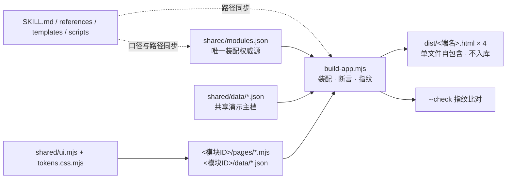

## 产品概述

针对 `prototypes/` 数据存放结构出具一份全范围（P0–P3）整改执行方案。审查已确认物理目录分层本身合理、无需重排；整改聚焦「目录齐备但内容与状态失序」，按用户确认的范围与口径落地，并在每个阶段保留可验证、可回滚的检查点。

## Core Features

- **状态对齐**：核对并发在途改动、消除构建基线漂移、补齐目录卫生规则，使基线检查恢复通过。
- **删除未装配空壳**：移除未分配端、未参与任何产物装配的模板页与空演示数据；注册表保留页面清单作为预留，待页面归属端时再由脚手架重建。
- **建立共享演示主档**：把货主、商品、仓库、批次等被多处复制的演示数据收敛为单一事实源，各页只保留本页特有行，消除多份真相与口径不一致。
- **命名消歧与目录重命名**：分离模块与端的命名冲突、去掉带空格的目录名，全量同步页面引用、忽略规则、脚本、模板与规范文档中的路径。
- **规范与文档同步**：补齐「预留路径」「未装配骨架」「共享主档层」「命名口径」条款，按文档规则留痕。
- **全量重建与交付验收**：重建四个端产物，通过漂移检查、交付验收与提交前双项自检，确认界面与交付物零回归。

## 一、技术栈选型

沿用现有工程栈，**不引入任何新依赖、框架或构建工具**：

| 层 | 现有技术 | 本次用法 |
| --- | --- | --- |
| 运行时 | Node.js 18 及以上、原生 ESM（`.mjs`） | 复用 `build-app.mjs`、`init-module.mjs`、`verify-delivery.mjs` |
| 配置 | `01 shared/modules.json`（唯一装配权威源）、各模块 `module.json` | 保留页面清单，新增预留路径与端 id 口径 |
| 数据 | 静态 JSON 演示数据 | 新增共享主档文件，改造各页 data 结构 |
| 产物 | 四个自包含单文件 HTML | 只由构建生成，不手改、不入库 |
| 规范 | Markdown（`.codebuddy/skills/3pl-wms-proto/`、`docs/`） | 用户已授权同步修改 |
| 版本控制 | git + `.gitignore` | 作为分阶段回滚点 |


复用既有成熟机制：`--check` 的 sha256 源指纹、构建期断言标签体系、`entriesOf(appId)` 装配过滤、脚手架占位符替换、验收脚本 S1–S5 + X 分组。

## 二、实现策略

**总体方法**：契约先行、分阶段推进、每阶段以 `node prototypes/build-app.mjs --check` 与 git 暂存作为验证点与回滚点。顺序为「冻结基线 → 改规范口径 → 删空壳与注册表对齐 → 建共享主档 → 目录重命名 → 全量重建验收」。P1 删除、P2 数据契约、P3 路径三者高度耦合，必须串行，禁止并行改动。

**关键决策与取舍**

1. **命名方案（推荐，用户未指定，标注为可调整项）**

- `00 dist/` → `dist/`，`01 shared/` → `shared/`：同时消除空格与「数字前缀＝排序技巧」的隐含约定，让 `../../shared/ui.mjs` 这类相对路径对 shell 与工具链友好。备选为 `00-dist/`、`01-shared/`（保留置顶排序），二选一须在动手前定稿。
- **改端 id，不改模块 ID**：`owner/network/warehouse/mall` → `owner-app/network-app/warehouse-app/mall-app`。端 id 只出现在 `apps[].id`（4 处）、`pages[].app`（21 处）、`build-app.mjs` 的 `app.id === 'owner'`（1 处）与 `--app` 参数；而模块 ID 绑定目录名、`data-page-id`、CSS 前缀、`module.json` 与脚手架参数，改动半径大得多。端名 `apps[].name` 与产物 HTML 文件名保持不变，**界面与交付物零变化**。
- 不新增 `prototypes/modules/` 之类的包装层——审查已确认扁平结构合理，加层属于冗余。

2. **删除空壳：按「双条件」逐个复核，成套删除**

- 判定条件：`注册表 pages[].app 为空` **且** `pages/*.mjs 含模板注释（如「本模板只演示骨架」「示例列名」）`。据此锁定 16 页；`inventory/pages/batch-owner-list.mjs`、`mall/pages/home.mjs`、`mall/pages/product-detail.mjs` 等已装配且有内容的页面**不在删除范围内**。
- 删除 13 个 `{"rows":[]}` 空壳 data + 16 个模板页；另有 `inbound/data/receiving-scan.json`、`outbound/data/picking-scan.json`、`warehouse/data/count-scan.json` 三个复合结构占位 data 与对应模板页成套，**建议一并删除**（相对用户所述「13 个」的偏差需在执行记录中写明理由），否则留下无页面消费的孤儿数据。合计 16 页 / 16 data。
- **只删文件，保留 8 个模块目录与 `module.json`**：`verify-delivery.mjs` 的 `checkBoundary()` 会对所有 `deployed` 模块校验目录与清单存在，`checkGlossary()` 会遍历注册表全部 `pages[].name`，删目录会导致误报。
- `modules.json` 的 `pages[].file` **全部保留**为预留路径。现有 `validateRegistry()` 的文件存在性断言写作 `if (p.app &amp;&amp; !fs.existsSync(...))`，仅对已归属端的页生效，删除无 `app` 的页**天然不会误报**，无需改该断言，但必须在 `modules.md` 补「预留路径」条款。
- 根因治理：`init-module.mjs` 第 135 行无条件写 `JSON.stringify({ rows: [] })` 是空壳来源，须同步改为「仅当页面已分配 `app` 时生成 `data/*.json`」，否则下次启用页面又会产生空壳。

3. **共享主档层：构建期合并 + 断言，不引入运行时 join**

- 新增 `shared/data/`（`owners.json`、`skus.json`、`warehouses.json`、`batches.json`），作为演示数据的唯一事实源。
- `renderApp` 中把主档一次性读入并挂到 `data` 的**保留键**（如 `data.master`），页面模块沿用既有「派生列写成纯函数」约定，按 `skuCode`/`owner` 从主档查字段；各页 `data/*.json` 去掉重复的主档展示字段，只保留本页特有行。
- 新增构建期断言：①各页 data 引用的 `skuCode`/`owner`/`warehouse` 必须存在于主档；②保留键不得与任何全局页 key 冲突（扩展现有 `validateRegistry` 的 key 唯一断言）；③`mall/data/home.json` 正名为商品展示表后，`cart/checkout/orders/search/product-detail` 五个页面对 `data.home` 的读取与 `product-detail.mjs` 的 `data['product-detail']` 硬编码键必须同步改写；④`buildMallHtml` 中硬编码的 `mall/data/cart.json` 路径同步。
- 批次两份行数据合并为一份事实表，按端投影列（库位 / 仓库）与过滤行，去掉 `batchNo` 双份维护。

4. **目录重命名的路径同步清单（已核实的具体位置）**

| 文件 | 需同步点 |
| --- | --- |
| `prototypes/build-app.mjs` | `SHARED`(13)、`DIST`(14)、`demoOwners` 无关、`validateRegistry`(56)、`buildMallHtml` 的 `mall/data/cart.json`(175)、`fingerprint` 文件清单(259-270)、`buildHtml` 的 `app.id === 'owner'`(214)、`distOf`(272)、`--check` 分支(274-285) |
| `templates/build-app.mjs` | 与上一一对应的模板副本 |
| `scripts/init-module.mjs` | `SHARED`(34)、`ensureShared()` 复制清单(64-71)、`ensureGitignore()` 的 `rules`(80)、头部注释(12)、`initModule` 的空 data 生成(135) |
| `scripts/verify-delivery.mjs` | `SHARED`(31)、`DIST`(32)、`entriesOf`(58-59)、`../../01 shared/` 前缀判断(85)、`.gitignore` 精确匹配(185)、`git ls-files` 过滤(195) |
| 37 个 `prototypes/&lt;模块ID&gt;/pages/*.mjs` | `import ... from '../../01 shared/ui.mjs'` → `'../../shared/ui.mjs'` |
| `templates/page-*.mjs`（5 个） | 同款 import |
| `.gitignore` | 两条产物规则改为新路径，新增 `.DS_Store` |
| `SKILL.md` 与 `references/` 6 个文档 | 目录结构图、依赖边界表、命令示例中的全部路径与 `dependsOn` 说明 |
| `docs/log.md`、`docs/产品需求/原型同步方案.md`、`docs/产品需求/商品档案管理方案.md` | 路径引用；按 `docs/index.md` 规则 2 留痕并更新索引「最近更新」 |
| `.codebuddy/rules/工作前读规范/RULE.mdc` | 含 `prototypes/` 引用但**超出本次 skill 规范授权范围**：仅核对并按需提出差异，不擅自改动 |


**性能与可靠性**：构建为单遍 O(N)（N ≤ 43 页）；新增断言复用既有 `entries` 遍历，避免二次全盘扫描；主档合并为一次读取 + `Map` 索引 O(M)（M 为十余行 SKU，可忽略）。**`fingerprint()` 必须纳入 `shared/data/*`**，否则主档变更不会触发 `--check` 漂移，属正确性缺陷而非优化项。产物保持单文件自包含、零网络请求。

**避免技术债**：全部复用既有模式——注册表装配、构建期断言、纯函数派生列、脚手架占位符、验收分组；唯一新增概念是「共享演示主档」与「预留路径」两条口径，均先在规范中定义再落地实现，符合项目「先有规范再画页面」的既有纪律。

## 三、实施注意（执行细节）

- **在途改动保护（最高优先）**：工作区存在其他会话的批量未提交改动（`ui.mjs`、`build-app.mjs`、`templates/*`、5 个 `references`、`docs/*` 等，含新增「登录演示身份／货主视图」功能）。开工先跑全量 `git status --short` 与 `--check` 重记基线；所有文件**只做增量修改，禁止整体覆盖或回滚**；审查所得数字（16 模板页 / 13 空壳 / drift 指纹）取自改动前状态，执行前须重新核对。
- **漂移处理**：`--check` 报 `drift` 先按 SKILL.md 排查并发会话，再决定重建时点；在途功能改动须保留并纳入重建，不得丢弃。
- **删除安全**：遵守 SKILL.md 第 49 行「别删模块目录重跑，会丢已经写好的内容」；用 `[subagent:code-explorer]` 做 very thorough 扫描生成删除清单并人工复核后再删。
- **数据契约**：`data` 对象是全局页 key 命名空间（`data[e.page.key] = ...`），共享主档保留键不得与之冲突；`home.json` 改名波及 5 个页面的读取键，务必成组修改。
- **界面零回归**：本次为源结构与构建链改造，不改 `ui.mjs` 样式逻辑、不改端名与文案。用构建前后产物 diff（剔除 `data-build` 指纹）确认 HTML 结构无意外变化；`checkGlossary()` 要求注册表全部 43 个页面名仍存在于 `glossary.md`，删文件不删文案登记。
- **docs 纪律**：按 `docs/index.md` 规则 2「改完必须在 log.md 留痕并更新索引最近更新」；提交前 `node docs/check.mjs` 与 `node docs/数据字典/check.mjs` 零错误；`humanfile/` 只读不碰。
- **影响面控制**：产物不入库、由构建覆盖，不手改；每阶段结束以 `--check` 与 git 暂存为回滚点；授权范围外的 `.codebuddy/rules/` 差异单独记录，不擅自修改。

## 四、架构设计



数据流：注册表按 `pages[].app` 过滤出各端 entries → 构建一次性读入共享主档与各页演示行合并为 `data` → 页面模块用纯函数查主档渲染 → 外壳合成 + 断言 → 写出四个端 HTML。规范层不参与运行时，只约束注册、路径与验收。

## 五、目录结构

以下按推荐命名方案（`dist/` / `shared/`）列出全部受影响文件；若定稿为备选 `00-dist/` / `01-shared/`，路径整体替换即可。

```
3plwms/
├── .gitignore                                  # [MODIFY] 把两条产物忽略规则改为新 dist 路径；新增 .DS_Store 规则
├── prototypes/
│   ├── build-app.mjs                           # [MODIFY] SHARED/DIST 常量、app.id 判断、buildMallHtml 硬编码路径、
│   │                                          #          fingerprint 纳入 shared/data/*、共享主档合并与三条一致性断言、
│   │                                          #          validateRegistry 扩展保留键冲突检测
│   ├── 01 shared/ → shared/                    # [RENAME] 去掉数字前缀与空格，目录整体迁移
│   │   ├── modules.json                        # [MODIFY] apps[].id 统一加 -app 后缀；同步 21 处 pages[].app；
│   │   │                                      #          pages[].file 全保留为预留路径；补共享主档清单声明
│   │   ├── tokens.css.mjs                      # [MODIFY] 仅在含路径字串时同步；取值不变
│   │   ├── ui.mjs                              # [MODIFY] 仅增量同步在途改动，不动样式与登录/会话逻辑
│   │   └── data/                               # [NEW] 共享演示主档目录
│   │       ├── owners.json                     # [NEW] 货主唯一清单，收敛 registry.owners / mall/search.json / base/owner-list.json
│   │       ├── skus.json                       # [NEW] 商品唯一主档，收敛 base/sku-list.json 与 mall/home.json 重复字段
│   │       ├── warehouses.json                 # [NEW] 仓库唯一主档，供 network/mall 引用
│   │       └── batches.json                    # [NEW] 批次事实表，替换 inventory 两份重复行数据
│   ├── 00 dist/ → dist/                        # [RENAME] 产物目录；四个 HTML 由构建覆盖重写，不手改、不入库
│   │   ├── 货主端.html / 仓网管理端.html        # [MODIFY-生成物] 构建产出；剔除 data-build 后界面应零差异
│   │   ├── 单仓端.html / 商城端.html
│   ├── .DS_Store                               # [DELETE] 清理未跟踪杂项文件
│   ├── base/
│   │   ├── module.json                         # [MODIFY] 状态/负责人/交付说明按实际装配情况校正
│   │   ├── data/carrier-list.json              # [DELETE] 13 个空壳之一（{"rows":[]}）
│   │   ├── data/sku-list.json                  # [MODIFY] 去掉与共享主档重复的字段，改为 skuCode 引用行
│   │   ├── data/sku-warehouse-list.json        # [MODIFY] 改为按端投影的视图行，不再复制主档
│   │   ├── data/{owner-list,warehouse-list,sku-apply-list,sku-audit-list,sku-policy-detail}.json  # [MODIFY] 主档引用一致性核对
│   │   └── pages/carrier-list.mjs              # [DELETE] 16 个模板页之一；其余 7 页 [MODIFY] import 路径与查主档逻辑
│   ├── inbound/                                # [MODIFY] 目录与 module.json 保留
│   │   ├── pages/{asn-list,asn-detail,putaway-task,receiving-scan}.mjs  # [DELETE] 4 个模板页
│   │   └── data/{asn-list,asn-detail,putaway-task}.json                 # [DELETE] 3 个空壳
│   │   └── data/receiving-scan.json            # [DELETE] 复合占位 data，与对应模板页成套删除
│   ├── outbound/                               # [MODIFY] 目录与 module.json 保留；status/owner 按未装配实际校正
│   │   ├── pages/{so-list,wave-list,picking-scan,handover-list}.mjs    # [DELETE] 4 个模板页
│   │   └── data/{so-list,wave-list,handover-list}.json                 # [DELETE] 3 个空壳
│   │   └── data/picking-scan.json              # [DELETE] 复合占位 data，成套删除
│   ├── warehouse/                              # [MODIFY] 目录与 module.json 保留；补「本模块页面不进单仓端」说明
│   │   ├── pages/{count-task,location-list,move-task,count-scan}.mjs   # [DELETE] 4 个模板页
│   │   └── data/{count-task,location-list,move-task}.json              # [DELETE] 3 个空壳
│   │   └── data/count-scan.json                # [DELETE] 复合占位 data，成套删除
│   ├── inventory/
│   │   ├── module.json                         # [MODIFY] 交付说明校正
│   │   ├── pages/{ledger-list,stock-list,stock-report}.mjs             # [DELETE] 3 个模板页
│   │   ├── data/{ledger-list,stock-list,stock-report}.json             # [DELETE] 3 个空壳
│   │   ├── data/{batch-list,batch-owner-list}.json                     # [MODIFY] 合并为 batches.json 的两个投影
│   │   └── pages/{batch-list,batch-owner-list,batch-network-report}.mjs # [MODIFY] import 路径、主档查询
│   ├── mall/
│   │   ├── module.json                         # [MODIFY] 保留在途改动，仅校正交付字段
│   │   ├── data/home.json → products.json      # [RENAME+MODIFY] 正名为商品展示表；去掉主档重复字段
│   │   ├── data/search.json                    # [MODIFY] owners 改为引用共享主档，删除硬编码清单
│   │   └── pages/{home,search,product-detail,cart,checkout,orders}.mjs # [MODIFY] data.home / data['product-detail'] 读取键与 import 路径
│   ├── network/ 与 resource/                   # [MODIFY] 各 2 / 3 个页面的 import 路径与主档引用；module.json 校正
├── .codebuddy/skills/3pl-wms-proto/            # 用户已授权改动
│   ├── SKILL.md                                # [MODIFY] 「目录怎么生成」「硬约束」「正误对照」补新口径与命名
│   ├── references/modules.md                   # [MODIFY] 第 3 节目录结构图、预留路径条款、端 id 对照表、依赖边界
│   ├── references/output-format.md             # [MODIFY] data 契约（共享主档 + 保留键）、指纹覆盖范围、交付清单
│   ├── references/{design-spec,glossary,acceptance,anti-patterns}.md   # [MODIFY] 路径引用与验收/文案条目同步
│   ├── scripts/init-module.mjs                 # [MODIFY] SHARED 常量、ensureShared、ensureGitignore、不再生成空壳 data
│   ├── scripts/verify-delivery.mjs             # [MODIFY] SHARED/DIST 常量、import 前缀判断、.gitignore 与 git ls-files 匹配
│   └── templates/{build-app,ui,tokens.css,module,modules,page-list,page-detail,page-report,page-scan,page-shop}.*  # [MODIFY] 与实现层一一同步路径及占位符
├── docs/
│   ├── index.md                                # [MODIFY] 更新索引「最近更新」（按使用规则 2）
│   ├── log.md                                  # [MODIFY] 按「日志管理」追加本次变更留痕
│   ├── 产品需求/原型同步方案.md                 # [MODIFY] 同步 prototypes 路径引用
│   └── 产品需求/商品档案管理方案.md             # [MODIFY] 同步商品主档单一事实源口径
└── .codebuddy/rules/工作前读规范/RULE.mdc       # [核对-不擅改] 超出授权范围，仅记录路径差异待确认
```

> 说明：`prototypes/&lt;模块ID&gt;/pages/*.mjs` 共 37 个文件，其中 21 个已装配页统一修改 `import` 路径（及必要的查主档逻辑），16 个模板页删除；上表按模块分组列明，未逐一展开 21 个已装配页的文件名。

## Agent Extensions

### Skill

- **3pl-wms-proto**
- Purpose：作为 `prototypes/` 全链路的规范权威源，用于开工前读「开工前／硬约束／流程」、记 `--check` 基线、按 `templates` 与 `init-module.mjs` 处理骨架重建、执行 `build-app.mjs` 全量构建与 `verify-delivery.mjs` 交付验收。
- Expected outcome：整改全程符合 SKILL.md 的六步流程与构建期断言，删除/重命名后脚手架可正确重建预留页面，四个端产物重建且验收脚本退出码 0。

### SubAgent

- **code-explorer**
- Purpose：以 very thorough 级别做两轮影响面扫描——①按「无 app + 含模板注释」双条件锁定 16 个模板页与 16 个配套 data，排除已装配有内容页；②目录重命名后全仓复查 `01 shared` / `00 dist` / `prototypes/00 dist/` 等残留引用，覆盖 37 个页面 import、2 个 scripts、全部 templates、6 个 references 与 3 个 docs。
- Expected outcome：产出可人工复核的精确删除清单与「零残留」验证结果，避免误删已装配页面或遗漏硬编码路径。