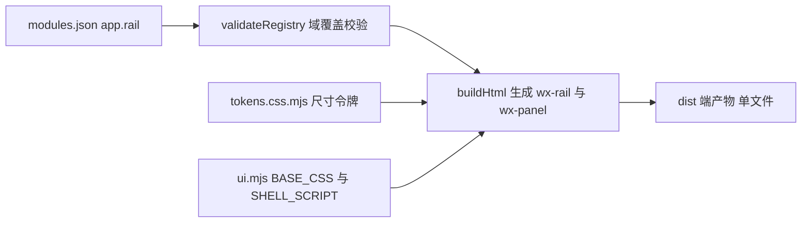

## 用户需求

将货灵ERP、货灵运营中台管理端、货灵WMS 三端的导航改为双栏导航（Dual-Rail），视觉参照给定参考图，同时保持三端现有页面与业务不变。

## 产品概述

三端由「顶栏 + 单侧栏 + 页头页签」改为「业务域首栏 + 导航面板 + 内容区」：左侧窄栏以圆角方块字标承载 5~6 个业务域，右侧白底面板按段名分组列出当前域的业务页，点击首栏切域、点击条目切页；顶栏与页头页签取消，品牌、端名、搜索与跨端入口迁入面板表头，帮助、通知、账号移至首栏底部；面板可收起，收起后只剩首栏，正文加宽。整体保持工具型后台的密度与克制，不出现租户、套餐、配额等非单实例形态元素。

## 核心功能

- 首栏业务域：货灵ERP 5 域、货灵运营中台管理端 5 域、货灵WMS 6 域，域名与单字字标固定
- 导航面板：显示当前域的分段（段名小标签 + 页条目），当前页高亮并带状态点；当前域与当前页同步
- 面板表头：端名、产品名、本域搜索框；货灵ERP 另含「前往商城」入口
- 面板收起 / 展开：收起后仅留首栏，状态在本次会话内保持
- 删除顶栏与页头页签，页面内容直接铺满右侧滚动区

## 技术栈选择

- 原型构建：Node 原生 ESM，无第三方依赖，`prototypes/build-app.mjs` 聚合模块页源产出 `prototypes/dist/<端名>.html` 单文件
- 外壳实现：模板字符串拼 HTML + CSS 变量令牌（`prototypes/shared/tokens.css.mjs`）+ 原生 DOM 脚本（`prototypes/shared/ui.mjs` 的 `BASE_CSS` / `SHELL_SCRIPT`）
- 校验：构建期断言（`build-app.mjs`）、交付验收（`verify-delivery.mjs`）、文档自检（`docs/check.mjs`）

## 实施方案

先把结构口径写进规范层与注册表，再改共享层实现，最后重建五端：业务域作为 `apps[].rail` 显式声明（域名、字标、所含段 id），构建期校验每段恰好归属一个域、每域至少一页，避免用命名派生规则造成漂移。骨架从「固定顶栏 + 固定侧栏 + margin 让位」改为两列 flex 流：`wx-rail`（76px）+ `wx-panel`（256px，可收为 0）+ `wx-main`（自适应）。交互只做显隐与类名切换，不新增骨架类型、不引入前端框架，页面模块零改动。

关键决定与理由：

- 保留 `.wx-shell` 类名，因 `build-app.mjs` 用其反查「后台端是否混入 PDA」，改名等于扩大改动面
- 复用 `data-target` 与 `activate()`，新增 `data-domain` / `data-domain-panel`；页容器沿用既有 `data-nav-group` 反查所属域，不新增页面字段
- 令牌增删只发生在 `tokens.css.mjs`（删 `--wx-side-w`、`--wx-side-collapsed`、`--wx-top-h`、`--wx-head-h`，增 `--wx-rail-w`、`--wx-panel-w`），页面模块不接触色值与尺寸
- 参考图的「Enterprise Tier」「Storage Used」不落地：单实例单主体、非 SaaS，「租户/套餐/订阅」等词有构建断言拦截
- 强调色预算按一处计：首栏当前域与面板当前页同属一次导航强调，规范层补写一句避免验收歧义

性能与可靠性：五端一次性构建，单页 DOM 规模不变；切域切页只 toggle `hidden` 与 class，复杂度 O(域内页数)；搜索为线性过滤，不重排 DOM；无网络请求、无外部资源，产物仍可离线双击打开。

## 实现要点

- 按 SKILL「边界」顺序落笔：规范层 → `shared/` → 重建；改动前先跑 `node prototypes/build-app.mjs --check` 记最新基线（工作树存在并发改动）
- 文案先登记再使用：三端域名、字标、「搜索本域页面」「收起导航 / 展开导航」「本域无匹配页面」全部进 `glossary.md`
- 货灵ERP「前往商城」只换位置不换契约：仍保留 `data-mall-entry`、`data-mall-base`、`owner` 参数、`target="_blank"`、`rel="noopener"` 与「前往商城」四字，构建与验收断言才不会失败
- 新增 flex 组件必须补 `[hidden]{display:none!important}`，否则 `display:flex` 会压过默认隐藏
- 会话面板定位去掉顶栏高度叠加，改贴视口顶部；登录层不受影响
- 收起草稿写入 `sessionStorage` 键 `wx-nav-collapsed`，仅在 `.wx-app` 上加 class，不重建 DOM
- 宽度 ≤1024 时首次进入默认收起面板（可手动展开），≥1280 默认展开；表格容器内横向滚动不变
- 不触碰 `MALL_CSS`、`renderShopShell`、`PDA_CSS`、`renderPdaShell`；货灵商城与作业APP 仅随共享层重建一次，产物逻辑不变
- 模板 `templates/ui.mjs`、`templates/build-app.mjs`、`templates/modules.json` 与实现同步，否则下次脚手架会回退

跨端联动结论（按「跨端联动确认」规则）：

| 端 | 落点 | 联动点 | 结论 |
| --- | --- | --- | --- |
| 货灵ERP | `shared/ui.mjs`、`build-app.mjs`、`modules.json` 的 `erp-app.rail` | 「前往商城」移至面板表头；12 段归 5 域；44 页归属不变 | 必须同改 |
| 货灵运营中台管理端 | 同上三文件，`network-app.rail` | 12 段归 5 域；54 页归属不变 | 必须同改 |
| 货灵WMS | 同上三文件，`warehouse-app.rail` | 11 段归 6 域；51 页归属不变 | 必须同改 |
| 货灵商城 | `renderShopShell`、`MALL_CSS` | 不共享顶栏与侧栏选择器 | 无需改，仅重建 |
| 作业APP | `renderPdaShell`、`PDA_CSS` | 同上，且后台外壳判定类名保留 | 无需改，仅重建 |
| 规范层与 docs | `references/*`、`templates/*`、`docs/log.md`、`docs/index.md`、三份方案现状句 | 双栏骨架、业务域词表、`data-*` 契约、验收项 | 必须同改 |


## 架构设计

装配链保持单层：`modules.json`（域 → 段 → 页）经 `validateRegistry()` 校验后进入 `buildHtml()`，由 `ui.mjs` 导出的令牌、基础样式与外壳脚本渲染成端产物。新增业务域只是给这条链补一层显式映射，不改变模块目录与页面归属：



## 目录结构

```
3plwms/
├── prototypes/
│   ├── shared/modules.json          # [MODIFY] 三端 apps[] 增 rail：域名、单字字标、含哪些 nav 段；页面归属与段不动
│   ├── shared/tokens.css.mjs        # [MODIFY] 删侧栏与顶栏四个令牌，增 --wx-rail-w:76px、--wx-panel-w:256px，色值不变
│   ├── shared/ui.mjs                # [MODIFY] BASE_CSS 重写外壳样式（rail/panel/main），SHELL_SCRIPT 改切域、切页、收起、搜索；删除顶栏、页头页签、.wx-scope；会话面板定位调整
│   ├── build-app.mjs                # [MODIFY] buildHtml 生成首栏与面板；validateRegistry 校验 rail 完整覆盖；checkProduct 增双栏断言与无顶栏断言
│   └── dist/*.html                  # [GENERATED] 五端产物重建，不手改
├── .codebuddy/skills/huoling-proto/
│   ├── references/shells/admin.md               # [MODIFY] 第 2 节尺寸、第 3 节骨架与导航规则、第 6 节强调色、第 7 节禁区改为双栏口径
│   ├── references/core/glossary.md              # [MODIFY] 第 2 节增三端业务域表（域名 + 字标 + 所含段）与新文案
│   ├── references/core/output-format.md         # [MODIFY] 外壳骨架表 admin 行与「前往商城」位置句
│   ├── references/core/acceptance.md            # [MODIFY] A15、B13 改写并新增一条双栏结构验收
│   ├── references/registry.md                   # [MODIFY] 第 1 节字段说明、第 2 节端清单补 rail
│   ├── references/implementation.md             # [MODIFY] 令牌表、类名与 data-* 契约（data-domain、data-domain-panel、data-side-toggle）
│   ├── templates/modules.json                   # [MODIFY] 补 rail 示例
│   ├── templates/ui.mjs                         # [MODIFY] 与 shared/ui.mjs 同步
│   └── templates/build-app.mjs                  # [MODIFY] 与 prototypes/build-app.mjs 同步
└── docs/
    ├── log.md                                   # [MODIFY] 追加一条双栏导航改造记录
    ├── index.md                                 # [MODIFY] 更新「最近更新」
    └── 产品需求/                                 # [MODIFY] 运营中台与WMS功能方案、单仓端三模块设计方案、ERP订单体系与平台接入方案 中「侧栏 + 页头页签同源」「同一时刻只展开一段」现状句
```

## 关键结构

注册表新增字段（`apps[].rail`），域顺序即首栏顺序，`navs` 引用 `apps[].nav[].id`：

```
"rail": [
  { "id": "rail-trade", "name": "交易", "mark": "交",
    "navs": ["nav-order", "nav-fulfillment", "nav-aftersale", "nav-platform"] }
]
```

三端划分（域名 / 字标 / 所含段）：

- 货灵ERP：工作台「工」；交易「交」=订单、履约、售后、平台接入；仓储「仓」=仓储委托、异常与对账、库存；商品与店铺「商」=商品、商城店铺；财务与设置「财」=账单与服务、报表与设置
- 货灵运营中台管理端：总览「总」=总览、服务关系；仓网「网」=仓网档案、仓网调度、作业资源；库存与商品「库」=库存、商品；商城「城」=商城；平台与系统「平」=ERP运营、账号与权限、计费结算、服务与设置
- 货灵WMS：任务中心「任」；入库「入」=入库管理；出库与发货「出」=出库管理、发货作业；库内作业「内」=库内作业、盘点与异常；库存与资源「库」=库存中心、设备与容器；人员与配置「人」=人员与班次、作业配置、基础资料

## 设计风格

工具型双栏导航：密度优先、弱装饰，分区靠边框与浅灰底色，不用渐变、插画与装饰图形，参考图的结构保留、SaaS 元素不引入。

## 布局与交互

- 首栏 76px：浅灰底、右边框；顶部 40px 圆角方块品牌字标「仓」；中部业务域条目 40px 圆角方块内单字字标 + 11px 域名标签，纵向排列，间距 8px；当前域为浅蓝底 + 主色文字；底部固定帮助、通知两个 36px 图标按钮与 32px 头像。悬停仅底色微调，过渡 160ms。
- 面板 256px：白底、右边框；表头为端名 16px/600 与产品名 12px 灰字，下方 32px 圆角搜索框（货灵ERP 表头右上角放「前往商城」文字链）；主体按段分组，段名用 11px 灰字小标签（字距 0.04em），页条目 36px 行高、圆角 6px，当前页浅蓝底 + 主色 600 字重并在右侧显示 4px 主色圆点；底部一条上边框放收起按钮。
- 内容区：无顶栏、无页头页签，`padding 24px` 直接承接页面；面板收起时宽度过渡到 0，正文同步加宽 200ms。
- 响应式：≥1280 双栏展开；≤1024 首次进入默认收起面板，可由底部按钮展开；窄屏下首栏不缩、表格在容器内横向滚动，页面整体不产生横向溢出。
- 可访问性：首栏每个域按钮带 `aria-current` 与 `title`，纯图标按钮保留可访问名称；焦点可见。

## Agent Extensions

### Skill

- **huoling-proto**
- Purpose: 按项目原型规范完成跨端联动评估、规范层改写、外壳实现、构建与交付验收
- Expected outcome: 三端双栏外壳落地，五端重建通过 `verify-delivery.mjs` 全量验收，规范层与模板同步无回退
- **playwright-cli**
- Purpose: 打开 `prototypes/dist/` 三端产物，在 1440 / 1024 / 768 三档截图并验证切域、切页、收起、搜索与「前往商城」入口
- Expected outcome: 三端三档截图与交互验证结论，支撑视觉与行为自检