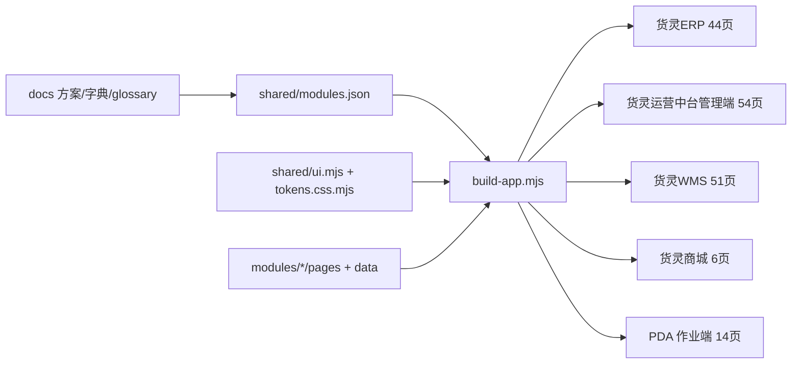

## 用户需求

基于工作区已有的调研报告与设计文档，输出一份详细方案，并据此一次性优化五端原型；方案先落文档，再改原型，最终统一验收。

## 产品概述

货灵供应链运营平台由货灵ERP、货灵运营中台管理端、货灵WMS、货灵商城、PDA 作业端五个自包含 HTML 端组成。原型以列表、报表、抽屉详情与表单抽屉为主，当前共 130 页进入产物、2 页预留未启用。

## 核心功能

- 方案文档：汇总调研结论与设计文档，给出五端逐页优化清单、字段与交互要求、冲突收口、施工顺序与验收清单。
- 页面补齐：新增 37 页并启用 2 页，覆盖 ERP 商品中枢与报表、中台计费与服务关系、WMS 入库出库库内与设备、异常闭环。
- 现有修复：修复 5 页表单抽屉不生效、billing 两页无端归属、商城 2 页无入口、PDA 14 页平铺、薄页面数据不足。
- 信息架构：ERP 12 段、中台 12 段、WMS 11 段、商城 6 个顶部入口、PDA 4 个分组 tab。
- 交互统一：列表分区、列序、状态枚举、抽屉详情、空态与危险动作确认统一。
- 视觉统一：后台三端同一外壳与密度，商城保持前台暖色，PDA 保持工业手持形态。
- 验收：五端共 169 页，构建、交付验收、文档自检与浏览器实测全部通过。

## 技术栈

- 运行时：Node.js 原生 ESM，无 `package.json`、无打包器、无测试框架。
- 产物：五端自包含 HTML，由 `prototypes/build-app.mjs` 按 `prototypes/shared/modules.json` 聚合；产物写入 `prototypes/dist/`，不手改。
- 样式与组件：`prototypes/shared/tokens.css.mjs` 是唯一色值来源；`prototypes/shared/ui.mjs` 提供 `ListPage`、`ReportPage`、`ScanPage`、`ShopPage`、`DrawerDetail`、`FormDrawer`、`DagDrawer` 等。
- 页面源：`prototypes/<模块ID>/pages/*.mjs` 与 `data/*.json`；页面只 import `../../shared/ui.mjs` 与同模块 `_list.mjs`。
- 校验：`node prototypes/build-app.mjs --check`、`node .codebuddy/skills/huoling-proto/scripts/verify-delivery.mjs`、`node docs/check.mjs`、`node docs/数据字典/check.mjs`。

## 实施方案

### 总体策略

按「方案文档 → 文案与字典登记 → 注册表与共享层 → 页面源与数据 → 全量构建与验收」推进。用户已确认一次性全量交付，因此不设分批验收；第 4~7 项工作流可并行，最终只做一次五端构建与一次全量验收。

### 依据到落点

| 依据 | 落点 |
| --- | --- |
| `运营中台与WMS功能方案.md` §5.4、§7、§9 | 中台 12 新增 + 2 启用、WMS 19 新增、12/11 段导航 |
| `货灵ERP竞品对标与定位方案.md` §6.4、§6.5 | ERP 商品中枢 4 页、店铺/利润报表 2 页、订单 360 利润页签、SPU 配对页签 |
| `legacy-三套对标系统源码调研` C1~C13 | 计费四段、质检、理货、分播、设备契约、盘点差异 |
| `legacy-店小秘与领星ERP调研报告` 7~12 章 | 库存六段、商品生命周期、九类异常筛选、履约失败八类、财务三口径 |
| `openWES深度分析`、`jeewms系统深度分析` | 任务池、人效、设备监控/告警/驱动/AGV、六步扫码与过账时点 |
| `商城双身份设计方案`、`商品档案管理方案`、`计划单与时效协议方案` | 既有页修复、字段口径、状态枚举 |


### 关键决策

1. 目标页数 169：ERP 44、中台 54、WMS 51、商城 6、PDA 14；所有页面必须有 `app`、有源、有演示数据。
2. 不新增独立 `detail` 页：SPU 详情并入 `spu-list` 行抽屉；`mall-shop/shop-cert` 由 `detail` 改为单行 `list` 加 `FormDrawer`，页面名与导航位置不变。
3. WMS 异常页 key 由 `warehouse/exception-list` 改为 `warehouse/wh-exception-list`，避免与 `owner/exception-list` 的全局 key 冲突；该页作为差异异常单的派生台账，`count-diff-audit` 是改账唯一出口。
4. `owner/sku-owner-list` 从商品段迁入仓储委托段，页面名沿用 glossary 的「本货主商品查询」，不新增别名。
5. 任务状态统一为 `taskStatus` 待派/已派/执行中/已完成/已取消，异常拆为 `exceptionFlag`；对账状态统一为 待处理/处理中/已处理/已忽略。
6. 原型不出现租户、订阅、套餐、租户切换器、平台运营后台；应用凭证保持部署级 `erp-app-list` 口径。
7. 商城与 PDA 的入口改由 `apps[].nav` 驱动，删除 `build-app.mjs` 中商城 4 项硬编码与 PDA 14 页平铺。
8. 新页优先 `list`/`report`；可录入走 `FormDrawer` 加 `ListPage({live})`；详情走 `DrawerButton` 加 `DrawerDetail`。不新增骨架类型。
9. 22 个 `owner` 页重复的 `listProps` 上提为 `shared/ui.mjs` 的 `listPageProps`，页面改为调用；若回归失败则保留原实现并记录，不阻塞验收。

### 性能与可靠性

- 构建复杂度为页面数 × 演示身份数，线性增长；169 页预计产物约 1.3~1.6 MB，仍为静态 section 切换，不引入运行时框架。
- 跨页主档用 `ref` 引用 `shared/data/`，避免重复数据；新增 `spus.json`、`listings.json` 并纳入 `MASTER_FILES`/`FK_OF`。
- 构建期断言继续兜底：页面 key 全局唯一、每页恰好落一段、无写死 hex、无页面脚本、无跨模块 import、抽屉与表单契约完整。
- 文档与字典改动必须过两套 `check.mjs`，不允许只改正文不记日志。

## 实施要点

- 开工前跑 `node prototypes/build-app.mjs --check` 记基线；出现 drift 先查并发会话，不覆盖他人改动。
- 先改 `references/core/glossary.md` 与数据字典，再改 `modules.json`；页面名、列名、动作、状态逐字取 glossary。
- 新增页 key 落表前先查全局唯一性；重点检查 `wh-exception-list`、`spu-list`、`settlement-list`、`invoice-list`。
- 页面源只 import `../../shared/ui.mjs`；数据用 `ref` 指向共享主档；派生列写纯函数。
- 共享层改动会重建五端，`templates/ui.mjs`、`templates/build-app.mjs` 必须同步，避免下次脚手架回灌漂移。
- 文案遵守界面文案纪律：列表页不加统计卡、大标题、自绘筛选栏；口径说明走 `tipKey`/`title`；PDA 无悬停端改为删减或并入主标签；危险动作保留后果提示。
- 商城 6 个顶部入口、PDA 4 个分组 tab 是外壳级改动，必须做 768 宽度与窄屏实测。
- 旧文档的 37/38/44/45/46/51/54 页与 `asn-list`、`so-list`、`owner-app` 均为历史口径；新方案以现场 key 与 169 页为准。

## 架构设计



## 目录结构

以下只列新增与必须修改的文件；仅随共享 CSS 与 nav 变化、无需改源的页面不逐页列出。

```text
docs/
├── 产品需求/
│   ├── 各端原型优化方案.md                         # [NEW] 方案主文档：依据与证据分级、现状基线、逐端逐页清单、冲突收口、跨端联动、字典与文案清单、施工顺序、验收与风险
│   ├── 三端核心功能清单.md                         # [MODIFY] 订正 sku-audit-list 归属，补 WMS 逐页 key 表
│   ├── 运营中台与WMS功能方案.md                    # [MODIFY] 回填实施状态并指向新方案
│   └── 货灵ERP竞品对标与定位方案.md                # [MODIFY] 回填商品中枢与报表落地状态
├── index.md                                        # [MODIFY] 登记新文档与最近更新
├── log.md                                          # [MODIFY] 追加方案与原型变更记录
└── 数据字典/
    ├── index.md                                    # [MODIFY] 登记新实体与扩字段
    ├── log.md                                      # [MODIFY] 追加字典变更
    ├── 结算单.md 发票与收款.md 服务目录与报价.md 货主仓授权.md 告警.md 月台预约.md 质检单.md 理货单.md 越库任务.md 打包单.md 分播任务.md 装车单.md 组套加工任务.md 冻结单.md 序列号.md 盘点差异.md 任务池任务.md 人效指标.md 设备告警.md 故障工单.md 设备驱动.md AGV调度策略.md 组织.md 审批流.md 维保计划.md SPU.md 变体.md 平台Listing.md  # [NEW] 约28份，复用优先后核定
    └── 仓库主档.md 库区库位.md 设备档案.md 容器档案.md 入库通知单.md 出库订单.md 费用账单.md 差异异常单.md 货主报表指标.md 商品主档.md 工序单.md  # [MODIFY] 扩字段

.codebuddy/skills/huoling-proto/references/
├── core/glossary.md                                # [MODIFY] 37个页面名、约80个列名、约25组枚举、PDA动作文案
├── core/acceptance.md                              # [MODIFY] 补169页、商城6入口、PDA4分组、detail口径
├── registry.md                                     # [MODIFY] 五端页数、模块范围、商城/PDA nav口径
├── implementation.md                               # [MODIFY] 补listPageProps、抽屉页签、data-*契约
├── shells/admin.md                                 # [MODIFY] 补12/12/11段、列表分区、超5页段说明
├── shells/mall.md                                  # [MODIFY] 补6入口、active规则、768换行
└── shells/pda.md                                   # [MODIFY] 补4分组tab、六步扫码、触控约束
templates/
├── ui.mjs                                          # [MODIFY] 同步PDA分组、商城nav、页签容器
└── build-app.mjs                                   # [MODIFY] 同步nav校验与商城/PDA装配

prototypes/
├── build-app.mjs                                   # [MODIFY] 商城/PDA改读nav；nav校验扩到所有端；补商城6入口与PDA分组断言；MASTER_FILES/FK_OF加spus/listings
├── shared/
│   ├── modules.json                                # [MODIFY] 169页、37新增、2启用、五端nav、sku-owner-list改段、shop-cert改list
│   ├── ui.mjs                                      # [MODIFY] listPageProps、PDA分组tab、商城nav active、只读页签容器
│   └── data/
│       ├── spus.json                               # [NEW] SPU主档：SPU编码、品名、品类、生命周期、变体数、Listing数、仓储SKU数
│       └── listings.json                           # [NEW] 平台Listing主档：平台、店铺、平台商品ID、平台SKU、SPU、变体、价格/库存推送状态
├── owner/pages/
│   ├── spu-list.mjs listing-list.mjs listing-task-list.mjs collect-box.mjs shop-report.mjs profit-report.mjs  # [NEW]
│   └── order-center.mjs fulfillment-list.mjs stock-owner-list.mjs sku-owner-list.mjs exception-list.mjs reconciliation-list.mjs tracking-list.mjs bill-owner-list.mjs sku-apply-list.mjs sku-audit-list.mjs my-shop.mjs shop-sku.mjs shop-price.mjs shop-order.mjs shop-cert.mjs workbench.mjs owner-report.mjs  # [MODIFY]
├── owner/data/                                     # [NEW/MODIFY] 与上述页面同名json；补form、利润页签、库存六段、失败原因、汇总行
├── billing/pages/
│   ├── rate-list.mjs bill-list.mjs settlement-list.mjs invoice-list.mjs  # [NEW]
│   └── data/rate-list.json bill-list.json settlement-list.json invoice-list.json  # [NEW]
├── network/pages/
│   ├── service-catalog.mjs owner-warehouse-auth.mjs alert-center.mjs ops-daily.mjs dock-schedule.mjs capacity-plan.mjs  # [NEW]
│   └── network-overview.mjs                                            # [MODIFY] 补告警/日报入口指标
├── network/data/                                   # [NEW/MODIFY] 与上述页面同名json
├── system/pages/
│   ├── org-list.mjs approval-flow.mjs              # [NEW]
│   └── user-list.mjs role-list.mjs audit-log.mjs   # [MODIFY] 权限域与组织口径
├── system/data/                                    # [NEW/MODIFY] org-list.json approval-flow.json 等
├── resource/pages/
│   ├── device-utilization.mjs maintenance-plan.mjs device-monitor.mjs device-alarm.mjs device-driver.mjs agv-strategy.mjs  # [NEW]
│   └── workflow-list.mjs                           # [MODIFY] 「从现有复制」登记
├── resource/data/                                  # [NEW/MODIFY] 与上述页面同名json
├── inbound/pages/
│   ├── appointment-list.mjs qc-order.mjs tally-task.mjs crossdock-task.mjs  # [NEW]
│   └── in-plan-list.mjs receiving-order.mjs putaway-order.mjs  # [MODIFY] 补预约号、质检、理货、上架数据
├── inbound/data/                                   # [NEW/MODIFY] 与上述页面同名json
├── outbound/pages/
│   ├── packing-order.mjs sort-task.mjs loading-list.mjs  # [NEW]
│   └── out-plan-list.mjs wave-list.mjs picking-order.mjs check-order.mjs handover-list.mjs  # [MODIFY] 波次容量、两级容器、装车字段
├── outbound/data/                                  # [NEW/MODIFY] 与上述页面同名json
├── warehouse/pages/
│   ├── location-capacity.mjs kitting-task.mjs freeze-list.mjs wh-exception-list.mjs  # [NEW]
│   └── count-plan.mjs count-task.mjs move-task.mjs  # [MODIFY] 差异审批与冻结口径
├── warehouse/data/                                 # [NEW/MODIFY] 与上述页面同名json
├── inventory/pages/
│   ├── serial-list.mjs count-diff-audit.mjs         # [NEW]
│   └── stock-by-location.mjs batch-list.mjs daily-check.mjs opening-stock.mjs stock-snapshot.mjs  # [MODIFY] 补库位状态与流水before/after/ref_no
├── inventory/data/                                 # [NEW/MODIFY] 与上述页面同名json
├── task/pages/
│   ├── task-pool.mjs staff-performance.mjs         # [NEW]
│   └── task-list.mjs task-report.mjs doc-overview.mjs  # [MODIFY] 三态列、来源单据、口径tip
├── task/data/                                      # [NEW/MODIFY] 与上述页面同名json
├── mall/pages/
│   └── search.mjs orders.mjs cart.mjs checkout.mjs product-detail.mjs home.mjs  # [MODIFY] 排序/页签/多店铺分组/空态
├── mall/data/                                      # [MODIFY] 搜索、订单、进货单、结算数据
├── mall-shop/pages/
│   └── my-shop.mjs shop-sku.mjs shop-price.mjs shop-order.mjs shop-cert.mjs  # [MODIFY] 删空壳行、补认证单列表与表单
├── mall-shop/data/                                 # [MODIFY] 补认证单与店铺数据
├── pda/pages/
│   └── pda-login.mjs pda-face.mjs pda-invite.mjs pda-activate.mjs pda-my-device.mjs pda-version.mjs  # [MODIFY] 补动作登记、状态切换、空态
├── pda/data/                                       # [MODIFY] 终端壳层演示数据
├── task/pages/
│   └── pda-home.mjs pda-putaway-list.mjs pda-picking-list.mjs pda-stocktaking-list.mjs pda-mine.mjs  # [MODIFY] 分组入口、任务卡数据、我的权限
├── task/data/                                      # [MODIFY] PDA任务4行改8~12行
├── inbound/pages/receiving-scan.mjs                # [MODIFY] 收货六步
├── outbound/pages/picking-scan.mjs                 # [MODIFY] 拣货六步
├── warehouse/pages/count-scan.mjs                  # [MODIFY] 盘点校验步骤
└── module.json（各模块）                            # [MODIFY] 版本、scope、说明与交付状态
```

## 关键结构

新增页面统一按以下形态落源，不新增骨架类型：

```js
// prototypes/<模块>/pages/<页key>.mjs
export const PAGE_CSS = '';
export function renderPage(data, ctx) {
  return ui.ListPage({
    pageId: `${ctx.moduleId}/${ctx.pageKey}`,
    title: ctx.pageName,
    columns: [],
    rows: data.rows,
    tabs: [],
    filters: [],
    toolbar: [],
    overlay: '',
    live: null,
  });
}
```

`modules.json` 的 `apps[].nav` 是入口唯一来源；商城与 PDA 的 nav 从 `build-app.mjs` 读取，不再硬编码。新增页条目必须含 `key`、`name`、`type`、`file`、`ownerScoped`、`app`。

## 验收

- `node docs/check.mjs` 与 `node docs/数据字典/check.mjs` 零错误。
- `node prototypes/build-app.mjs` 生成五端产物；`verify-delivery.mjs` 全量通过 S1~S5 与 X。
- 页数断言 44/54/51/6/14 = 169；每端每页恰好落一段。
- 浏览器实测：ERP 两身份隔离、订单 360 利润页签、SPU 抽屉/配对、Listing/采集箱、店铺/利润报表；中台计费四页状态链、服务目录、货主仓授权、告警转工单、月台预约、仓容、组织/审批、设备利用率/维保；WMS 入库预约→收货→质检→理货→上架、出库波次→拣货→打包→分播→装车→交接、盘点差异审批、冻结解冻、序列号轨迹、任务派工、设备告警、异常登记；商城 6 入口可达、商品详情/确认订单可开、多店铺分组、自买自卖拦截；PDA 4 分组可达 14 页、收货/拣货六步、扫码校验、我的。
- 1440/1024/768 三档无页面整体横向溢出；商城顶部 6 项在 768 下换行不溢出；PDA 窄屏铺满。
- 无写死 hex、无页面 script、无跨模块 import、无解释性文案、危险动作有确认与后果提示。

## 设计风格

沿用现有后台外壳与令牌体系，不换视觉语言，只提升信息密度、层级清晰度与操作反馈。整体是「运营级密集列表 + 右侧抽屉详情 + 工业手持终端」的组合。

## 后台三端

- 顶栏 54px、侧栏 188px，1024 以下侧栏折叠为 64px；侧栏同一时刻只展开当前段。
- 列表页按「查询区 → 工具条 → 已选择条 → 表格 → 抽屉」分区；列表页不加大标题、统计卡、自绘筛选栏。
- 报表页用 `ReportHero` + `StatRow` + `Block`，指标卡不超过 5 个，分节按仓或按类型。
- 详情统一右侧抽屉，配置驱动表单用 `FormDrawer`；危险动作使用确认与后果提示。
- 状态色只使用五种 tone：禁用、启用、信息、待处理、驳回；超阈值用警示色。

## 货灵商城

- 前台无侧栏，顶部 6 个入口，暖橙强调色只用于价格、主按钮与选中态。
- 商品卡两栏栅格，商品详情用阶梯价与批次表；结算页按店铺分组，一页多组分别提交。
- 768 以下顶部入口换行，商品卡降为单栏，表格容器内横向滚动。

## PDA 作业端

- 375×812 手机壳，底部 4 个分组 tab：作业、扫码、终端、我的；组内页面从首页卡、任务卡与我的入口进入。
- 触控目标不小于 44px；扫码框、任务上下文、步骤条、日志四段固定；六步流程用步骤条表达，不做教学段。
- 物理键盘保留返回、主页、菜单、清空、扫描、确定六键。

## 动效与响应式

- 抽屉 160~200ms 滑入，按钮 hover 与 focus 用底色变化，不做装饰性动画。
- 1440 三栏表格完整展示；1024 侧栏折叠；768 顶栏搜索收起，表格容器横向滚动，商城入口换行，PDA 铺满屏幕。
- 空态用 `EmptyState`，加载态用骨架行，错误态用行内提示与重试动作。

## Agent Extensions

### Skill

- **huoling-proto**
- Purpose: 约束五端原型的新增与修改，按注册表、三套外壳、组件白名单、跨端联动与构建验收执行。
- Expected outcome: 169 页全部有源、有数据、有入口，五端产物可独立打开，交付验收通过。
- **agent-browser**
- Purpose: 对五端产物做浏览器实测，覆盖新增页、状态迁移、跨端入口与 1440/1024/768 三档响应式。
- Expected outcome: 输出逐端实测记录，确认无死链、无溢出、无状态迁移异常。
- **humanizer-zh**
- Purpose: 对《各端原型优化方案》做去 AI 味润色，保持文档简洁、事实化、可执行。
- Expected outcome: 方案文档无套话、无空泛结论，段落与表格可直接用于评审。