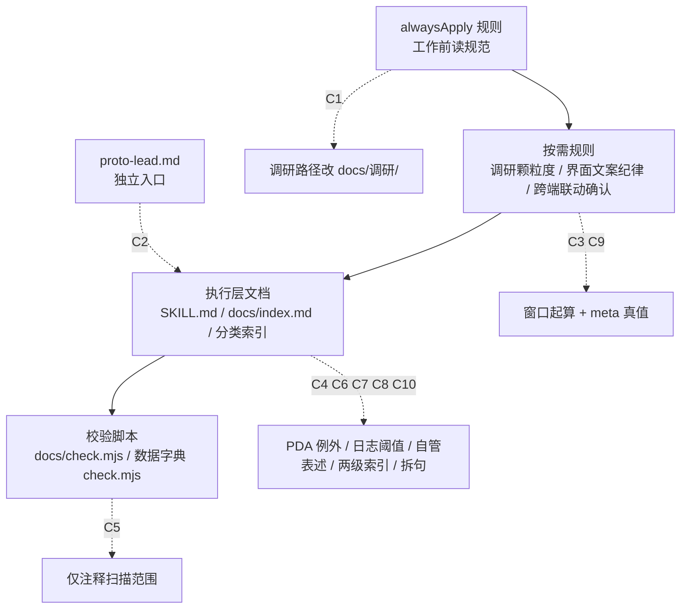

## 用户需求

把已审计出的 10 处约束冲突一次改完（用户已确认「全部 10 处」）。

## 改动范围

| 编号 | 严重度 | 处置 |
| --- | --- | --- |
| C1 | 高 | `工作前读规范` 表里调研路径由 `docs/产品需求/` 改为 `docs/调研/` |
| C2 | 高 | 重写 `proto-lead.md`：删保真度三档、直写 HTML、日期+保真度命名，改为指向 SKILL.md 与跨端规则 |
| C3 | 中 | 明确调研窗口从「清单确认后第一次实际观察」起算 |
| C4 | 中 | `SKILL.md` 硬约束补 PDA 等无悬停端不用 tooltip 兜底 |
| C5 | 中 | 数据字典补「租户」边界说明：只禁在字典字段与界面文案，方案层可用并注明与 SaaS 租户的区别 |
| C6 | 低 | 日志归档补「或单文件超过 100 KB」 |
| C7 | 低 | 分类自管表述改为「清单由分类索引维护，校验由脚本执行」 |
| C8 | 低 | `调研/index.md` 补两级索引更新纪律 |
| C9 | 低 | 调研规则补「meta 为真值，封面表由 meta 渲染」 |
| C10 | 低 | `docs/index.md` 第 6 条拆成「新规」与「存量豁免」两句 |


## 边界

不改存量调研文档、不改 `prototypes/`、不改数据字典禁语数组内容、不修 `国家标准/GBT18354-2021.html` 断链（并发会话引入，不属本次范围）。

## 验收

`node docs/check.mjs` 不新增错误（允许存量 1 条），`node docs/数据字典/check.mjs` 零错误；`proto-lead.md` 无「保真度 / lo|mid|hi / 直写 HTML」残留；变更记入 `docs/log.md`。

## 技术栈

纯文本约束文件（Markdown + YAML frontmatter）与 Node 原生 ESM 校验脚本，无构建、无依赖、无测试框架。改动全部是文本替换与章节重写，唯一涉及脚本的是 C5 的注释说明，不触碰校验逻辑与阈值常量。

## 实施策略

按「上游规则 → 下沉文档 → 脚本注释 → 留痕 → 校验」推进。先改被引用方（`工作前读规范`、`调研颗粒度`），再改引用方（`SKILL.md`、`docs/index.md`、分类索引），最后统一记录并跑两个 check。理由：`工作前读规范` 是 alwaysApply，改晚了每次注入都还在放大错误口径。

C2 的改写原则：保留与项目实践一致的部分（主 Agent 自己执行、不派写文件的活、需要决策时给可选项、每轮收口），替换与项目冲突的部分（保真度三档 → 页面类型与外壳判断；直写 HTML → 改源后构建；日期+保真度命名 → 模块目录与 `dist/<端名>.html`）。改写后该文件成为「入口说明 + 指向 SKILL.md」，不复制 SKILL.md 的细则，避免第二份真相。

C3 的起算点定为「覆盖清单确认后第一次实际观察」，不选「首次访问」，因为清单确认可能跨天，若以首次访问起算，等于要求用户在 24 小时内必须确认；清单前的浏览明确降级为「只用于定范围，不作证据」，需要引用的在新窗口内复核后记录。这样 `docs/check.mjs` 现有的「窗口 ≤ 24 小时」判定不需要改逻辑。

C5 只补说明不改代码：`FORBIDDEN` 数组保持原样（「租户」仍禁在数据字典实体字段里），在 `docs/数据字典/index.md` 使用规则增一条边界条款，并在 `check.mjs` 文件头注释写明扫描范围仅限 `docs/数据字典/`。理由是禁语表防的是字典字段被 SaaS 化，不是禁掉方案文档描述货灵ERP 的多卖家隔离。

## 实施要点

- 所有改动用精确文本替换，替换前重读目标段落，避免并发会话改动后匹配失败。
- `docs/index.md` 一次改三处（C6、C7、C10），同一文件串行编辑，不做并行。
- `proto-lead.md` 是整段重写，保留 frontmatter 的 `name`、`mainAgent`、`model`、`maxTurns`、`enabled`、`tools` 字段值不动，只改 `description`、`initialPrompt` 与正文。
- 改完不新建文档、不新建目录；`docs/log.md` 只追加一条汇总记录，不逐条刷屏。
- 校验只看「不新增错误」：当前 `docs/check.mjs` 有 1 条存量错误（国家标准断链），改动前后对比错误条数与文案，一致即通过。

## 架构设计

约束分三层，本次改动按层落位：



## 目录结构

```
3PLWMS/
├── .codebuddy/
│   ├── rules/
│   │   ├── 工作前读规范/RULE.mdc        # [MODIFY] C1：表格第 3 行括号内路径改为 docs/调研/
│   │   │                                #   只改这一处，其余 7 行任务映射不动
│   │   └── 调研颗粒度/RULE.mdc          # [MODIFY] C3、C9：第 7 节「24 小时窗口」段补起算点；
│   │                                    #   「必需元信息」表后补「meta 为真值，封面对象表由 meta 渲染」
│   ├── skills/huoling-proto/SKILL.md    # [MODIFY] C4：硬约束表「信息自解释」行补「无悬停端（PDA / 触屏）
│   │                                    #   改为删减或并入主标签」，其余文字不动
│   └── agents/proto-lead.md             # [MODIFY] C2：整段重写。frontmatter 的 description 改为
│                                        #   货灵原型主 Agent；initialPrompt 去掉保真度与直写 HTML；
│                                        #   正文删 §2 保真度闸门、§4 技术产出规范、§5 A/C、§6 保真度条款，
│                                        #   保留 §0 判断设计问题、§3 自己执行不派活（改理由）、§7 收口；
│                                        #   新增「开工顺序」指向 SKILL.md 五层与跨端联动规则
└── docs/
    ├── index.md                         # [MODIFY] C6：日志管理第 1 条补「或单文件超过 100 KB」；
    │                                    #   C7：第 3 条改为「清单由分类索引维护，校验由对应脚本执行」；
    │                                    #   C10：第 6 条拆成两句，新规与存量豁免各自独立
    ├── 调研/index.md                    # [MODIFY] C8：使用规则第 3 条补「顶层 docs/index.md 的
    │                                    #   『最近更新』只记分类入口本身，不随单份报告变动」
    ├── 数据字典/index.md                # [MODIFY] C5：使用规则增第 5 条「租户边界」：
    │                                    #   仅禁在实体字段与界面文案；方案文档描述货灵ERP 多卖家隔离
    │                                    #   可用「租户模型」，须注明与 SaaS 租户的区别
    ├── 数据字典/check.mjs               # [MODIFY] C5：文件头注释补「禁语扫描范围仅限 docs/数据字典/」，
    │                                    #   FORBIDDEN 数组与校验逻辑不动
    └── log.md                           # [MODIFY] 追加一条汇总记录，类型「修改」，
                                         #   摘要写 10 处冲突编号与落点，原因写约束自洽性整改
```

## 关键结构

`proto-lead.md` 改写后的章节骨架（不保留原有编号，按执行顺序重排）：

| 新章节 | 内容 |
| --- | --- |
| 第一动作 | 判断本轮要回答什么设计问题；判断不了先问，不开始生成 |
| 定位 | 指向 `SKILL.md` 的「五层」「开工前」「硬约束」「流程」，声明本文件不复制细则 |
| 开工顺序 | 读规范 → 记基线（`build-app.mjs --check`）→ 跨端联动清单 → 等确认 → 查 `glossary.md` → 改源 |
| 自己执行 | 保留「不派写文件的活」，理由改为「页面模块结构需要边改边看，子 Agent 只回路径不回结构」 |
| 产出与命名 | 源 `<模块ID>/pages/<页key>.mjs`、产物 `dist/<端名>.html`，不手改产物 |
| 收口 | 本轮回答了什么、改了哪些端、需要重建几个产物、下一步选项 |