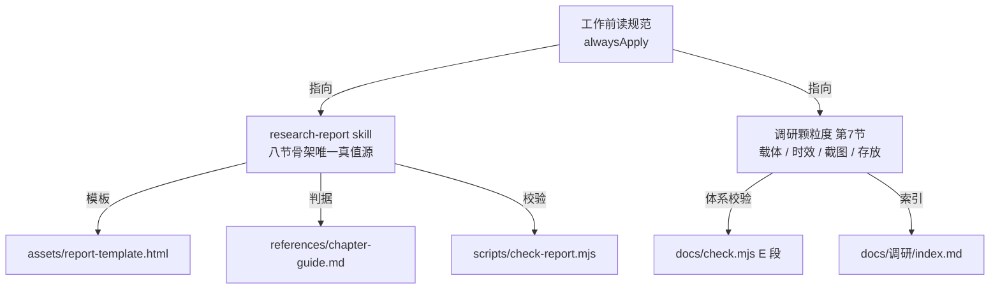

## 用户需求

修复工作区 11 处约束冲突，一次改完。

## 核心改动

| 编号 | 处置 |
| --- | --- |
| C1 | 「工作前读规范」表里调研路径由 `docs/产品需求/` 改为 `docs/调研/`，并新增一行指向 `research-report` skill |
| C2 | 重写 `proto-lead.md`：删保真度三档、直写 HTML、日期+保真度命名，改为指向 `SKILL.md` 与跨端规则 |
| C3 | 调研窗口从「覆盖清单确认后第一次实际观察」起算，清单等待时间不计入 |
| C4 | `huoling-proto/SKILL.md` 硬约束补「无悬停端改为删减或并入主标签」 |
| C5 | 数据字典补「租户」边界：只禁实体字段与界面文案，方案层可用并注明与 SaaS 租户的区别 |
| C6 | 日志归档补「或单文件超过 100 KB」 |
| C7 | 分类自管表述改为「清单由分类索引维护，校验由脚本执行」 |
| C8 | `调研/index.md` 补两级索引更新纪律 |
| C9 | `调研颗粒度` 补「meta 为真值，封面表由 meta 渲染」 |
| C10 | `docs/index.md` 第 6 条拆成「新规」与「存量豁免」两句 |
| C11 | `research-report` skill 改造：载体改 HTML，骨架改用项目八节，模板、判据、校验脚本同步 |


## 边界

不改存量调研文档、不改 `prototypes/`、不改数据字典禁语数组、不修 `国家标准/GBT18354-2021.html` 断链（并发会话引入，不属本次范围）。

## 验收

- `node docs/check.mjs` 不新增错误（允许存量 1 条）
- `node docs/数据字典/check.mjs` 零错误
- `research-report` 的 `check-report.mjs` 对模板自检可通过
- `proto-lead.md` 无「保真度 / lo|mid|hi / 直写 HTML」残留
- 八节骨架只在 skill 模板与判据里定义一次，项目规则不再重复

## 技术栈

纯文本约束文件（Markdown + YAML frontmatter + 内联样式 HTML）与 Node 原生 ESM 校验脚本。无构建、无依赖、无测试框架。唯一涉及代码的是 `check-report.mjs` 的解析层改造与 `docs/check.mjs` 的 E 段精简。

## 实施策略

按「上游规则 → skill 改造 → 脚本 → 下沉文档 → 留痕校验」推进。先改 alwaysApply 的「工作前读规范」，避免每次注入还在放大错误口径；再让 skill 成为八节骨架的唯一真值源；最后把项目规则里的重复定义删掉，只留载体、时效、截图、存放。

C11 的收敛原则：**骨架只在 skill 里定义一次**。`调研颗粒度` 第 7 节改成指针，`docs/check.mjs` 删掉 `SURVEY_SECTIONS`，全部章节判定交给 `check-report.mjs`。这样下次改骨架只动 skill 一处。

C2 的改写原则：保留与项目实践一致的部分（主 Agent 自己执行、不派写文件的活、需要决策时给可选项、每轮收口），替换与项目冲突的部分（保真度三档 → 页面类型与外壳判断；直写 HTML → 改源后构建；日期+保真度命名 → 模块目录与 `dist/<端名>.html`）。改写后该文件成为「入口说明 + 指向 SKILL.md」，不复制 SKILL.md 的细则。

C3 的起算点定为「覆盖清单确认后第一次实际观察」，不选「首次访问」，因清单确认可能跨天。清单前的浏览明确降级为「只用于定范围，不作证据」，需要引用的在新窗口内复核后记录。这样 `docs/check.mjs` 的「窗口 ≤ 24 小时」判定不需要改逻辑。

C5 只补说明不改代码：`FORBIDDEN` 数组保持原样，在 `docs/数据字典/index.md` 使用规则增一条边界条款，`check.mjs` 文件头注释写明扫描范围仅限 `docs/数据字典/`。禁语表防的是字典字段被 SaaS 化，不是禁掉方案文档描述货灵ERP 的多卖家隔离。

## 校验职责分工

| 脚本 | 管什么 |
| --- | --- |
| `research-report/scripts/check-report.mjs` | 单份报告的质量：八节齐全有序、章节非空、一句话结论、结论表判定与落点、截图索引与图片路径存在、空话词、占位符残留 |
| `docs/check.mjs` E 段 | 报告体系的合规：三项 meta 格式、窗口不超过 24 小时、文件名与 topic 及起始日一致、与 `docs/调研/index.md` 双向闭环 |
| `docs/数据字典/check.mjs` | 不变，仍管实体字段与禁语 |


## 架构设计



## 目录结构

```
3PLWMS/
├── .codebuddy/
│   ├── rules/
│   │   ├── 工作前读规范/RULE.mdc        # [MODIFY] C1：调研行路径改 docs/调研/；新增一行指向
│   │   │                                #   research-report skill；其余 7 行映射不动
│   │   └── 调研颗粒度/RULE.mdc          # [MODIFY] C3 C9 C11：第 7 节「章节顺序」八节清单改为
│   │                                    #   指向 skill 模板；「24 小时窗口」补起算点与清单前浏览降级；
│   │                                    #   「必需元信息」后补「meta 为真值，封面表由 meta 渲染」
│   ├── skills/
│   │   ├── huoling-proto/SKILL.md       # [MODIFY] C4：硬约束「信息自解释」行补「无悬停端（PDA / 触屏）
│   │   │                                #   改为删减或并入主标签」，其余不动
│   │   └── research-report/
│   │       ├── SKILL.md                 # [MODIFY] C11：删「不渲染 HTML」；description 改为产出 HTML；
│   │       │                            #   五步流程改为复制 html 模板 → 逐节填 → 清占位 → 跑脚本 → 自查；
│   │       │                            #   保留三条「不做」；资源索引更新
│   │       ├── assets/
│   │       │   ├── report-template.html # [NEW] 八节骨架：head 三个 meta、封面（六项元信息 + 对象表）、
│   │       │   │                        #   1~8 节 h2、GUIDE 注释、{{占位符}}、figure 截图位；
│   │       │   │                        #   内联 CSS 含侧栏目录、表格、callout、@media print；
│   │       │   │                        #   参照 docs/产品需求/货灵ERP与店小秘ERP对比分析.html 的视觉，
│   │       │   │                        #   但不修改该文件
│   │       │   └── report-template.md   # [DELETE] 避免两套骨架并存
│   │       ├── references/
│   │       │   ├── chapter-guide.md     # [MODIFY] C11：重写为八节判据，每节「写什么 / 不写什么 /
│   │       │   │                        #   合格线 / 常见错误（含改法）」，末附八节自检清单
│   │       │   ├── example-good.md      # [MODIFY] 仅加一行说明：示例为 Markdown 摘要，用于判断
│   │       │   │                        #   厚度与论据，实际交付为 HTML
│   │       │   └── example-bad.md       # [MODIFY] 同上
│   │       └── scripts/check-report.mjs # [MODIFY] C11：只支持 .html。章节从 h2 提取、正文剥标签计长、
│   │                                    #   表格从 table/thead/th 解析、图片查 src 存在性、空话词与
│   │                                    #   占位符按去标签文本匹配；删除 Markdown 分支
│   └── agents/proto-lead.md             # [MODIFY] C2：整段重写。frontmatter 保留 name / mainAgent /
│                                        #   model / maxTurns / enabled / tools 值不动，改 description 与
│                                        #   initialPrompt；正文按「第一动作 → 定位 → 开工顺序 →
│                                        #   自己执行 → 产出与命名 → 收口」重排
└── docs/
    ├── index.md                         # [MODIFY] C6 C7 C10
    ├── 调研/index.md                    # [MODIFY] C8
    ├── 数据字典/index.md                # [MODIFY] C5：使用规则增「租户边界」条
    ├── 数据字典/check.mjs               # [MODIFY] C5：仅文件头注释补扫描范围
    ├── check.mjs                        # [MODIFY] C11：E 段删 SURVEY_SECTIONS 与 img 检查，
    │                                    #   保留 meta / 窗口 / 文件名 / 索引闭环；头注释同步
    └── log.md                           # [MODIFY] 追加一条汇总记录，类型「修改」
```

## 关键实现点

**`report-template.html` 的八节 h2 文本**（脚本按此匹配，带序号也要认）：

`1 口径与证据`、`2 覆盖清单`、`3 逐页记录`、`4 术语对照`、`5 横向对比`、`6 结论与落点`、`7 缺项`、`8 截图索引`。

**`check-report.mjs` 的检查项映射**：

| 原检查 | 新检查（HTML） |
| --- | --- |
| E1 六章齐全有序 | E1 八节齐全有序，序号递增 |
| E2 章节非空 | E2 两 h2 之间剥标签去占位后 ≥ 20 字 |
| E3 元信息 | E3 封面「一句话结论」非空，且不是「本文对…进行了调研」句式 |
| E4 来源表 | E4 「口径与证据」章有 table，表头含「对象」与「访问日期」 |
| E5 结论判定 | E5 「结论与落点」有含「判定」「落点」两列的 table，判定值限三种，落点非空 |
| W3 核心发现含数据 | W3 「逐页记录」与「横向对比」各至少一张表或三处加粗结论 |
| W1 残留 | W1 去标签文本中 `{{`、`TODO`、`待填` 计数为 0 |
| W2 空话词 | W2 BANNED 词表不变，按去标签文本匹配 |
| 新增 E6 | E6 「截图索引」有 table，且正文每个 `img src` 指向的文件存在；`data:` 与 `http` 开头的 src 报错 |


**`docs/check.mjs` E 段精简后保留**：meta 三项存在与格式、窗口 ≤ 24 小时、文件名日期与窗口起始日一致、`调研/index.md` 与目录文件双向闭环。删除 `SURVEY_SECTIONS` 常量、h2 提取与 `` 循环。

**`docs/index.md` 第 6 条衔接**：新增一句「报告写完跑 `.codebuddy/skills/research-report/scripts/check-report.mjs <报告路径>`，与 `node docs/check.mjs` 两份都过再提交」，避免只跑体系检查漏掉内容质量。

**验收方式**：改造后用一个最小合规 HTML 样本（八节齐全、结论表合法、一张本地图片）跑 `check-report.mjs` 应为 0；再删掉一节、改一个非法判定值、指向不存在图片，应各报一条错误。样本用完删除，不入库。

## Agent Extensions

### Skill

- **skill-creator**
- Purpose: 改造 `research-report` skill 时按其规范调整 SKILL.md 结构、资源索引与脚本契约
- Expected outcome: skill 目录结构、frontmatter 与资源引用符合 skill 规范，改造后仍可被正常加载