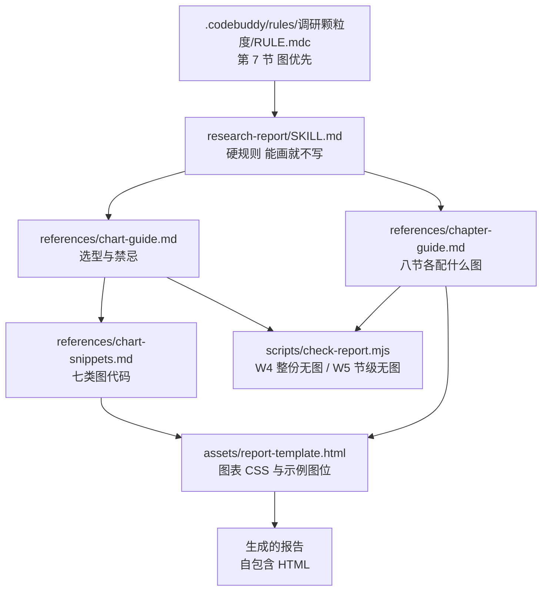

## 用户需求

生成调研报告时优先采用可视化呈现：凡是数据、流程、结构或对比类内容适合用图表表达的，都绘制相应图形，不用纯文字描述；在工作区内查找可用的绘图 skill 并实际使用；图表合理嵌入报告对应章节之内。

## 产品概述

调研报告的呈现方式从「表格加文字」升级为「图表优先」：每个章节先判断内容类型，能用图形表达的就在该节内直接画出，文字只保留判断、来源与口径。报告仍是可双击打开的自包含单文件，不依赖网络与构建。

## 核心功能

- 报告模板内置一套零依赖图表组件：横向条形、堆叠占比条、步骤链、状态带、缩进树、参与者泳道（内联 SVG）、能力矩阵色块
- 新增图表选型规范，把「内容类型对应什么图形」写成可执行的判据，并列出禁用图形
- 八节骨架逐节给出该配什么图的建议，写作时按节取用
- 校验脚本增加无图警告：整份报告没有图、或关键章节只有文字没有图表时给出提示
- 图表统一用报告已有色值令牌，带 `role="img"` 与 `aria-label`，图注写图号与一句结论，打印时不被切断

## 技术栈

- 载体：单文件 HTML，样式与图形全部内联，无 CDN、无构建、无 npm 依赖
- 图形：纯 CSS 绘制条形、占比条、步骤链、状态带、缩进树；时序与结构关系用内联 SVG（固定 `viewBox`，语义 `aria-label`）
- 脚本：Node 原生 ESM（`check-report.mjs` 增加检查项）
- 不采用 Mermaid：HTML 内渲染需引 CDN，破坏自包含；md 场景继续沿用既有 Mermaid 做法，两者边界不变

## 绘图工具盘点与取舍

| 工具 | 实际状态 | 本方案怎么用 |
| --- | --- | --- |
| `archify` | `bin/archify.mjs` 不存在，`renderers/` 仅有四个子目录且 `workflow/` 只有 README，缺 `architecture` 渲染器，`validate` / `deliver` / `visual-check` 均无法执行 | 只读其规范：`schemas/` 五类图定义与 `assets/template.html` 的 SVG 组织方式，作为画结构关系与时序图的作者依据；不调用 CLI，不声称生成 |
| `dashboard-design` | 规范完整：encoding ladder、颜色跟随实体、标题数字必须有对比基线、数字格式与表格数字对齐、红绿不单独承载语义 | 作为图表选型与视觉规则的来源，代码是 React + Tailwind，本方案翻成纯 CSS |
| 项目先例 | `docs/产品需求/流程图/货主档案创建流程.html` 用 `viewBox` + `role="img"` + `aria-label` 自绘 SVG | 作为 SVG 写法与无障碍属性的基准 |
| Mermaid | md 里在用，HTML 需外部依赖 | 不进入报告链路 |


archify 的 CLI 缺失是客观事实，方案不依赖它自动出图，改由 skill 内建图表组件承担，archify 仅提供作者规范参考。

## 实施策略

按「选型规范 → 代码片段 → 模板落地 → 写作判据 → 校验兜底 → 规则与留痕」推进。

1. 先把「什么内容用什么图、什么图不许画」定成判据，避免执行时凭手感。
2. 再给可直接复制的代码片段，每段自带语义结构、无障碍属性与打印规则，复制即用。
3. 模板里加图表样式与三处示例图位，示例用注释包裹，不干扰模板自检。
4. 八节判据逐节补「本节该配什么图」，写作时按节对照。
5. 校验加两级警告：整份无图、关键节无图；只警告不阻断，避免把有理有据的纯文字报告判死。
6. 规则层补一句指向，日志留痕，三个脚本复跑。

## 实施要点

- 图表只用报告已定义的 CSS 变量（`--accent`、`--line`、`--muted`、`--ink`、`--accent-soft`），不新增色板；一个强调色，红绿只表差异方向且不单独承载含义。
- 每图必须 `role="img"` 与 `aria-label`，`<figcaption>` 写「图号 + 一句结论」，不复述标题。
- 条形图给对比基线：同一指标在不同对象间比较时才画条；只有一个数值时用文字或 KPI 数字，不画单条。
- 占比不用饼图；三维、双 Y 轴、装饰性图标一律不画。
- 内联 SVG 的 `viewBox` 固定，宽度 `max-width:100%`，打印 `break-inside: avoid`。
- 模板自检要保持 0 错误：示例图位放在 HTML 注释内，`{{占位符}}` 现状不变，只新增警告不新增错误。
- 存量 `docs/调研/` 五份 legacy 报告不补图，新规则只约束今后生成的报告。

## 架构设计



## 目录结构

```
.codebuddy/skills/research-report/
├── SKILL.md                              # [MODIFY] 硬规则加第 6 条「能画就不写」；八节骨架表加「建议图形」列；
│                                         #   资源索引加 chart-guide 与 chart-snippets 两行；「不做什么」加不引外部图表库；
│                                         #   新增「绘图工具与边界」段，写明 archify 只读规范、dashboard-design 供选型
├── assets/report-template.html           # [MODIFY] 新增图表 CSS：.chart / .bar-row / .bar / .stack /
│                                         #   .steps / .state-band / .tree / .matrix；新增三处示例图位（注释包裹，
│                                         #   分别在第 2 节菜单树、第 3 节状态带、第 5 节对比条形）；@media print 加
│                                         #   figure/.chart 的 break-inside: avoid
├── references/
│   ├── chart-guide.md                    # [NEW] 图表选型判据：七类内容的图形对应表、每类的用与不用、
│   │                                     #   颜色与基线规则、无障碍与图注要求、禁用图形清单、什么时候不画图
│   ├── chart-snippets.md                 # [NEW] 七类图的可复制代码：横向条形、堆叠占比条、步骤链、状态带、
│   │                                     #   缩进树、参与者泳道 SVG、能力矩阵色块；每段含 HTML 结构 + CSS +
│   │                                     #   示例数据 + 放在哪一节
│   └── chapter-guide.md                  # [MODIFY] 八节各补「本节该配什么图」一段；交付前自检清单加图检查两条
└── scripts/check-report.mjs              # [MODIFY] 新增 W4「整份报告没有任何图」、W5「第 2/3/5/6 节只有文字没有
                                          #   表格或图」；只警告不阻断；--help 与检查项列表同步

.codebuddy/rules/
└── 调研颗粒度/RULE.mdc                    # [MODIFY] 第 7 节加一句：报告图优先，数据/流程/结构/对比类内容按
                                          #   research-report 的 chart-guide 配图，正文只留判断与来源

docs/log.md                               # [MODIFY] 追加一条变更记录
```

## 关键结构

图表选型的判据表（写入 `chart-guide.md` 的核心表）：

| 内容类型 | 用什么 | 不用什么 |
| --- | --- | --- |
| 多个对象的同一指标对比 | 横向条形，按值排序 | 单条条形、饼图 |
| 构成与占比（三到五段） | 堆叠占比条，标注百分比 | 饼图、环形图 |
| 线性流程与步骤 | 步骤链，箭头连接，分支另起一行 | 纯文字罗列 |
| 状态与逆向流转 | 状态带，终态加重，逆向用虚线回指 | 只写状态名 |
| 层级结构（菜单、模块树） | 缩进树，层级用竖线 | 缩进的项目符号列表 |
| 跨参与者交互 | 参与者泳道 SVG | 长段落描述 |
| 多对象多维度 | 表格加单元格色块 | 三张分开的单维表 |


七类图与八节的对应关系（写入 `chapter-guide.md`）：

| 节 | 建议图形 |
| --- | --- |
| 1 口径与证据 | 对象 × 证据级矩阵；单对象时用一行 KPI 数字，不画图 |
| 2 覆盖清单 | 菜单缩进树；覆盖率的条形 |
| 3 逐页记录 | 状态带；页面结构分区的步骤链 |
| 4 术语对照 | 表格即可，不画图 |
| 5 横向对比 | 能力矩阵色块；关键维度的横向条形 |
| 6 结论与落点 | 落点按端或模块计数的条形 |
| 7 缺项 | 不画图 |
| 8 截图索引 | 缩略图网格 |


校验规则（`check-report.mjs`）：

```
W4 整份报告既无 <svg> 也无 .chart 也无 <figure> → 警告：报告没有任何图
W5 第 2/3/5/6 节内既无 <table> 也无 <svg> 也无 .chart 也无 <figure> → 警告：本节只有文字
```

两级都只记警告，退出码不受影响；理由是图表是否必要取决于内容，脚本只提示不裁定。

## 设计目标

图表要让人在三秒内读到差异与结构，不是给报告加装饰。所有图形服从报告既有的克制风格：白纸、单一强调色、细线、无阴影堆叠。

## 图表风格

- 横向条形：条高 10px，圆角 2px，底色 `--accent`，比较项使用 `--accent-soft`；数值右对齐贴条端，单位紧随数字
- 堆叠占比条：单条高 14px，段间留 2px 白缝，段内标百分比，颜色按强调色与两级灰阶分配
- 步骤链：每个步骤是一个圆角 6px 的框，边框 `--line`，箭头用 `--faint`；主路径实线，异常分支虚线
- 状态带：状态按推进顺序横排，终态加粗下边线，逆向流转用虚线回指并标「撤销/驳回」
- 缩进树：层级用 1px 竖线与 12px 缩进表达，节点文字不换行，超过三层折叠为「等 N 项」
- 参与者泳道：SVG 固定 viewBox，参与者列头用 `--ink`，消息线用 `--muted`，返回线虚线
- 能力矩阵：单元格填 `有/无/未验证`，用三档底色区分，文字保留在格内，不靠颜色单独表意

## 图注与版式

- 每图配 `<figcaption>`：`图 N ｜ 一句结论`；结论写「谁比谁多多少」或「哪一步是瓶颈」，不复述标题
- 图与正文间距 16px，图宽不超过正文栏宽，居中不左浮
- 打印时图不跨页、不裁切，`break-inside: avoid`

## 禁用

饼图、环形图、三维图、双 Y 轴、装饰性图标、渐变填充、投影卡片。单值不画条形，改用一句话加数字。

## Agent Extensions

### Skill

- **dashboard-design**
- Purpose: 从其 `references/perception.md` 的 encoding ladder 与颜色、基线规则中提炼图表选型判据，作为 `chart-guide.md` 的规则来源
- Expected outcome: 形成一张可执行的「内容类型 → 图形」对照表与禁用清单，规则有出处不靠手感
- **archify**
- Purpose: 只读其 `schemas/` 五类图定义与 `assets/template.html` 的 SVG 组织方式，作为结构关系图与参与者泳道图的作者规范
- Expected outcome: `chart-snippets.md` 里的 SVG 结构有据可依；明确记录其 CLI 缺失，不调用 `validate` 与 `deliver`，不声称生成成功
- **research-report**
- Purpose: 本次改造对象本身，按 skill 规范调整 SKILL.md 的硬规则、资源索引与章节骨架表，保持可被正常加载
- Expected outcome: 改造后 skill 仍符合 skill 规范，硬规则与资源索引一致，模板自检 0 错误