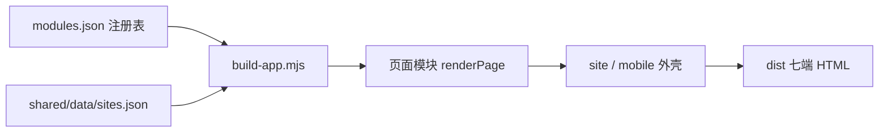

## 产品概述

货灵ERP 新增「独立站」统一管理模块：货主用登录身份管理本人名下的多个独立站，每个站点选择品牌站或采销站；与货灵商城「商城店铺」并列，互不复用。模块覆盖创建、配置、内容、商品、订单、多端发布、成员权限与运维，并配套 Web 与 APP 两个品牌站前台。

## 核心功能

- 多站点：站点列表、新建、启停；站点归属登录货主，ERP 不设货主下拉与货主筛选。
- 品牌站：内容、栏目、品牌故事、门店网点；交易可关闭，商品可仅展示；权限偏内容编辑与发布审核。
- 采销站：商品、价格、库存、下单、支付、售后；订单进 ERP 订单中心；改价、退款、订单导出需审批。
- 配置与运维：站点基础配置、域名与证书、内容发布、站点商品、站点订单、成员与权限、站点总览。
- 多端：Web、APP、微信小程序、支付宝小程序；ERP「多端发布」展示端覆盖矩阵、同步状态与权限一致性；发布版本化，支持回滚。
- 前台：Web 品牌站 5 页（站点首页、站点商品、站点商品详情、品牌故事、门店网点）；APP 品牌站同名 5 页，底部四 tab。
- 权限：站长、运营、内容、客服、财务、只读；数据范围限本站点；四端共用一套账号与角色。
- 视觉：ERP 为运营控制台；Web 为编辑式品牌站；APP 为手机卡片流。

## 边界

- 品牌站不强制交易，采销站必须走交易；两类共用站点档案、域名、多端发布、成员权限与总览。
- 独立站不复用商城店铺的页面、导航与数据；商品、订单、履约复用现有共享主档与订单中心。

## 技术栈

- Node 18+ 原生 ESM，无 package.json、无框架、无外部依赖；产物为自包含 HTML。
- 装配驱动：`prototypes/shared/modules.json` 决定端、模块、页面归属；`prototypes/build-app.mjs` 聚合页面源并输出 `prototypes/dist/<端名>.html`。
- 本次形成 7 端、5 套外壳：`admin`（货灵ERP、运营中台、WMS）、`mall`（货灵商城）、`pda`（作业 APP）、`site`（货主独立站 Web）、`mobile`（独立站 APP）。
- 页数：货灵ERP 44→53、运营中台 54、WMS 51、商城 6、作业 APP 14、货主独立站 5、独立站 APP 5，合计 188 页。
- 只改 `prototypes/` 与 huoling-proto 规范层；`docs/` 一行不动。

## 方法论：DDD 的使用边界

- 采用 DDD 战略设计，不搬全套战术 DDD。战略设计回答「边界在哪」，战术设计只在站点档案、站点商品、发布版本三处落实体、值对象与状态机。
- 独立站划 7 个限界上下文：站点档案、配置与域名、内容、商品与定价、交易与会员、多端发布、站点权限。
- 上下文映射：商品主档→站点商品与定价（防腐层，单向同步）；站点交易→订单中心、履约、库存；账号与货主为共享内核；多端发布→四端运行时。
- 通用语言落 `glossary.md` 与各模块 `scope`；Event Storming 只用于「站点开通」与「多端发布」两条流程。
- 界面首栏的 `rail` 是动线归并，不是限界上下文；保持 ERP 五域不变，独立站作为「商品与店铺」域下两段。领域重排不在本次范围。

## 实施方案

- 顺序：先登记文案与注册表 → 跑脚手架生成骨架 → 扩展共享外壳与共享主档 → 填页面与数据 → 构建 → 全量验收。
- 共享层只做增量：新增 `renderSiteShell`、`renderMobileShell`、`SITE_CSS`、`MOBILE_CSS`、`STOREFRONT_SCRIPT`；不改 `renderShopShell`、`renderPdaShell`、`SHELL_SCRIPT` 的既有输出。
- 组件参数化保持向后兼容：`ProductCard` 增加 `detailTarget`、`actions`、`publicPrice`；`ShopPrice` 增加 `publicPrice`；`ShopHero` 增加 `actionTarget`；`ShopFloor` 增加 `moreTarget`；`ShopDetailHero` 增加 `actions`、`meta`、`publicPrice`。默认值维持货灵商城现状。
- 不新增视觉令牌：品牌站用 `--wx-gray-900`、`--wx-gray-100`、`--wx-primary-*` 替代商城橙，避免与货灵商城混色；商品图沿用首字色块，不引外部图片。
- 性能：构建期一次性装配，复杂度 O(页面数 × 行数)；产物无网络请求、无外链；指纹覆盖 `build-app.mjs`、`modules.json`、`tokens`、`ui.mjs`、主档与全部页面/数据文件。
- 可靠性：页面模块只写声明式数据与纯函数；交互走 `data-*`；危险动作（解绑域名、回滚发布、停用站点）带后果提示与确认。

## 跨端联动评估

| 端 | 落点（模块 / 页 key / 共享层） | 联动点 | 结论 |
| --- | --- | --- | --- |
| 货灵ERP | `modules.json` 的 `apps[erp-app].nav/rail`；新模块 `site` 9 页 | 新增 `nav-site`、`nav-site-ops`；`rail-merch.navs` 追加；ERP 44→53 页 | 必须同改 |
| 货主独立站（新） | `apps[site-app]`；`site-front` 5 页；`shell: site` | 端名、产物名、4 个页面入口、登录 entry 模式 | 必须同改（新增） |
| 独立站 APP（新） | `apps[site-mobile-app]`；`site-front` 5 页；`shell: mobile` | 端名、产物名、4 个底部 tab、登录 entry 模式 | 必须同改（新增） |
| 货灵商城 | `mall-app`、`mall` 壳 | 不复用壳与页面；`find(shell === 'mall')` 仍唯一命中；商城 6 页不变 | 无需改（依据：新端用 `site` / `mobile` 壳） |
| 货灵运营中台 | 无页面与数据改动 | `shared/ui.mjs` 新增导出；仅重建 | 无需改（重建验证） |
| 货灵WMS | 无页面与数据改动 | 同上 | 无需改（重建验证） |
| 作业 APP | `pda` 壳 | 不复用 pda；`mobile` 壳无按键区 | 无需改（重建验证） |
| 商城店铺 `mall-shop` | 5 页 | 并列独立，不改导航与数据 | 无需改（依据：已确认并列） |
| `shared/data` | 新增 `sites.json` | ERP 9 页与前台 10 页引用；`owners` / `skus` 不变 | 必须同改 |
| `shared/ui.mjs` | 新外壳与组件可选参数 | admin / mall / pda 默认行为不变；七端全量重建 | 必须同改（重建） |


重建产物：七端全部。受影响验收项：A11、A14、A15、A18、A19、A20，B11、B14、B21。

## 架构



数据流：货主登录 → ERP 按演示身份过滤 `owner` → 页面模块读 `data` → `renderPage` 输出 → 外壳合成 → 单文件 HTML。站点档案、配置、发布状态为单点写入；商品、价格、库存从 ERP 主档单向下发；订单、售后、会员由各端写入并由订单中心汇总。

## 目录结构

```text
prototypes/
├── build-app.mjs                         [MODIFY] 增加 site/mobile 外壳、shop 页归属白名单、sites 主档、产物断言
├── shared/
│   ├── modules.json                      [MODIFY] 7 端、19 模块、188 页；ERP 增两段导航
│   ├── ui.mjs                            [MODIFY] 新外壳、CSS、脚本；商城组件可选参数
│   └── data/sites.json                   [NEW] 站点唯一事实源
├── site/
│   ├── module.json                       [NEW] 独立站模块交付清单
│   ├── pages/                            [NEW] 9 个 ERP 页面
│   └── data/                             [NEW] 9 份演示数据
└── site-front/
    ├── module.json                       [NEW] 独立站前台交付清单
    ├── pages/                            [NEW] Web 5 页 + APP 5 页
    └── data/                             [NEW] 10 份演示数据
```

```text
.codebuddy/skills/huoling-proto/
├── SKILL.md                              [MODIFY] 五端→七端、三套→五套外壳
├── README.md                             [MODIFY] 外壳与端数量表述
├── scripts/verify-delivery.mjs           [MODIFY] site/mobile 外壳断言、端数表述
└── references/
    ├── registry.md                       [MODIFY] 7 端、19 模块、188 页、目录与新增端流程
    ├── implementation.md                 [MODIFY] 外壳函数、组件白名单、data-* 增量
    ├── core/glossary.md                  [MODIFY] 2 端名、2 模块名、19 页面名、列名、按钮、状态
    ├── core/output-format.md             [MODIFY] 5 套外壳、7 端交付、登录模式
    ├── core/acceptance.md                [MODIFY] A14/A18/A19/A20/B11/B14 与新增 A22
    ├── core/anti-patterns.md             [MODIFY] 五端表述同步为七端
    └── shells/
        ├── site.md                       [NEW] 独立站 Web 外壳视觉法
        └── mobile.md                     [NEW] 独立站 APP 手机壳视觉法
```

19 个页面与数据文件：

| 端 | 页 key | 页面名 / 类型 | 页面源 | 演示数据 | 关键内容 |
| --- | --- | --- | --- | --- | --- |
| ERP | `site-overview` | 独立站总览 / report | `prototypes/site/pages/site-overview.mjs` | `prototypes/site/data/site-overview.json` | 站点数、营业中、今日访客、待发布端；状态分布、多端异常、站点商品与订单 |
| ERP | `site-list` | 独立站列表 / list | `prototypes/site/pages/site-list.mjs` | `prototypes/site/data/site-list.json` | 站点名称、类型、域名、状态、承载端、商品数、订单数；新建站点 FormDrawer |
| ERP | `site-config` | 站点配置 / list | `prototypes/site/pages/site-config.mjs` | `prototypes/site/data/site-config.json` | 站点、配置项、当前值、生效范围；交易开关按站点类型限制 |
| ERP | `site-domain` | 域名与证书 / list | `prototypes/site/pages/site-domain.mjs` | `prototypes/site/data/site-domain.json` | 域名、绑定端、证书状态、到期时间、解析状态；解绑为危险动作 |
| ERP | `site-content` | 站点内容 / list | `prototypes/site/pages/site-content.mjs` | `prototypes/site/data/site-content.json` | 页面栏目、内容类型、内容状态、发布人、发布时间；新建内容 FormDrawer |
| ERP | `site-sku` | 站点商品 / list | `prototypes/site/pages/site-sku.mjs` | `prototypes/site/data/site-sku.json` | 商品编码、名称、售价、可售库存、上架状态；live 上架/下架；品牌站可仅展示 |
| ERP | `site-order` | 站点订单 / list | `prototypes/site/pages/site-order.mjs` | `prototypes/site/data/site-order.json` | 订单编号、买家、金额、支付状态、履约状态；品牌站未开交易给空态 |
| ERP | `site-channel` | 多端发布 / list | `prototypes/site/pages/site-channel.mjs` | `prototypes/site/data/site-channel.json` | 站点×端、版本、发布状态、功能覆盖、同步状态；抽屉放覆盖矩阵与权限一致性 |
| ERP | `site-member` | 成员与权限 / list | `prototypes/site/pages/site-member.mjs` | `prototypes/site/data/site-member.json` | 成员、角色、数据范围、状态；邀请 FormDrawer；抽屉放权限点矩阵 |
| Web | `sf-home` | 站点首页 / shop | `prototypes/site-front/pages/sf-home.mjs` | `prototypes/site-front/data/sf-home.json` | 深色品牌 hero、品牌事实、商品楼层、门店入口 |
| Web | `sf-products` | 站点商品 / shop | `prototypes/site-front/pages/sf-products.mjs` | `prototypes/site-front/data/sf-products.json` | 四/三/二列商品网格，公开零售价 |
| Web | `sf-product` | 站点商品详情 / shop | `prototypes/site-front/pages/sf-product.mjs` | `prototypes/site-front/data/sf-product.json` | 大图、规格表、到店咨询动作 |
| Web | `sf-brand` | 品牌故事 / shop | `prototypes/site-front/pages/sf-brand.mjs` | `prototypes/site-front/data/sf-brand.json` | 年份沿革、资质、产地 |
| Web | `sf-stores` | 门店网点 / shop | `prototypes/site-front/pages/sf-stores.mjs` | `prototypes/site-front/data/sf-stores.json` | 城市、地址、营业时间、电话 |
| APP | `sf-m-home` | 站点首页 / shop | `prototypes/site-front/pages/sf-m-home.mjs` | `prototypes/site-front/data/sf-m-home.json` | 纵向 hero、两列商品、底部四 tab |
| APP | `sf-m-products` | 站点商品 / shop | `prototypes/site-front/pages/sf-m-products.mjs` | `prototypes/site-front/data/sf-m-products.json` | 两列商品卡，44px 触控目标 |
| APP | `sf-m-product` | 站点商品详情 / shop | `prototypes/site-front/pages/sf-m-product.mjs` | `prototypes/site-front/data/sf-m-product.json` | 大图、两列规格、到店动作 |
| APP | `sf-m-brand` | 品牌故事 / shop | `prototypes/site-front/pages/sf-m-brand.mjs` | `prototypes/site-front/data/sf-m-brand.json` | 时间线纵排、资质卡 |
| APP | `sf-m-stores` | 门店网点 / shop | `prototypes/site-front/pages/sf-m-stores.mjs` | `prototypes/site-front/data/sf-m-stores.json` | 三列门店表，地址不截断 |


## 关键结构

站点主档记录：

```
{
  "siteCode": "SITE001",
  "siteName": "鲜集",
  "siteMark": "鲜",
  "siteType": "brand",
  "owner": "海纳食品",
  "domain": "shop.xianji.cn",
  "status": "active",
  "channels": [{ "end": "web", "status": "published", "version": "v1.4.0" }],
  "skuCount": 18,
  "orderCount": 0,
  "visitorToday": 1280,
  "story": [{ "year": "2012", "text": "首条生产线投产" }],
  "stores": [{ "name": "静安门店", "city": "上海", "address": "南京西路 1266 号", "hours": "09:00-21:00", "phone": "021-62001266" }]
}
```

外壳签名：

```text
renderSiteShell({ product, appName, siteName, siteMark, nav, userLabel, content })
renderMobileShell({ product, appName, siteName, siteMark, tabs, userLabel, content, bootId })
```

外壳骨架：`site` 为 `.wx-site-app`（品牌顶栏 + 页面导航 + 内容区 + 页脚）；`mobile` 为 `.wx-mobile-app`（机身 + 状态条 + 导航 + 内容区 + 底部四 tab），无按键区。页面容器仍是 `.page[data-page-id]`，切页用 `data-target`；移动端新增 `data-mobile-tab`、`data-mobile-group`、`data-mobile-back`。

## 实施注意

- `build-app.mjs`：`SHELLS` 增加 `site`、`mobile`；`shop` 页归属白名单改为 `mall/site/mobile`；`MASTER_FILES` 增加 `sites`，`FK_OF` 增加 `sites: "siteCode"`；`buildHtml` 增加两个分派；`checkProduct` 增加两套外壳断言。
- `mallTarget()` 与 `verify-delivery.mjs` 的 `shell === 'mall'` 不改：新端不用 `mall` 壳，仍唯一命中货灵商城。
- ERP 每个页面的行必须带 `owner`，构建按 `r.owner === view` 过滤；站点名不得包含另一个演示货主的完整名称，避免 `[货灵ERP]` 身份泄漏断言。
- `shop` 页只允许 `ShopPage`，不得出现 `ListPage`、`ReportHero`、`ScanPage`；新端产物不得出现 `.html` 跨端链接。
- `ShopPrice` 默认仍输出「登录可见价格」；品牌站传 `publicPrice: true`，并在 `SITE_CSS` / `MOBILE_CSS` 内覆盖 `html[data-auth="guest"]` 的隐藏规则。
- 品牌站不出现商城橙：在 `site` / `mobile` 壳内把 `.wx-shop-btn`、价格、hero 底色覆盖为 `gray-900` / `gray-100` / `primary`。
- 移动端组件按 375 宽覆盖：商品网格两列、hero 单列、表格三列；不依赖视口 media query，改用 `.wx-mobile-app` 作用域。
- 页面类名带模块前缀：ERP 用 `st-`，前台用 `sf-`；不写页面级脚本、不硬编码 hex、不使用 `rpx`。
- 先登记 `glossary.md` 再跑脚手架，避免 S2「缺页面名」返工；`module.json` 验收通过后再置 `delivered`。
- 不同步更新 `templates/`，避免空工作区拉起不存在的独立站模块。

## 构建与验收

```
node prototypes/build-app.mjs
node .codebuddy/skills/huoling-proto/scripts/verify-delivery.mjs
node prototypes/build-app.mjs --check
```

预期：7 个产物；`货灵ERP.html` 53 页、`货灵运营中台管理端.html` 54 页、`货灵WMS.html` 51 页、`货灵商城.html` 6 页、`作业 APP.html` 14 页、`货主独立站.html` 5 页、`独立站 APP.html` 5 页。回归：现有五端页数与页面源不变，商城橙不进入独立站，PDA 六键不变，ERP 无货主下拉与货主筛选。

## 风险与回退

- `shop` 断言放宽可能让后台端误挂 shop 页：白名单只允许 `mall/site/mobile`，保留后台端禁用。
- `ShopPrice` 公开价可能回归商城：默认 `false`，构建后对货灵商城关键页做截图对比。
- 移动端 375 宽可能横向溢出：所有覆盖限定 `.wx-mobile-app`，用 375 截图逐页检查。
- 站点名泄漏其它货主：命名用「鲜集」「星漾」等品牌名，不拼货主全名。
- 若新外壳不稳定，先只保留 `site` 与 `mobile` 的壳函数与空端，回退页面填充，不影响现有五端。

## 设计取向

不新造后台视觉：ERP 九页沿用 admin 外壳的双栏、列表与报表骨架，只新增「独立站」「站点运营」两段导航。独立站 Web 采用编辑式品牌站：深色首屏、宽留白、细分隔线、四列商品网格；不用营销口号，用品牌事实（门店数、在售商品、产地）撑首屏。APP 采用 375×812 手机壳：状态条、单行导航、底部四 tab、两列商品卡，触控目标不小于 44px，无按键区。

## 页面构成

- ERP：总览用 ReportHero + StatRow + Block；列表用 ListPage，计数进页签；新建、配置、邀请用 FormDrawer；多端发布与成员权限用 DrawerDetail 展开矩阵。
- Web：首页为深色品牌 hero + 商品楼层 + 门店入口；商品页四/三/二列网格；详情页大图 + 规格表 + 到店动作；品牌故事用年份沿革 + 资质；门店网点用城市分组表。
- APP：同五页，英雄区纵向堆叠，商品两列，表格收成三列，底部 tab 固定。

## 交互

顶栏与底部 tab 切页，商品卡整块可点；hover 只做轻反馈；解绑域名、回滚发布、停用站点标危险后果；空态保留状态与原因，不写引导文案。

## Agent Extensions

### Skill

- **huoling-proto**
- Purpose: 约束 7 端装配、5 套外壳、跨端联动、构建与验收；本次所有原型改动按该 skill 的「五层」与流程执行。
- Expected outcome: 七端产物构建通过，`verify-delivery.mjs` 全量验收退出码 0，现有五端不退化。
- **playwright-cli**
- Purpose: 打开 `prototypes/dist/` 下 7 个自包含 HTML，按 1440、1024、768、375 宽度截图走查。
- Expected outcome: 独立站 Web 与 APP 无横向溢出，四 tab 与抽屉可切换，商城与 PDA 视觉未被新外壳污染。