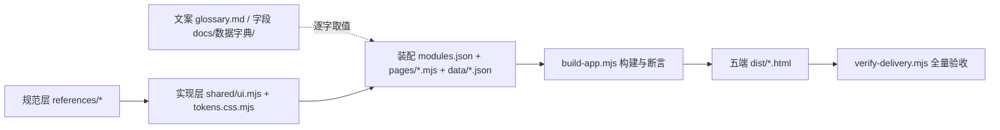

## 产品概述

明确并落地 3PL 云仓「货主创建商品 → 提交仓网端审核」的完整可操作流程，并按货主端全功能清单把缺失的页面补齐。本轮交付的是一份修改页面的实施计划，范围与交互深度已由用户选定：覆盖全功能清单，且录入要做成可填字段、能驱动状态流转的真表单。

## 核心功能

- 商品审核链路闭环：货主端查看自有商品、新建与编辑商品资料申请（新增／变更／停用）、提交审核、撤回、驳回后修改重提、查看审核状态与审核意见；仓网端审核详情、审核通过／驳回并留意见、赋商品编码、版本递增发布、按仓库下发。含异常与逆向场景（校验失败补录、撞码退回、作废、反审核、已产生单据不可逆）。
- 按全功能清单补齐货主端：工作台、商品资料查询、委托单据中心、调拨与退货申请、差异与异常协同、物流跟踪、费用结算（确认与申诉）、数据报表、账号与权限。
- 表单可录入字段并驱动状态流转，草稿／待审核／已通过／已驳回／已撤回／已作废等状态在页签、计数、列表与操作轨迹上实时体现；审核人、审核时间、审核意见、驳回原因留痕可见。
- 两端申请单数据一致，审核通过能落到商品主档。
- 边界：单实例单主体；货主端按登录身份限定数据，不提供货主下拉、货主筛选与身份切换；不执行仓内作业、不赋码发布、不改主档。

## 视觉

沿用既有后台外壳、统一色值字号与组件风格，五个端观感一致，不引入新视觉风格；录入以行下钻抽屉承载，状态页签与计数随操作变化，过渡平滑。

## 技术栈选择

沿用仓库现状，不引入新技术：Node 原生 ESM（`.mjs`，无第三方依赖，根目录 `node <路径>` 运行），构建期装配生成自包含的五端单文件 HTML；三层分治为规范层 `.codebuddy/skills/3pl-wms-proto/references/*`、`prototypes/shared/*` 实现层、`prototypes/shared/modules.json` 装配索引层；文案真值 `references/core/glossary.md`、字段真值 `docs/数据字典/`、产物校验 `prototypes/build-app.mjs` 与 `scripts/verify-delivery.mjs`。表单与状态流转用原生 DOM 加既有事件委托实现，不引入框架、组件库、后端或数据库。文档侧沿用 `docs/index.md` + `log.md` 与两套 `check.mjs`。

## 实现思路

先收口真值源再动画面。第一轮已查实 5 条商品链路口径矛盾（仓网端能否越过审核直接建档、新增申请单是否预先带 `skuCode`、状态枚举不足、审核留痕无字段、两端申请单 5 行／6 行不对齐）与范围命名冲突（`原型同步方案.md` 的 gap「不纳入」清单、委托与计划单「不合并」结论、`plan-owner-list`／`asn-owner-list` 等四套页 key、页「待实现」滞后标注、`ownerScoped` 与货主端无货主下拉的冲突）。按 `docs/数据字典/index.md:9`「先写字典再画页」和「页面名列名逐字取 glossary」，先补实体字典、登记文案与规范层，再改实现层与页面。

关键决策一：表单用「复用既有五类骨架 + 扩展抽屉为表单抽屉」，不新增第六类 `type`。依据是 `build-app.mjs:17` 的 `PAGE_TYPES = new Set(['list','detail','report','scan','shop'])` 硬编码、`checkPageSource` 按 type 分派骨架断言、`ownerScoped` 仅允许 list；新增 type 会连带改构建器、验收脚本、registry、SKILL 与模板，影响面过大。项目已有 `DrawerButton` + `DrawerDetail` 的 overlay 机制（SKILL 第 75 行），把只读字段扩展为可录入字段、把 `actions` 扩展为带表单动作的提交按钮，即可在不改装配骨架的前提下做出真表单，且完全贴合「页面只写 columns／rows／filters／toolbar、交互由 data-* 驱动、不写内联脚本」。代价是表单以抽屉形态承载、不做独立全页表单路由；字段多的创建商品场景用分组／多段抽屉解决。

关键决策二：诚实界定「状态流转」的可行性。产物是静态自包含 HTML，货主端与仓网端是两个独立文件，无后端与跨文件通信。因此流转实现为 `SHELL_SCRIPT` 内按页 key 索引的内存状态机（配 `sessionStorage` 保留刷新前状态）：提交／审核动作改内存中的申请单与主档行，重算页签计数与列表渲染；不做真实持久化、承诺不了跨端实时联动。两端「数据对齐」改为构建期共用一份 `prototypes/shared/data/` 申请单单一事实源、两页用 ref 引用，既解决现存不对齐，也符合硬约束「共享数据单一事实源」。演示态与真实系统行为要在文档与产物里区分说明，不可逆终态显式标注。

顺序遵循 `SKILL.md:117` 与 `implementation.md:51`：规范层登记 → `shared/ui.mjs` 实现 → 页面与数据 → 文档同步 → 五端重建与全量验收。

性能与复杂度：新增十余页使产物线性增长；`SHELL_SCRIPT` 复用已有 document 级事件委托，不新增全局监听器、不重复绑定；表单校验 O(字段数)、重渲染 O(当前页可见行)，内存状态按页 key 索引避免全表扫描，无 N+1 与重复遍历。改 `shared/` 后五个端产物必须全部重建（硬约束），这是主要成本。

避免技术债：复用 `ListPage`／`DrawerDetail`／`StatusTag`／`renderButton(attrs)`／`esc`／`var(--wx-*)`；新组件类名用 `wx-` 前缀、页面自定义类名带模块前缀；不复制组件 HTML、不自造色型、不硬编码 hex。

## 实现要点

- 动手前 `node prototypes/build-app.mjs --check` 记下 `data-build`；报 drift 先查并发会话，不直接全量重建。
- 构建期断言须逐条避开：页面禁内联脚本、禁跨模块 import、色值须在 `tokens.css.mjs`／`ui.mjs` 调色板内、`StatusTag`／`Tag` 色型限既定几种、类名须 `wx-` 或模块前缀、type 限五类、`ownerScoped` 仅 list、shop 只归 mall 端。表单页仍用 `type=list` + overlay 抽屉，天然不触发这些断言。
- 输入控件只在 `ui.mjs` 出结构，页面模块只传字段声明（label／key／type／required／options），不手写结构 HTML。
- 新登记枚举（草稿、已撤回、已作废、反审核回待审核、审核意见、驳回原因、审核人、审核时间等）先在 glossary 登记再用；状态名与 `docs/数据字典/` 一致，遵守 `.codebuddy/rules/流程图规范/RULE.mdc`：若补状态流转图，必须同时覆盖异常与逆向场景，归入 `docs/产品需求/` 并登记索引与 log。
- 改 `docs/` 必须在 `docs/log.md` 留痕并更新 `docs/index.md`「最近更新」；字典改动同步 `docs/数据字典/index.md` 与 `log.md`；提交前 `node docs/check.mjs` 与 `node docs/数据字典/check.mjs` 均零错误。
- 影响面控制：先翻案 `原型同步方案.md` 的 gap「不纳入」清单（用户已选全量纳入），顺带修 `商品主档.md`「待实现」标注、委托与计划单三处互斥、四套页 key、`ownerScoped` 冲突；`dist/*.html` 由构建生成，不手改。
- 交付前跑不带 `--fast` 的全量 `verify-delivery.mjs`，逐条过 `acceptance.md` 的 A／B 组，重点核表单页无死链、五端登录层与端隔离、新 `data-*` 无撞名，再回填各 `module.json` 交付字段。

## 架构设计

改 B 会波及 F 的全部端产物，故共享层改动必须全量重建与重新验收；D 先于 C，避免构建期文案与骨架断言拦下。

## 目录结构

规范层（先改）：

- `.codebuddy/skills/3pl-wms-proto/references/implementation.md` [MODIFY] 组件白名单登记表单抽屉／表单字段组件，`data-*` 契约登记表单提交、校验、状态动作等属性；如补焦点环／字重令牌，同步第 2 节。
- `.codebuddy/skills/3pl-wms-proto/references/core/glossary.md` [MODIFY] 登记新页面名、列名、按钮、表单字段标签与状态枚举。
- `.codebuddy/skills/3pl-wms-proto/references/registry.md` [MODIFY] 登记新页归属与模块前缀，说明复用五类骨架不加 type。
- `.codebuddy/skills/3pl-wms-proto/references/shells/admin.md`、`references/core/output-format.md`、`references/core/acceptance.md` [MODIFY] 表单抽屉的层级／焦点态与验收判据。
- `.codebuddy/skills/3pl-wms-proto/SKILL.md` [MODIFY] 流程第 75 行补「表单抽屉」用法。
- `.codebuddy/skills/3pl-wms-proto/templates/ui.mjs`、`templates/page-list.mjs` [MODIFY] 可选同步，保证空工作区初始化一致。

实现层：

- `prototypes/shared/ui.mjs` [MODIFY] 新增表单抽屉与字段渲染（含转义），`SHELL_SCRIPT` 新增表单校验／提交／状态流转逻辑，复用现有 `toast` 与事件委托。
- `prototypes/shared/tokens.css.mjs` [MODIFY] 仅当表单需要焦点环／字重档时补令牌。
- `prototypes/shared/data/*.json` [NEW] 申请单单一事实源与各新域主档，供两页 ref 引用。
- `prototypes/shared/modules.json` [MODIFY] 新增 `pages[]`（key／name／type／file／ownerScoped／app），为 `system/user-list`、`role-list` 等预留页分配 app，启用相关模块。

商品链路页面：

- `prototypes/base/pages/sku-apply-list.mjs` [MODIFY] 新建／编辑／详情表单抽屉、提交审核、撤回、退回修改重提，页签与列补草稿／已撤回／审核留痕。
- `prototypes/base/pages/sku-audit-list.mjs` [MODIFY] 审核详情抽屉、审核意见与驳回原因录入、通过／驳回真动作、赋码发布入口。
- `prototypes/base/pages/sku-list.mjs` [MODIFY] 发布／赋码／版本递增动作，收口「仓网端新增」歧义。
- `prototypes/base/data/sku-apply-list.json`、`sku-audit-list.json`、`sku-list.json` [MODIFY] 对齐申请单号、补审核留痕与 `skuCode` 口径。

新域页面（按 registry 模块前缀归既有模块，确无合适再新建）：

- `prototypes/{base,inbound,outbound,inventory,billing,system,workbench}/pages/*.mjs` 与 `data/*.json` [NEW] 本货主商品查询、委托单据中心、调拨申请、退货申请、差异异常协同、物流跟踪、账单确认与申诉、数据报表（周转库龄／出入库趋势／履约时效／费用构成／多仓对比）、子账号与权限。
- `prototypes/workbench/pages/workbench.mjs` [MODIFY] 补库存概览与待确认账单指标。
- 相关 `prototypes/*/module.json` [MODIFY] 交付字段。

文档：

- `docs/产品需求/三端核心功能清单.md`、`原型同步方案.md`、`端定位补齐方案.md`、`计划单与时效协议方案.md`、`商品档案管理方案.md`、`商品档案创建流程.md` [MODIFY] 收口范围、gap 清单、委托与计划单口径、页 key、状态名。
- `docs/数据字典/*.md` [NEW] 商品资料变更申请单、库存台账、批次、费用账单、差异异常、调拨退货、物流运单、账号权限等实体字典；`docs/数据字典/index.md`、`log.md` [MODIFY]。
- `docs/数据字典/商品主档.md` [MODIFY] 去「待实现」标注、补申请单关联。
- `docs/index.md`、`docs/log.md` [MODIFY] 索引与留痕。
- `prototypes/dist/货主端.html` 等五个产物 [MODIFY，构建生成，不手改]。

## 关键契约（文字约定，不新增代码骨架类型）

表单字段声明沿用现有 `fields`／`actions` 的声明式形状，新增 `type`（text／select／date／textarea）、`required`、`options`；动作按钮沿用 `renderButton` 的 `attrs` 透传挂载表单动作属性；表单抽屉作为 `renderPage` 的 `overlay` 返回，复用 `data-drawer-open`／`data-drawer-panel` 打开与收起，`SHELL_SCRIPT` 在既有 click 委托里增加表单分支。页面模块始终保持只写声明，不写结构与脚本。

## Agent Extensions

### Skill

- **3pl-wms-proto**
- Purpose：提供 `prototypes/` 五层规范、组件白名单、`data-*` 契约、表单抽屉登记顺序、构建与全量验收流程，作为本次扩展共享层与新增页面的唯一口径。
- Expected outcome：全部改动落在规范允许的结构内，通过 `build-app.mjs` 断言与不带 `--fast` 的 `verify-delivery.mjs` 全量验收，五端产物可独立打开。

### SubAgent

- **code-explorer**
- Purpose：开工前跨 `references/`、`prototypes/`、`docs/` 核对规范条目、页 key 现状、字典与文案登记情况，定位所有需同步修改的目标。
- Expected outcome：输出准确的修改目标清单与冲突项，避免漏改、误改与文档自相矛盾。