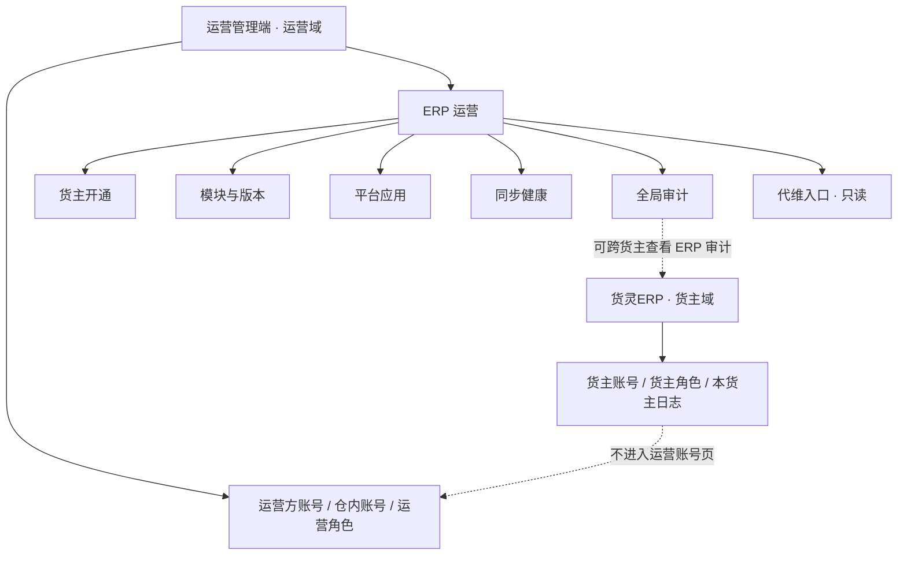

## 用户需求

- 将「仓网管理端」更名为「运营管理端」，只改显示名、产物文件名与文案引用，`apps[].id` 仍为 `network-app`，模块目录与页面 key 不动。
- 在运营管理端新增「ERP 运营」后台，包含货主开通、模块与版本、平台应用、同步健康、全局审计五页，并提供代维入口。
- 彻底拆清两个权限域：货灵ERP只管货主账号与角色；运营管理端只管运营方与仓内账号，不再管理货主账号、货主角色或货主 ERP 日志。
- 全局审计允许查看跨货主 ERP 日志；「账号与权限 → 操作日志」仍只保留运营管理端/PDA 日志，两页职责分开。
- 代维只做只读摘要与提示，不进入货主业务页，动作留审计。
- 同步修改方案、字典、glossary、registry、现行文档端名与日志；历史日志与旧问答保留原文，新增记录说明更名与边界。

## 产品概述

运营管理端成为 3PL 运营方的统一后台，包含「仓网运营」与「ERP 运营」两块。货灵ERP仍是货主业务后台，负责订单、库存、账单、子账号与角色。两边账号、角色、日志互不越界。

## 核心功能

- 运营管理端新增「ERP 运营」一级菜单，五页全部使用现有列表与抽屉，不新增骨架。
- 货主开通页支持开通/停用、调整有效期、模块配置、代维进入、查看审计。
- 模块与版本页展示模块、当前版本、适用端、已开通货主数；平台应用页展示凭证脱敏、能力范围、限流与审核状态。
- 同步健康页汇总全店铺积压、错误率、授权到期；全局审计页按货主、端、模块、动作筛选。
- 运营管理端账号页只保留运营方与仓内账号；角色菜单增加「ERP 运营」，动作增加「代维」。
- 构建产物由 `仓网管理端.html` 改为 `运营管理端.html`，旧产物删除。

## 技术栈

- 沿用 Node 原生 ESM 构建、`prototypes/shared/modules.json` 装配、`data/*.json` 演示数据、`shared/ui.mjs` 的 `ListPage` / `FormDrawer` / `DrawerDetail`。
- 不新增依赖、不新增骨架类型、不新增组件库；五页均为 `list` 类型。
- 视觉沿用现有 admin 外壳与设计令牌，不新增字体、色值或页面骨架。

## 实现策略

1. 先改文档与字典，确定两域口径和运营管理端名称，再动原型数据。
2. 更名只改显示名：`apps[id=network-app].name`、glossary/registry 端名、产物文件名、数据 `所属端`、现行文档引用；历史日志与旧问答不改写。
3. 运营管理端账号域只做数据清理，不改 `system/pages/*.mjs`：删货主账号、去货主角色选项、删货主日志。
4. 新建 `erp-ops` 模块与五页，页面用薄包装复用现有列表与抽屉，避免复制五套页面代码。
5. 同步健康与全局审计是 `同步任务`、`操作日志` 的视图，不建第二份真相。
6. 最后五端重建、全量验收、浏览器核验与日志回填。

## 架构设计



- 运营管理端 = 3PL 运营方后台；货灵ERP = 货主业务后台。
- `erp-ops` 只读货主级汇总与审计，不持有货主业务数据；货主账号与角色仍由 `owner` 模块管理。
- `system/role-list.json` 菜单增加「ERP 运营」，动作增加「代维」；运营管理员默认勾选。
- `erp-global-audit` 可出现「货灵ERP」端；`system/audit-log` 只保留运营管理端、单仓端、PDA 作业端。
- 代维入口是货主开通页的行动作：打开只读摘要抽屉，提供「进入代维（原型示意）」按钮并 toast，不跨端跳转。

## 目录结构

```
prototypes/
├── shared/modules.json                              # [MODIFY] network-app 端名改运营管理端；新增 erp-ops 模块与 5 页；导航加「ERP 运营」段
├── erp-ops/
│   ├── module.json                                  # [NEW] ERP 运营模块，5 页，页面归 network-app
│   ├── pages/
│   │   ├── _list.mjs                                # [NEW] 五页共用薄包装，复用 ListPage/FormDrawer 逻辑
│   │   ├── erp-tenant-list.mjs                      # [NEW] 货主开通页
│   │   ├── erp-module-list.mjs                      # [NEW] 模块与版本页
│   │   ├── erp-app-list.mjs                         # [NEW] 平台应用页
│   │   ├── erp-sync-health.mjs                      # [NEW] 同步健康页
│   │   └── erp-global-audit.mjs                     # [NEW] 全局审计页
│   └── data/
│       ├── erp-tenant-list.json                     # [NEW] 3~4 个货主开通演示数据
│       ├── erp-module-list.json                     # [NEW] 8 个 ERP 模块与版本
│       ├── erp-app-list.json                        # [NEW] Amazon/Temu/速卖通部署级应用
│       ├── erp-sync-health.json                     # [NEW] 全店铺同步健康数据
│       └── erp-global-audit.json                    # [NEW] 跨货主 ERP 审计数据
├── system/
│   ├── data/user-list.json                          # [MODIFY] 删 2 行货主账号，账号类型只留运营方/仓内
│   ├── data/audit-log.json                          # [MODIFY] 删 3 条货灵ERP日志，补 3 条运营管理端/PDA日志
│   ├── data/role-list.json                          # [MODIFY] 菜单加「ERP 运营」，动作加「代维」
│   └── module.json                                  # [MODIFY] 版本 0.3.1，scope 改运营管理端域
docs/
├── 产品需求/
│   ├── ERP运营后台方案.md                            # [NEW] 定位、五页、开通生命周期、平台应用、同步健康、全局审计、代维、两张流程图
│   ├── 账号与权限方案.md                            # [MODIFY] 两域拆分、运营管理端域与货主域边界
│   └── 三端核心功能清单.md                          # [MODIFY] 「仓网端」改「运营管理端」，新增 ERP 运营管理行
├── 数据字典/
│   ├── 货主开通.md                                  # [NEW] ownerCode、erpStatus、modules、version、expireDate、账号数、店铺数
│   ├── 平台应用.md                                  # [NEW] 平台、应用类型、AppKey脱敏、授权方式、回调、能力、限流、审核状态
│   ├── ERP模块.md                                   # [NEW] 模块编码、名称、当前版本、适用端、状态
│   ├── 子账号.md                                    # [MODIFY] 补 accountDomain，唯一性按域
│   ├── 角色.md                                      # [MODIFY] 端名改运营管理端
│   ├── 操作日志.md                                  # [MODIFY] 端名改运营管理端
│   ├── index.md                                     # [MODIFY] 登记三份新字典
│   └── log.md                                       # [MODIFY] 字典变更留痕
├── 问答记录/需求问答.md                              # [MODIFY] 新增一轮：端名更名与 ERP 运营后台
├── index.md                                         # [MODIFY] 登记 ERP 运营方案
└── log.md                                           # [MODIFY] 记录更名、五页新增、域拆分与验收
```

- `references/core/glossary.md`：端名、侧栏标题、5 页名称与列名、货主开通状态、模块状态、应用审核状态、同步健康状态、代维动作、账号域取值。
- `references/registry.md`：端名「运营管理端」、模块 17、运营管理端 40 页、总 128 页、导航 10 段，补 `erp-ops` 模块行。
- 现行文档中的端名统一替换；历史 `docs/log.md`、`docs/数据字典/log.md` 与旧问答不改写。
- 删除 `prototypes/dist/仓网管理端.html`，构建输出 `prototypes/dist/运营管理端.html`。

## 关键约束

- 构建期 `SAAS_WORDS` 会拦截「租户」「订阅」「套餐」「续费」「试用到期」「平台运营后台」「升级专业版」；页面与数据统一写「货主开通」「模块与版本」。
- 页面 key 全局唯一：`erp-tenant-list`、`erp-module-list`、`erp-app-list`、`erp-sync-health`、`erp-global-audit`。
- 五页只读汇总，不新增业务表；同步健康与全局审计从 `同步任务`、`操作日志` 派生。
- 运行时仍是静态列表、筛选与分页，无额外请求、无队列、无定时任务；新增 5 页与 5 份 JSON，产物体积增量有限。
- 更名只改显示名，不改 `network-app` id、模块目录与页面 key，避免大范围重构。

## 跨端联动

| 端 | 落点 | 联动点 | 结论 |
| --- | --- | --- | --- |
| 货灵ERP | 无页面/数据改动 | 端名引用、账号域与审计口径 | 无需改页面，重建确认无回归 |
| 运营管理端（原仓网管理端） | 端名；新增 `erp-ops` 五页；`system` 账号/日志清理；导航 10 段 | 产物文件名、页面归属、导航、页数、角色菜单 | 必须同改 |
| 单仓端 | 无改动 | 人员页关联仓内账号 | 无需改 |
| PDA 作业端 | 无改动 | 我的页角色/仓库范围 | 无需改 |
| 商城端 | 无改动 | 买家/店主沿用货主账号 | 无需改 |
| 共享层 | `modules.json` 端名/新模块/页面/nav、`glossary.md`、`registry.md` | 端名、模块清单、页数 | 必须同改 |
| 文档 | 新方案、账号方案、功能清单、3 份新字典、现行文档端名、索引与日志 | 端名与两域口径 | 必须同改；历史记录不改写 |


重建范围：五端全建。验收重点 A2/A10/A11、B1/B5/B13。

## 验收

- 运营管理端账号管理 7 行，无 `ow.*` 货主账号；账号类型筛选只有「运营方账号 / 仓内账号」；角色下拉无货主角色。
- 运营管理端「账号与权限 → 操作日志」无「货灵ERP」端；「ERP 运营 → 全局审计」可按货主筛选并出现货灵ERP端。
- 货灵ERP子账号、角色、操作日志仍只显示本货主，数据不变。
- `node prototypes/build-app.mjs` 五端构建通过；`--check` 五端 `check ok`。
- `node .codebuddy/skills/3pl-wms-proto/scripts/verify-delivery.mjs` 全量通过；两套 `check.mjs` 零错误。
- 产物为 `dist/运营管理端.html`，旧 `dist/仓网管理端.html` 已删除；`glossary.md` 与 `registry.md` 端名、页数、导航段一致。

## Agent Extensions

### Skill

- **3pl-wms-proto**
- Purpose: 按现有 `modules.json`、`data/*.json`、`shared/ui.mjs` 与交付验收规范新增 `erp-ops` 模块、修改运营管理端账号/日志数据并重建五端。
- Expected outcome: 运营管理端导航新增「ERP 运营」五页，账号域只保留运营方与仓内账号，五端产物一致且验收零违规。
- **agent-browser**
- Purpose: 打开运营管理端与货灵ERP产物，核对账号行数、账号类型筛选、日志端名、五页可开与 ERP 货主隔离。
- Expected outcome: 截图与交互记录证明运营管理端账号 7 行、无 `ow.*`、账号日志无货灵ERP、ERP 五页正常、ERP 侧数据不变。