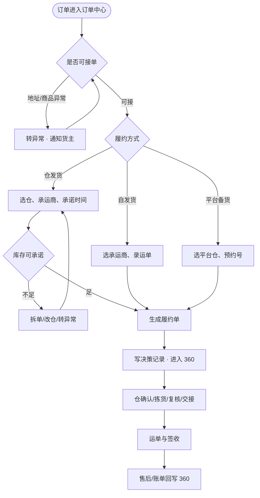
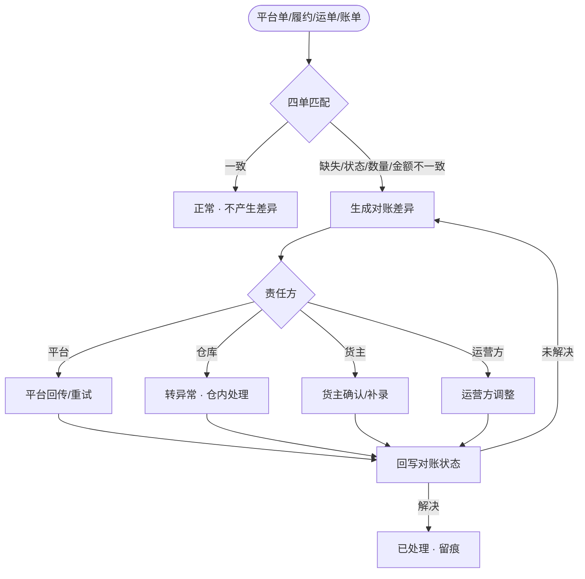

# ERP 履约控制台优化方案

**目标读者**：产品、原型维护人。
**核心目的**：把货灵ERP从「单据集合」补成「履约控制台」：订单 360、履约决策记录、ATP/承诺风险、异常与对账四个横向能力。
**前提**：仍是自包含 HTML 原型；不做真实后端、OAuth、队列、跨页运行时联动。订单 360 是读模型，不新建万能订单表；履约决策是字段与事件，不新增第四种单据。

## 1. 为什么补这四个能力

货主把仓配外包给 3PL，但不能外包五件事：接单、履约决策、委托跟踪、四本账对账、组织与经营。现有 ERP 的页面覆盖已经完整，缺口在横向控制力：

- 订单分散在订单、履约、仓储委托、售后、账单五处，缺一条订单时间线。
- 履约方式有动作，但没有记录「为什么这样发、为什么拆单、承诺何时发」。
- 库存有在库/可用/冻结，但没有 ATP、没有承诺时钟。
- 异常只有仓储差异，账单只有金额，缺跨域异常与四单对账。

## 2. 订单 360

不新增页面，在 `owner/order-center` 每行加「360」抽屉，保留「处理」。

抽屉分五块：

| 区块 | 内容 |
| --- | --- |
| 订单概览 | 订单编号、平台、店铺、订单类型、订单金额、收货方、商品明细、下单时间 |
| 履约决策 | 履约方式、目标仓库、承运商、承诺发货时间、拆分原因、规则版本、决策人、决策时间 |
| 关联单据 | 履约单、出库计划单/自发货单/平台备货单、运单、售后单、账单；类型、单号、状态、时间 |
| ATP 检查 | 商品、需求、可用、可承诺、缺口、仓库 |
| 时间线 | 接单 → 决策 → 仓确认 → 拣货/复核 → 发货 → 签收 → 售后 → 账单 |

列表补两列：最晚发货、履约风险（正常 / 临期 / 超时）。动作列放「处理」「360」两个入口。

边界：

- 订单 360 是演示快照；表单保存决策后不回写 360 面板。
- 不复制平台/仓储主数据，只做聚合视图。
- 部分发货订单必须有 2 张履约单与拆分原因，作为 1:N 的可见证据。

## 3. 履约决策记录

字段：`decisionNo`、`orderNo`、`fulfillmentNo`、`fulfillMode`、`targetWarehouse`、`carrierName`、`promiseShipTime`、`splitReason`、`ruleVersion`、`decisionBy`、`decisionTime`。

规则：

- 一次决策可生成 1 张或多张履约单；拆单必须写拆分原因。
- 决策记录只追加，不改写历史；改派仓/承运商追加新决策。
- 不新增「履约决策」页面；字段落在订单/履约读模型，360 与履约单共用。
- 决策进入操作日志，高风险改派（已下发后改仓/改承运商）标记异常。

## 4. ATP 与承诺

- ATP = 可用数量 − 未发订单占用 + 在途入库；按「货主 × 商品 × 仓库」计算。
- 库存页补：已占用、在途、可承诺、数据截止。
- 订单中心补：最晚发货、履约风险；360 的 ATP 检查显示需求、可用、可承诺、缺口。
- 承诺时钟：平台要求发货时间 → 仓内最晚交接时间；超时/临期进入工作台风险队列。
- 原型只做演示数据，不做实时 ATP 计算。

## 5. 异常与对账

### 5.1 异常队列

- `owner/exception-list` 从「仓储委托」移到新段「异常与对账」，页面名改「异常队列」。
- 补来源域、SLA 两列；来源域覆盖订单、平台同步、履约、售后、账单、仓储。
- 处理动作：确认、异议申诉、关闭；处理结果回写来源单据。

### 5.2 对账差异

新增 `owner/reconciliation-list`「对账差异」：

| 列 | 说明 |
| --- | --- |
| 对账编号 | `RC` + 日期 + 流水 |
| 对账类型 | 订单同步 / 履约 / 运单 / 账单 / 售后 |
| 来源单号 | 来源业务单号 |
| 关联单据 | 平台单 / ERP 单 / 履约单 / 运单 / 账单的组合 |
| 差异类型 | 单号缺失 / 状态不一致 / 数量不一致 / 金额不一致 / 重复单 |
| 差异值 | 数量或金额 |
| 对账状态 | 待处理 / 处理中 / 已处理 / 已忽略 |
| 责任方 | 平台 / 仓库 / 货主 / 运营方 |
| 处理时限 | SLA |
| 操作 | 转异常、确认、关闭 |

四单对账口径：平台单 ↔ ERP 订单 ↔ 履约/运单 ↔ 账单/售后。不新建对账主表，页面是现有单据的差异视图；转异常后进入异常队列。

## 6. 信息架构

货灵ERP 导航由 11 段增至 12 段：

| 序 | 一级菜单 | 页面 |
| --- | --- | --- |
| 1 | 工作台 | 货主工作台 |
| 2 | 订单 | 订单中心、平台订单、代发采购单 |
| 3 | 履约 | 履约单、平台备货单、自发货单、物流跟踪 |
| 4 | 售后 | 平台售后单、退货申请 |
| 5 | 仓储委托 | 入库计划单、出库计划单、调拨申请、委托单据中心 |
| 6 | 异常与对账 | 异常队列、对账差异 |
| 7 | 库存 | 本货主库存总览、本货主库存查询、本货主库存台账、批次效期查询 |
| 8 | 商品 | 本货主商品查询、商品资料变更申请 |
| 9 | 商城店铺 | 我的店铺、店铺商品、店铺价格、店铺订单、企业资质认证 |
| 10 | 平台接入 | 平台店铺、同步任务 |
| 11 | 账单与服务 | 本货主费用账单、费用规则查看、服务费账单、仓储服务 |
| 12 | 报表与设置 | 货主数据报表、子账号与权限、角色权限、操作日志 |

页面数：ERP 37 页；异常与对账 2 页，仓储委托 4 页。

## 7. 流程图

### 7.1 订单决策与拆单

### 7.2 差异发现与对账

## 8. 页面映射

| 页面 | 模块 / key | 类型 | 改动 |
| --- | --- | --- | --- |
| 订单中心 | `owner/order-center` | list | 360 抽屉、决策字段、承诺/风险列 |
| 本货主库存查询 | `inventory/stock-owner-list` | list | 已占用、在途、可承诺、数据截止 |
| 货主工作台 | `workbench/workbench` | report | 风险队列、承诺/库存/对账待办 |
| 异常队列 | `owner/exception-list` | list | 来源域、SLA；迁入异常与对账段 |
| 对账差异 | `owner/reconciliation-list` | list | 新增页；四单差异与转异常 |
| 本货主费用账单 | `billing/bill-owner-list` | list | 补费用项目、计费量、来源单据号 |

## 9. 使用路径

### 9.1 首次上线

1. 平台接入 → 平台店铺：完成店铺授权，确认凭证到期时间。
2. 平台接入 → 同步任务：确认首次拉单成功；失败按原因重试。
3. 商品：提交商品资料变更申请；确认 SKU、条码、包装单位。
4. 仓储委托：确认货主与仓库的服务协议、可存品类。
5. 报表与设置 → 子账号与权限：邀请子账号，分配货主角色与仓库范围。
6. 订单中心：确认首单已拉回，做第一次履约决策。

### 9.2 每天早上

1. 工作台 → 风险队列：先处理承诺超时、库存缺口、对账差异、授权即将过期。
2. 订单中心 → 未下发：按最晚发货时间排序，逐单决策。
3. 履约 → 履约单：看待发货、异常，处理改派/取消。
4. 异常与对账：处理跨域异常与对账差异。
5. 账单与服务：处理待确认账单与申诉。

### 9.3 一张订单怎么走

1. 订单中心找到订单，点「360」看渠道、商品、收货方、承诺时间。
2. 看 ATP 检查：可承诺足不足；不足则改仓、拆单或转异常。
3. 点「处理」做履约决策：仓发货/自发货/平台备货，选仓、承运商、承诺时间，写拆分原因。
4. 保存后生成履约单；在履约段跟踪仓确认、拣货、复核、交接。
5. 运单与签收后，360 时间线回写；售后与账单从关联单据进入。

### 9.4 异常怎么处理

1. 异常与对账 → 异常队列：按来源域、SLA 排序。
2. 仓储差异：确认/申诉；需要库存调整的走台账冲正。
3. 对账差异：确认差异类型与责任方；转异常、确认或关闭。
4. 售后：按仓发货/自发货/平台备货分流，仓发货生成售后入库计划单。

### 9.5 谁能看什么

- 货主管理员：全部货主菜单与本货主数据，管理子账号、角色。
- 订单履约：订单、履约、售后、异常与对账；可做履约决策。
- 财务：账单与服务、对账差异；确认/申诉账单。
- 售后：售后、异常与对账；处理退款与退货。
- 只读查询：订单 360、库存、报表；不能做决策与退款。

## 10. 边界

- 订单 360 是读模型，不新建订单主表；不复制平台状态为第二真相。
- 履约决策是字段与事件，不新增第四种单据。
- ATP、对账是演示数据与视图，不做实时计算、不接真实平台 API。
- 360 抽屉与表单不跨页联动；保存决策不回写 360 快照。
- 不重做全站 IA：暂不拆报表与设置、暂不移动代发采购、暂不重定位商城店铺。
