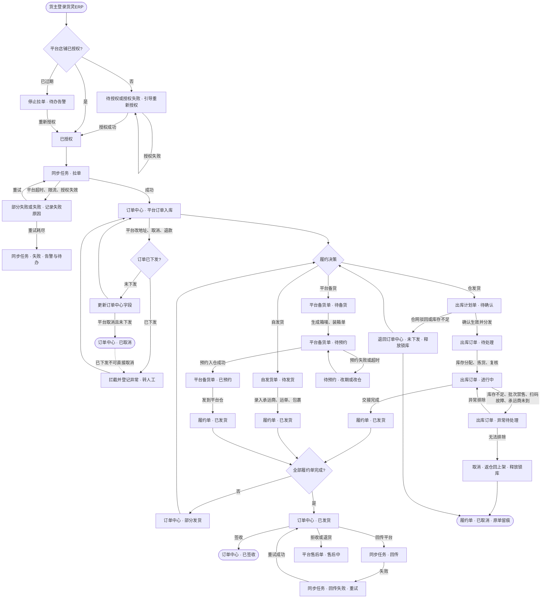
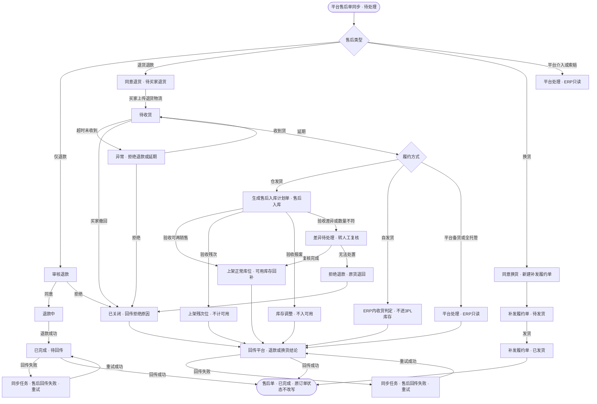

# ERP 订单体系与平台接入方案

**目标读者**：产品、原型维护人。
**核心目的**：为货灵ERP建立从平台店铺拉单、订单履约到售后的订单体系，并明确原型落点。
**前提**：单实例单主体，不做 SaaS；货主是业务维度；原型是自包含 HTML，不实现真实平台接口、队列、限流与资金对账。

## 1. 定位与边界

- 订单主入口是平台店铺拉单，不是手工录单。手工单只做补录，不做体系主干。
- 平台接入是软件产品能力，不是给某个货主做的定制集成。同一套软件交付多个部署，每个部署单主体，适配器随产品版本发布。
- 平台差异按「平台 × 订单类型」配置，不按平台建实体，也不把 Amazon、速卖通、Temu 的规则写进页面。
- 履约方式分三类：仓发货、自发货、平台备货。订单中心与履约单是聚合视图，不建第二份真相。
- ERP 不接管 3PL 库存账：仓发货由出库计划单锁库，自发货不校验在仓库存。

## 2. 订单分层

| 层 | 内容 | 是否持有业务真相 |
| --- | --- | --- |
| 渠道单 | 平台订单、商城订单、代发采购单、手工订单（补录） | 是，保留各自原始状态与字段 |
| 履约单 | 一次发货一条，记录来源单、履约方式、执行单号、包裹与运单 | 视图，不单独建表 |
| 执行单 | 出库计划单（仓发货）、自发货单（自发货）、平台备货单（平台备货） | 是，三类执行单各自持有状态 |
| 订单中心 | 跨渠道、跨店铺的订单聚合视图 | 视图，不单独建表 |

订单中心按来源单号聚合履约单，形成「未下发 / 待发货 / 部分发货 / 已发货 / 已签收 / 售后中 / 已取消」的履约状态。一个渠道单可以对应多张履约单，履约单号不再只存一个。

## 3. 平台 × 订单类型

平台订单不是同质实体。订单类型决定履约责任方、备货位置、发货对象、面单来源、承运商规则、时效、状态映射与退货归属。

| 平台 / 类型 | 履约责任 | 货发到哪 | 面单来源 | 执行落点 |
| --- | --- | --- | --- | --- |
| 速卖通 全托管 | 平台 | 平台仓 / 集货仓 | 平台 | 平台备货单 |
| 速卖通 半托管 | 卖家 | 终端消费者 | 平台生成 | 自发货单或出库计划单 |
| 速卖通 自营 / POP | 卖家 | 终端消费者 | 卖家自备 | 自发货单或出库计划单 |
| Amazon FBA | 平台 | Amazon 仓 | 平台 | 平台备货单 |
| Amazon FBM | 卖家 | 终端消费者 | 卖家自备 | 自发货单或出库计划单 |
| Temu 全托管 | 平台 | Temu 仓 | 平台 | 平台备货单 |
| Temu 半托管 | 卖家 | 终端消费者 | 平台 / 卖家 | 自发货单 |

「平台订单类型」配置按 `platformCode + orderTypeCode` 维护，至少包含：

| 配置项 | 作用 |
| --- | --- |
| 履约责任方 | 平台 / 卖家 |
| 备货位置 | 平台仓 / 自有仓 / 3PL 仓 |
| 发货对象 | 终端消费者 / 平台仓 / 集货仓 |
| 面单来源 | 平台生成 / 卖家自备 / 仓配 |
| 承运商规则 | 平台指定 / 卖家自选 |
| 发货时限、揽收时限 | 驱动倒计时与异常 |
| 平台状态映射 | 平台原始状态 → ERP 统一状态 |
| 退货归属 | 平台仓 / 卖家 / 3PL 仓 |
| 结算方式 | 平台代收 / 卖家直收 / 代发结算 |

订单只存类型编码，页面动作、必填字段、状态映射、退货路径由配置与能力矩阵驱动。

## 4. 三类履约方式

| 方式 | 适用订单 | 执行单 | 库存口径 | 发货凭证 |
| --- | --- | --- | --- | --- |
| 仓发货 | 卖家履约、货在 3PL 仓 | 出库计划单 → 出库订单 → 工序单 | 提交锁库，交接扣减 | 交接回写承运商与运单 |
| 自发货 | 卖家履约、货在自有仓或供应商 | 自发货单 | 不校验 3PL 库存 | 货主录入承运商、运单、包裹 |
| 平台备货 | 全托管 / FBA，货发平台仓 | 平台备货单 → 出库计划单（平台备货出库） | 3PL 仓发货时锁库；自有仓不锁 | 箱唛、装箱单、入仓预约号，不产生消费者运单 |

一对多规则：

- 一个渠道单可以拆多张履约单，按商品行、仓库或包裹拆分。
- 履约单发货后回写渠道单的履约进度；全部履约单完成才转「已发货」。
- 部分发货时渠道单停在「部分发货」，未发部分可继续履约、补发或取消。
- 退换货补发新建履约单，不改写原履约单；原履约单留痕不可删。

## 5. 平台接入

### 5.1 店铺授权

- 「平台店铺」是外部平台店铺主档，与货源商城的「商城店铺」分开，不复用 `店铺.md`。
- 一个货主可以有多个平台、多个店铺；授权按店铺隔离，子账号只能看授权范围内的店铺。
- 授权状态：待授权 / 已授权 / 即将过期 / 已过期 / 已撤销 / 授权失败。
- 未授权或授权过期的店铺不拉单；已拉到的订单与进行中的履约不受影响。
- 应用凭证按部署配置，存在客户侧；货主只做店铺授权，看不到 App Secret。

### 5.2 拉单

- 每店一条队列，平台级限流，全局并发上限；店与店公平调度。
- 同步任务记录：任务号、店铺、同步类型（拉单 / 回传 / 售后）、触发方式、时间窗、状态、成功数、失败数、失败原因、重试次数。
- 幂等键：`shopCode + platformOrderNo`、`platformAfterSaleNo`、`waybillNo`。
- 拉单只写订单中心，不自动下发履约；下发仓库、自发货、平台备货由订单中心动作触发。
- 平台状态变更、地址变更、取消在订单未下发时更新；已下发时拦截并登记异常，转人工处理。
- 同步失败是正式状态，不是异常字段：部分失败、失败、重试耗尽、告警与待办都要可查。

### 5.3 售后同步

- 平台售后单记录：平台售后号、原订单、售后类型、原因、金额、状态、退货物流、处理时限、处理结果、回传状态。
- 售后类型：仅退款 / 退货退款 / 换货 / 平台介入 / 索赔。
- 售后状态：待处理 / 待买家退货 / 待收货 / 退款中 / 已完成 / 已关闭 / 平台介入。
- 分支按履约方式：
  - 仓发货：退货生成售后入库计划单，验收后按可再销售 / 残次 / 报废处置。
  - 自发货：ERP 内闭环，收货与质检可选，不进 3PL 库存。
  - 平台备货 / 全托管：平台处理，ERP 只读。
- 售后不改写原订单终态，原订单与原履约单留痕；退款金额与订单金额对账，部分退款单独记录。

## 6. 状态与聚合

| 层 | 状态 |
| --- | --- |
| 渠道单（平台订单） | 未下发 / 待发货 / 部分发货 / 已发货 / 已签收 / 售后中 / 已取消 |
| 履约单 | 待发货 / 已发货 / 已签收 / 已取消 / 异常 |
| 出库计划单 | 草稿 / 待确认 / 已生效 / 已分发 / 已关闭 |
| 平台备货单 | 待备货 / 待预约 / 已预约 / 已发货 / 平台收货 / 已完成 / 已取消 |
| 自发货单 | 待发货 / 已发货 / 已签收 / 已取消 |
| 平台售后单 | 待处理 / 待买家退货 / 待收货 / 退款中 / 已完成 / 已关闭 / 平台介入 |

平台原始状态必须保留，统一状态只用于 ERP 聚合与待办。映射按「平台 × 订单类型」维护，不能一张表包所有平台。

## 7. 取消、部分发货与逆向

- 未下发：可直接取消渠道单，不产生履约单。
- 已下发未拣货：仓发货取消出库计划单并释放锁库；自发货取消自发货单；平台备货取消备货单。
- 已拣货未交接：先返仓回上架、释放锁库，再取消；任务行与扫码原值留痕。
- 已交接：不可取消，只能走平台售后或退货退仓，生成逆向入库计划单。
- 部分发货：已发部分不可撤回；未发部分可继续履约或取消；渠道单保持「部分发货」直到全部履约单收口。
- 售后逆向：仓发货退货回 3PL 仓；自发货退货回自有仓；全托管 / FBA 退货回平台仓，ERP 只读。

## 8. 页面映射与信息架构

### 8.1 信息架构与一级菜单

一级菜单按信息线索分，不按单据类型或模块名分：一个菜单只回答一个问题，同一线索的页面放一起，配置与账号类不插在业务动线中间，单段不超过 5 页。

| 序 | 一级菜单 | 回答的问题 | 页面 |
| --- | --- | --- | --- |
| 1 | 工作台 | 今天要处理什么 | 货主工作台 |
| 2 | 订单 | 客户与平台下了什么单 | 订单中心、平台订单、代发采购单 |
| 3 | 履约 | 这批货怎么发、发到哪 | 履约单、平台备货单、自发货单、物流跟踪 |
| 4 | 售后 | 退换怎么处理 | 平台售后单、退货申请 |
| 5 | 仓储委托 | 我交给仓里的活到哪了 | 入库计划单、出库计划单、调拨申请、委托单据中心 |
| 6 | 异常与对账 | 哪里对不上、谁来处理 | 异常队列、对账差异 |
| 7 | 库存 | 我还有多少货、在哪 | 本货主库存总览、本货主库存查询、本货主库存台账、批次效期查询 |
| 8 | 商品 | 我卖什么 | 本货主商品查询、商品资料变更申请 |
| 9 | 商城店铺 | 我在商城怎么卖 | 我的店铺、店铺商品、店铺价格、店铺订单、企业资质认证 |
| 10 | 平台接入 | 数据从哪个平台来 | 平台店铺、同步任务 |
| 11 | 账单与服务 | 我要付或收多少钱 | 本货主费用账单、费用规则查看、服务费账单、仓储服务 |
| 12 | 报表与设置 | 经营怎么样、账号怎么管 | 货主数据报表、子账号与权限、角色权限、操作日志 |

导航只改 `apps[].nav` 与 `apps[].rail`，不改页面归属与模块目录；首栏按业务域归并段，面板按段列页，不再有页头页签。新增页面先判断回答哪个问题，再放入对应段；单段超过 5 页时拆段。订单 360 不单独占页，挂在订单中心抽屉；对账差异是新增页，归「异常与对账」段。

### 8.2 页面映射

| 页面 | 模块 / key | 说明 |
| --- | --- | --- |
| 平台店铺 | `owner/platform-shop-list` | 授权状态、凭证到期、最近同步；授权、重新授权、解除授权 |
| 对账差异 | `owner/reconciliation-list` | 平台单、ERP 单、履约/运单、账单/售后四单差异；转异常、确认、关闭 |
| 同步任务 | `owner/sync-task-list` | 拉单 / 回传 / 售后任务、成功失败数、失败原因、重试 |
| 订单中心 | `owner/order-center` | 多平台多店铺订单聚合、订单类型、履约方式、履约状态 |
| 履约单 | `owner/fulfillment-list` | 一次发货一条，展示一单多履约与部分发货 |
| 平台备货单 | `owner/platform-replenish-list` | 箱唛、装箱单、预约号、发到平台仓 |
| 自发货单 | `owner/selfship-list` | 承运商、运单、包裹、发货时间 |
| 平台售后单 | `owner/platform-aftersale-list` | 售后处理、退货物流、退款、生成售后入库计划单 |

现有页面改造：平台订单加订单类型与三种下发动作；物流跟踪加来源单据；出库计划单补收货信息与平台备货出库类型；工作台加接入与履约待办；货灵WMS出库订单详情补收货方、预约号、箱唛。

## 9. 分批与验收

1. 文档与文案：问答记录、本方案、数据字典、`glossary.md`、`registry.md`、索引与日志。
2. 平台接入：平台店铺、同步任务、平台店铺主档、平台接入导航。
3. 订单与履约：订单中心、履约单、平台订单改造。
4. 发货执行：平台备货单、自发货单、出库计划单、物流跟踪、工作台、货灵WMS详情。
5. 售后：平台售后单、售后入库计划单回指、工作台售后待办。
6. 收尾：五端重建、全量验收、A/B 清单、`module.json`、文档日志回填。

## 10. 流程图

### 10.1 订单履约主链

### 10.2 售后逆向链

