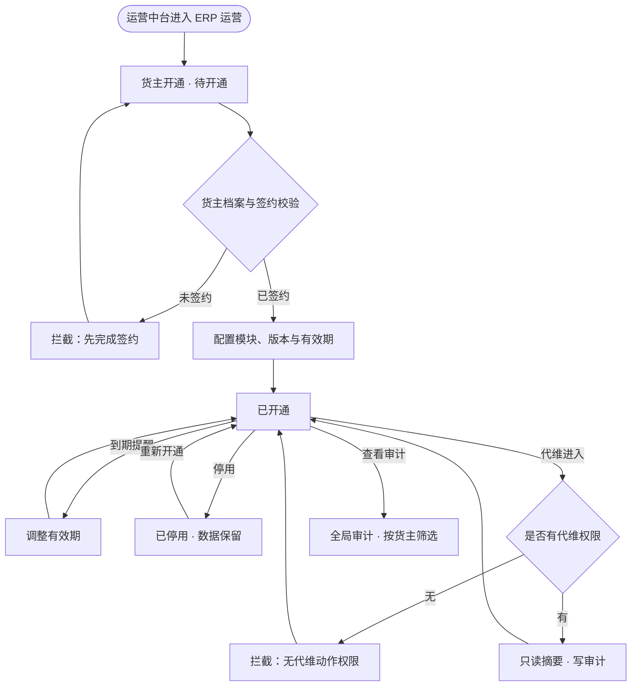
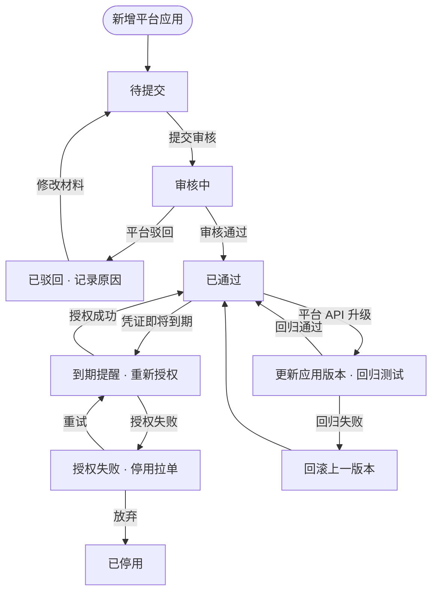

# ERP 运营后台方案

**目标读者**：产品、原型维护人。
**核心目的**：在货灵运营中台管理端补齐面向软件运营方的 ERP 运营后台，管货主开通、模块与版本、平台应用、同步健康与全局审计。
**前提**：单实例单主体，不做 SaaS 多租户；概念上是租户运营，产品文案统一写「货主开通」，不使用「租户」「订阅」「套餐」「续费」。

## 1. 定位与边界

- 货灵运营中台管理端 = 3PL 运营方的统一后台，分「仓网运营」与「ERP 运营」两块。
- 货灵ERP = 货主业务后台，管订单、履约、售后、仓储委托、库存、商品、商城店铺、平台接入、账单、报表、子账号与角色。
- 仓网运营 = 总览、仓网档案、仓网调度、库存、商品、作业资源、商城、账号与权限、服务与设置。
- ERP 运营 = 货主开通、模块与版本、平台应用、同步健康、全局审计、代维入口。

硬边界：

- 运营中台不管理货主子账号与货主角色；货主账号只在货灵ERP建。
- ERP 运营只读货主级汇总与审计，不进入货主业务页，不持有货主业务数据。
- 代维只做只读摘要与提示，动作留审计，不实现真实跨端登录。
- 全局审计允许出现「货灵ERP」端；「账号与权限 → 操作日志」只保留运营中台、货灵WMS、PDA 日志，不出现货灵ERP。

## 2. 页面映射

| 页面 | 模块 / key | 说明 |
| --- | --- | --- |
| 货主开通 | `erp-ops/erp-tenant-list` | 货主编码、货主名称、签约状态、ERP 状态、模块数、版本、有效期、店铺数、账号数、最近活跃；开通/停用、调整有效期、模块配置、代维进入、查看审计 |
| 模块与版本 | `erp-ops/erp-module-list` | 模块、模块编码、当前版本、适用端、已开通货主数、状态、更新时间；启用/停用、查看开通明细、更新版本 |
| 平台应用 | `erp-ops/erp-app-list` | 平台、应用类型、App Key、授权方式、回调地址、能力范围、限流、审核状态、应用版本；查看凭证、测试连接、更新版本、停用 |
| 同步健康 | `erp-ops/erp-sync-health` | 货主、店铺、平台、最近成功、积压、错误率、授权到期、状态；查看任务、重试、告警设置 |
| 全局审计 | `erp-ops/erp-global-audit` | 时间、货主、操作人、端、模块、动作、对象编号、结果、IP；按货主/端/模块/动作/时间筛选 |

导航：货灵运营中台管理端「ERP 运营」段，放在「商城」之后、「账号与权限」之前；五页。

## 3. 货主开通

状态：待开通 → 已开通 → 已停用。

- 待开通：已建货主档案但未开放货灵ERP；可开通。
- 已开通：可登录货灵ERP，按模块与数据范围使用。
- 已停用：停止货灵ERP访问，已有数据保留；可重新开通。
- 调整有效期只改 `expireDate`，不自动停用；到期前由运营中台提醒。
- 模块配置只决定货主可见的模块，不写货主业务数据。
- 代维进入打开只读摘要，提供「进入代维（原型示意）」并留审计；不跳转货主业务页。

## 4. 模块与版本

- 模块按 `moduleCode` 唯一，`currentVersion` 是软件版本（如 `2026.11`），不是商业套餐。
- 适用端：货灵ERP、货灵运营中台管理端、货灵WMS、货灵商城。
- 停用模块只影响新开通，不影响已有数据；已开通货主数用于判断影响面。
- 更新版本只改版本号与更新时间，不自动改货主配置。

## 5. 平台应用

- 部署级应用，凭证由部署运维维护；货主只做店铺授权，看不到 App Secret。
- 字段：平台、应用类型、App Key（脱敏）、授权方式、回调地址、能力范围、限流、审核状态、应用版本。
- 审核状态：待提交 / 审核中 / 已通过 / 已驳回 / 已停用。
- 能力范围决定页面动作：不支持面单的店铺不显示获取面单；不支持售后写回的店铺只读。
- 应用版本随软件发布更新；平台 API 变更不得到客户现场改代码。

## 6. 同步健康与全局审计

同步健康：

- 按店铺汇总最近成功、积压、错误率、授权到期与健康状态（正常 / 延迟 / 异常 / 未授权）。
- 只读视图，重试与告警设置不改变店铺授权状态；异常按授权、限流、失败原因排查。
- 单店明细仍看货灵ERP「同步任务」，本页不复制任务行。

全局审计：

- 跨货主只读审计，覆盖货灵ERP、运营中台、货灵WMS、PDA。
- 可按货主、端、模块、动作、时间筛选；不提供删除。
- 与运营中台「账号与权限 → 操作日志」分开：后者只看运营中台/WMS/PDA，不出现货灵ERP。

## 7. 流程图

### 7.1 货主开通、停用与代维

### 7.2 平台应用审核、过期与重试

## 8. 原型落点与验收

- 五页均为 `list` 骨架，不新增组件；页面源在 `prototypes/erp-ops/`，数据在 `prototypes/erp-ops/data/`。
- 代维、测试连接、重试、告警设置只做 toast；不实现真实 OAuth、token、API、队列与限流。
- 货主开通页不出现 `ow.*` 货主账号操作；运营中台账号页也不出现货主账号。
- 验收：五页可开、页签可筛；运营中台账号 7 行、无货主账号；账号日志无货灵ERP，全局审计可出现货灵ERP；货灵ERP数据不变。
