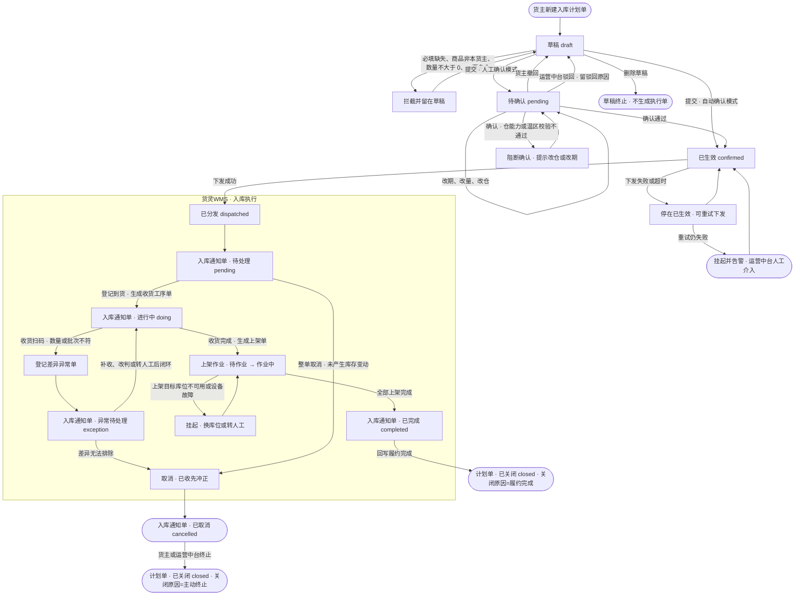
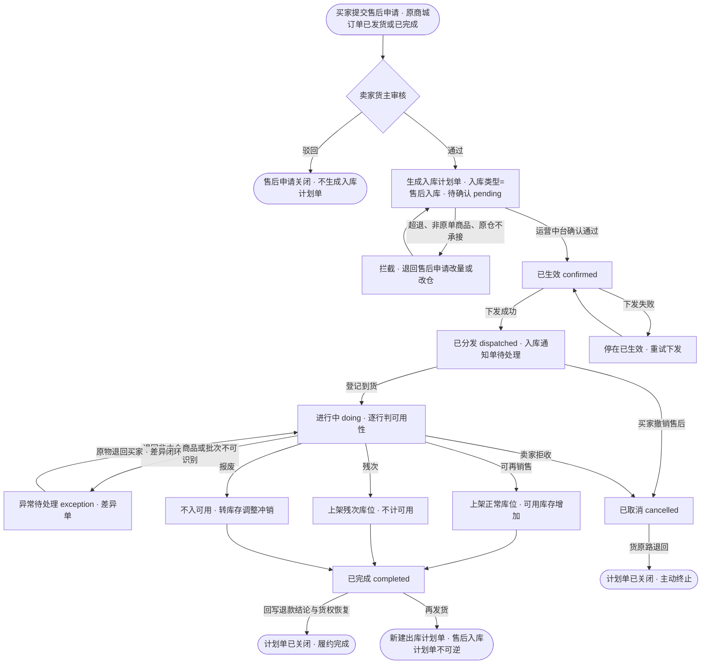
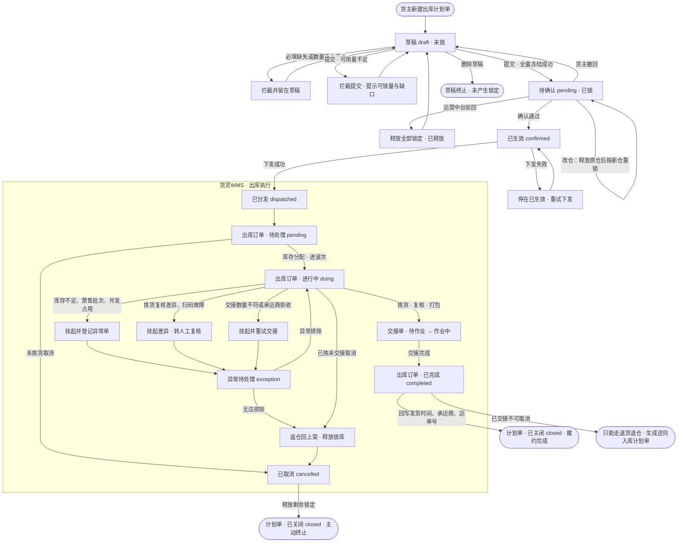
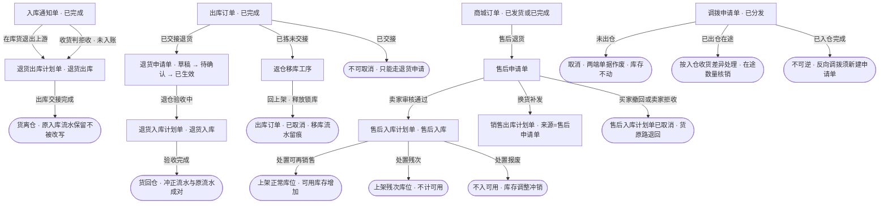

# 出入库计划单状态流转与逆向流程

> 状态：草案｜日期：2026-11-07
> 术语：货主视角说的「入库单」「出库单」就是入库计划单、出库计划单（L1 委托层，主键 `planNo`）；仓内执行层分别叫入库通知单、出库订单，沿用同一 `planNo`。全文与原型不把两层混称。
> 真值源：[入库计划单](../数据字典/入库计划单.md)、[入库通知单](../数据字典/入库通知单.md)、[出库计划单](../数据字典/出库计划单.md)、[出库订单](../数据字典/出库订单.md)、[工序单](../数据字典/工序单.md)、[退货申请单](../数据字典/退货申请单.md)、[差异异常单](../数据字典/差异异常单.md)、[库存台账](../数据字典/库存台账.md)、[商城订单](../数据字典/商城订单.md)
> 分层口径：[计划单与时效协议方案.md](计划单与时效协议方案.md) 第 2 节与第 4 节
> 状态中文名与英文值逐字取上列字典与 `.codebuddy/skills/huoling-proto/references/core/glossary.md`，不另造状态名。本文新增的枚举（入库类型「售后入库」、来源单据类型「售后申请单」、处置结果、关闭原因）已同步登记字典与 glossary。

## 1. 三层单据与两套状态

### 1.1 层级分工

| 层级 | 单据 | 主键 | 状态字段 | 谁推进 | 数量口径 |
| --- | --- | --- | --- | --- | --- |
| L1 委托层 | 入库计划单 / 出库计划单 | `planNo` | `planStatus` 五态 | 货主建单、运营中台确认、系统下发 | `planQty` 计划数量 |
| L2 执行层 | 入库通知单 / 出库订单 | 沿用 `planNo` | `docStatus` 五态 | 货灵WMS | `receivedQty` / `shippedQty` 等实绩 |
| L3 作业层 | 工序单、任务 | `processNo` / 任务号 | `processStatus` 五态 | 人员或设备 | `doneQty` 完成数量 |

一票一仓：`targetWarehouse` 定在单头，一张计划单只落一座实体仓，确认即下发，1:1 落一张执行单，编号不变。

### 1.2 两套状态互不覆盖

`planStatus` 只回答「委托受理到哪一步、下发没有」，`docStatus` 只回答「仓内执行到哪一步」。两者不共用一张状态表，也不互相改写：

- 执行单取消不回滚计划单，计划单停在「已分发」，取消原因记在执行单上（[计划单与时效协议方案.md](计划单与时效协议方案.md) 第 4 节第 5 条）。
- 执行单完成不自动改写 `docStatus` 以外的派生字段，计划单的已收与上架进度从工序单汇总。
- 计划单「已生效」只在确认后下发失败时停留，属异常态，不是稳态。

### 1.3 数量派生规则

`docStatus` 由数量与差异闭环派生，不靠人工点选；页签上的状态随收货、上架、拣货、交接的实绩重算。

| 派生状态 | 判定条件 |
| --- | --- |
| 待处理 `pending` | 无工序单开工，实绩数量为 0 |
| 进行中 `doing` | 已有工序单开工，或 0 < 实绩数量 < 计划数量，且无未闭环异常单 |
| 异常待处理 `exception` | 存在未闭环差异异常单（收货差异、批次不符、串货、破损、拣货复核差异、交接差异），优先级高于进行中 |
| 已完成 `completed` | 全部行收货完成且上架完成（入库），或全部行交接完成（出库），且无未闭环异常单 |
| 已取消 `cancelled` | 人工或上游发起取消，不由数量派生 |

差异单闭环后回「进行中」；差异无法排除时才走取消。取消与完成都是终态，进入后不再被数量派生改写。

## 2. 入库计划单（含售后入库）

### 2.1 计划单状态机

入库类型取 `bizType`：采购入库 / 调拨入库 / 退货入库 / 加工入库 / 售后入库。入库不锁库，计划单提交只做仓能力与商品归属校验。

| 状态 | 进入条件 | 可做动作 | 留痕 | 可逆性 |
| --- | --- | --- | --- | --- |
| 草稿 `draft` | 货主新建或保存草稿 | 编辑、提交、删除 | 创建人、创建时间 | 可编辑、可删除；删除即终止，不生成执行单 |
| 待确认 `pending` | 货主提交，人工确认模式 | 运营中台确认、驳回、改期、改量、改仓；货主撤回 | 提交人、提交时间、驳回原因 | 可撤回或驳回，均回草稿 |
| 已生效 `confirmed` | 运营中台确认通过，同一次操作内下发 | 重试下发；查看 | 确认人、确认时间 | 下发失败才停留，可重试；不可退回待确认 |
| 已分发 `dispatched` | 下发成功，生成入库通知单 | 查看执行单；关闭 | 下发时间、`slaCode` 与 `slaDueTime` 快照 | 不可退回；改仓改量只能驳回重提后重新确认 |
| 已关闭 `closed` | 履约完成或货主、运营中台终止 | 查看 | `closeReason`（履约完成 / 主动终止）、关闭人、关闭时间 | 终态 |

人工确认模式下的顺序：`草稿 → 待确认 → 已生效 → 已分发`。自动确认模式下「提交」一个动作连跳三态，`confirmed` 只是瞬态。「已分发」之后的推进全部发生在执行层，计划单不再变化；履约完成后由系统写 `closed` 并记 `closeReason=履约完成`，与货主主动终止的关闭分开统计。

### 2.2 执行单状态机（入库通知单）

| 状态 | 进入条件 | 可做动作 | 留痕 | 可逆性 |
| --- | --- | --- | --- | --- |
| 待处理 `pending` | 计划单下发落单 | 登记到货、生成收货工序单、整单取消 | 落单时间、`arrivalCount` 初始 0 | 可取消，未产生库存变动 |
| 进行中 `doing` | 首次登记到货或首张收货工序单开工 | 收货验收、拆任务、生成上架单、部分收货后等后续到货 | `receivedQty`、`acceptedQty`、`rejectedQty`、`arrivalCount` 逐次累加 | 可回退到待处理（撤销未完成的到货登记）；已入账部分不可撤 |
| 异常待处理 `exception` | 登记差异异常单且未闭环 | 补收、改判、退仓、转人工复核、取消 | 异常单号、差异数量、扫码原值 | 处置完回进行中；无法排除走取消 |
| 已完成 `completed` | 全部行收货完成且上架完成，无未闭环异常 | 查看、导出 | 完成时间、上架单号、`ledgerNo` | 终态，库存变动走冲正，不回退单据 |
| 已取消 `cancelled` | 货主或运营中台终止；已入账部分先冲正再取消 | 查看 | 取消原因、取消人、取消时间 | 终态 |

入库「已完成」的两个必要条件分开看：数量条件看 `receivedQty` 与 `acceptedQty`，作业条件看全部上架单是否完成。上架未完成时单据停在进行中，即使货已全部收进暂存区。

### 2.3 工序单与任务

| 层级 | 状态 | 说明 |
| --- | --- | --- |
| 收货单 / 上架单 | 待作业 / 作业中 / 异常待处理 / 已完成 / 已取消 | 一道工序一张，按到货批次或目标库区组织，可跨多张 `planNo` |
| 任务 | 待作业 / 作业中 / 异常 / 已完成 | 一份任务只归一个执行主体（人员或设备），不跨库区 |

数量汇总方向是单向的：任务完成量汇总到工序单 `doneQty`，工序单汇总到执行单实绩，执行单不改写计划单。上架是位置变化，不重复计入 `receivedQty`。

### 2.4 入库计划单流转图

### 2.5 售后入库

#### 适用场景

商城买家货主签收后申请退货、拒收退回、换货返回，或仅退款但货已发出需要回收。货从买家处返回卖家货主的仓，货权回到卖家货主。售后入库是入库计划单的一种 `bizType`，不是独立单据。

#### 与其它入库类型的差异

| 维度 | 采购入库 | 退货入库 | 售后入库 |
| --- | --- | --- | --- |
| 发起方 | 货主 | 货主 | 商城买家发起，卖家货主承接 |
| 来源单据 | 采购单 | 原出库计划单 | 售后申请单，回指原商城订单与原出库计划单 |
| 货权变化 | 供应商 → 货主 | 外部客户 → 货主 | 买家货主 → 卖家货主 |
| 目标仓 | 货主任选一仓 | 原发货仓或协议指定退货仓 | 固定为原发货仓，不可改仓 |
| 数量上限 | 计划数量 | 原出库数量 | 原出库行退货数量，按行校验，不得超退 |
| 收货判定 | 质检、验收 | 验收 | 必须做可用性判定：可再销售 / 残次 / 报废 |
| 库存去向 | 正常库位 | 正常库位 | 按判定分库位：可再销售进正常位，残次进残次位，报废不入可用库存 |
| 状态联动 | 无 | 原出库计划单留痕、台账冲正 | 回写售后申请单的退款结论，不改写原商城订单状态 |

三条硬约束：

1. 售后入库计划单只由售后申请单生成，不允许货主手工新建。手工补录的走退货入库。
2. 按原出库仓拆单，同一仓生成一张入库计划单；一张售后申请单跨仓退回时生成多张，买家分批寄回按到货事件累计，不再按批次拆单。
3. 收货判定结果写执行单明细行，退货数量与判定结果一并回写售后申请单，作为退款金额与货权恢复的依据。

#### 全生命周期

| 阶段 | 动作 | 状态变化 |
| --- | --- | --- |
| 生成 | 售后申请单审核通过，系统按原出库行生成入库计划单，`bizType=售后入库`，`sourceDocType=售后申请单` | 计划单直接进待确认，不经草稿；来源单据不可编辑 |
| 受理 | 运营中台确认，校验原发货仓承接能力与退货数量 | 待确认 → 已生效 → 已分发 |
| 到货 | 单仓登记到货，生成收货工序单 | 通知单待处理 → 进行中 |
| 验收 | 逐行判可用性，写 `disposalResult` 与 `acceptedQty`、`rejectedQty` | 进行中 |
| 判定差异 | 退回非本仓商品、批次无法识别、数量与原单不符 | 进行中 → 异常待处理 |
| 上架 | 可再销售进正常库位，残次进残次位，报废转库存调整 | 进行中 → 已完成 |
| 联动 | 完成后回写售后申请单退款结论与货权恢复；合格与残次部分写正向入账流水，原出库流水不删 | 已关闭 · 履约完成 |

报废不走入库记账：收货时判报废的数量记 `rejectedQty`，转库存调整冲销，不入可用库存，台账留痕但不产生正向存货。

#### 异常与逆向

| 场景 | 触发 | 处理 | 归宿 |
| --- | --- | --- | --- |
| 超退 | 累计退回数量超原出库行数量 | 系统按行拦截提交，提示可退量 | 停在待确认，货主改量 |
| 错货 | 退回商品非本货主或非原单商品 | 登记差异单，货不入库，原物退回买家 | 异常待处理，闭环后回进行中 |
| 短少 | 买家少寄或运输丢件 | 按实收完成，差额登记差异单，售后申请单按实收结算 | 已完成，差额留痕 |
| 破损 | 运输破损或买家使用痕迹 | 判残次或报废，按判定分库位或转调整 | 已完成，`disposalResult` 留痕 |
| 买家撤回 | 买家在货到仓前撤销售后 | 取消未开工的计划单或执行单 | 已取消，计划单已关闭 · 主动终止 |
| 卖家拒收 | 卖家货主判定不符合退货条件 | 运营中台取消执行单，货原路退回 | 已取消，售后申请单回待处理 |
| 已完成后再退 | 售后入库已完成 | 不可逆，只能新建出库计划单把货发出 | 终态 |

售后退货不改写商城订单状态：商城订单「已完成」是终态，售后只另立逆向单据，原订单行与履约单号留痕不删。

#### 售后入库流转图

## 3. 出库计划单

### 3.1 计划单状态机

出库类型取 `bizType`：销售出库 / 调拨出库 / 退货出库 / 加工出库。出库与入库的最大差别是提交即锁库，锁库与状态是两条并行的线。

| 状态 | 进入条件 | 可做动作 | 留痕 | 可逆性 |
| --- | --- | --- | --- | --- |
| 草稿 `draft` | 货主新建或保存草稿 | 编辑、提交、删除 | 创建人、创建时间 | 可编辑、可删除，无锁定 |
| 待确认 `pending` | 提交且可用量校验通过，全量冻结 | 运营中台确认、驳回、改期、改量、改仓；货主撤回 | 提交人、提交时间、锁定量、驳回原因 | 可撤回或驳回，均释放锁定 |
| 已生效 `confirmed` | 运营中台确认通过，同一次操作内下发 | 重试下发；查看 | 确认人、确认时间 | 下发失败才停留；不可退回待确认 |
| 已分发 `dispatched` | 下发成功，生成出库订单 | 查看执行单；关闭剩余 | 下发时间、`slaCode`、`slaDueTime` 快照 | 不可退回；改量只能新建计划单 |
| 已关闭 `closed` | 履约完成或终止 | 查看 | `closeReason`、关闭人、关闭时间 | 终态 |

### 3.2 锁库与计划单的正交关系

`lockStatus`（未锁 / 已锁 / 已释放）是列，不是页签，不参与 `planStatus` 判定。

| 时机 | 锁库动作 | `planStatus` |
| --- | --- | --- |
| 保存草稿 | 不锁 | 草稿 |
| 提交 | 按商品 × 批次 × 仓全量校验并冻结，不足不允许提交 | 待确认，已锁 |
| 改量 | 差额补锁或释放 | 待确认，已锁 |
| 改仓 | 先释放原仓锁定，再按新仓重锁 | 待确认，已锁 |
| 撤回、驳回 | 释放全部锁定 | 草稿，已释放 |
| 确认并下发 | 锁定延续，不重复锁 | 已分发，已锁 |
| 拣货出库 | 锁定量随拣货扣减 | 已分发，已锁 |
| 关闭、取消 | 释放剩余锁定 | 已关闭，已释放 |

### 3.3 执行单状态机（出库订单）

| 状态 | 进入条件 | 可做动作 | 留痕 | 可逆性 |
| --- | --- | --- | --- | --- |
| 待处理 `pending` | 计划单下发落单 | 库存分配、进波次、整单取消 | 落单时间 | 未拣货可直接取消 |
| 进行中 `doing` | 分配完成或拣货单开工 | 拣货、复核、打包、交接 | `allocQty`、`pickedQty`、`shippedQty`、`packageCount` | 未交接可返仓取消；已交接不可取消 |
| 异常待处理 `exception` | 拣货差异、复核差异、库存不足、禁售批次、扫码故障、交接差异 | 重试、换批次或库位、转人工复核、取消 | 差异单号、扫码原值 | 处置完回进行中；无法排除走返仓取消 |
| 已完成 `completed` | 全部行交接完成，无未闭环异常 | 查看、导出 | `waybillNo`、`handoverNo`、`shipTime` | 终态，只能走退货逆向 |
| 已取消 `cancelled` | 未拣货直接取消，或已拣货返仓后取消 | 查看 | 取消原因、返仓记录、冲正流水号 | 终态 |

取消按已完成程度分三档，这是出库订单与入库通知单最大的结构差别：

| 档位 | 条件 | 处理 | 数据留痕 |
| --- | --- | --- | --- |
| 未拣货 | 无拣货记录 | 直接取消，释放锁库 | 单据行保留，状态转已取消 |
| 已拣货未交接 | 有拣货记录、未生成交接单 | 先返仓回上架（移库工序），释放锁库，再取消 | 任务行、扫码原值、返仓移库流水全部保留 |
| 已交接 | 交接单已完成 | 不允许取消，只能由买家拒收或走退货退仓 | 原单不删，生成逆向入库计划单 |

商城订单履约状态下，出库订单异常待处理期间商城订单停在「待发货」并提示，不自行跳到已发货或已取消；已交接后商城订单转「已发货」，取消只能走拒收或退货。

### 3.4 出库计划单流转图

## 4. 异常场景

### 4.1 数量类异常

数量异常统一在扫码环节拦截，不留到复核或对账阶段发现。已发生的一律走差异异常单，不物理删除原行。

| 场景 | 触发条件 | 处理动作 | 单据落点 | 库存与台账 |
| --- | --- | --- | --- | --- |
| 超收 | 行实收累计 > 行计划数量 | 默认零容差，超出部分扫码即拦截，按拒收处理；确需收货的，由货主另开一张计划单补收，原单不超收记账 | 通知单异常待处理，差异单类型=收货差异 | 只按 `acceptedQty` 入账，超出部分不入可用，暂存隔离 |
| 短收 | 行实收 < 行计划数量，且到货结束 | 分两种：行未完结则保持进行中等后续到货；货主确认按实收结案则按实收完成 | 进行中（等到货）或已完成（结案） | 按 `acceptedQty` 入账，差额不补账 |
| 超发 | 行已拣或已发 > 行计划数量 | 拣货扫码与复核双拦截；已交接的按实际交接记账，差额登记差异单，货主补开计划单或按冲销处理 | 异常待处理，差异单类型=破损丢失 或费用对账 | 已交接按实发记账，差额冲正留痕 |
| 短发 | 行已发 < 行计划数量，且交接完成 | 按实际交接完成，差额转差异单，货主选补发（新计划单）或结案 | 已完成，差异单未闭环时先停异常待处理 | 按 `shippedQty` 记账，未发部分释放锁定 |
| 拒收 | 验收不合格或货损 | 记 `rejectedQty`，货不入库，按退货出库退回上游或原路退回 | 进行中，差异单未闭环时停异常待处理 | 不入账，不占可用 |
| 批次不符 | 实物批次、效期与单据不一致 | 以实物为准改判批次，改判需复核确认；无法识别转人工 | 异常待处理 | 按改判批次入账，原批次值留痕 |

超收与超发默认零容差是本文确定的执行口径：计划单是货主的委托量，仓侧不代货主改承诺量。若后续要支持容差，需在仓库主档或时效协议里加容差字段，不在本条口径内。

### 4.2 单据挂起

挂起不是独立状态，统一落在「异常待处理」，差异单登记原因与责任方，SLA 计时不因挂起暂停。

| 挂起原因 | 触发 | 处理 | 归宿 |
| --- | --- | --- | --- |
| 库存不足或并发占用 | 分配时可用量被别的单占走 | 等释放、改批次或改库位、转人工调拨 | 进行中 |
| 禁售或临期批次 | 分配命中禁售批次 | 换批次；无替代批次转异常 | 进行中或取消 |
| 设备或扫码故障 | PDA 无响应、条码不可读 | 手工录单兜底，原扫码原值留痕 | 进行中 |
| 月台或库位占用 | 到货超出月台能力、目标库位满 | 改时段或改库位 | 进行中 |
| 承运商未到 | 交接等待超时 | 改派承运商或顺延 | 进行中 |
| 权限不足 | 操作人无该仓或该货主权限 | 转有权限作业人并留痕 | 进行中 |
| 货主叫停 | 货主要求暂停发货或收货 | 冻结任务，未完成部分回待作业 | 进行中或取消 |

### 4.3 执行中断

中断指作业中途停止：断电、系统故障、人员撤离、货主临时叫停、到货车辆中途返程。

处理原则是「已完成的算数、未完成的重排」，不回退已完成部分：

1. 已扫数量保留在任务行，任务转待作业或异常，不重扫已扫部分。
2. 已上架的货不回暂存区，除非库位错分需移库；已拣未复核的货返暂存区，已复核未交接的货留在发货区。
3. 执行单按已产生实绩重算 `docStatus`，中断不改变已完成行的数量口径。
4. 中断超过约定时限仍无法恢复，转异常待处理并通知货主，必要时走取消与返仓。

### 4.4 状态回退与反审核

回退不是任意跳态，只允许下表列出的回路；表外一律不允许回退。

| 回退动作 | 起点 | 条件 | 终点 | 数据影响 |
| --- | --- | --- | --- | --- |
| 撤回 | 计划单待确认 | 货主操作，运营中台未确认 | 草稿 | 出库释放全部锁定；入库无锁定变化 |
| 驳回 | 计划单待确认 | 运营中台操作，须填驳回原因 | 草稿 | 同上，驳回原因留痕 |
| 反审核 | 计划单已分发 | 未生成任何工序单，且无库存变动 | 待确认 | 出库需重新校验可用量并按新仓重锁；已生成的执行单一并作废 |
| 撤销到货登记 | 通知单进行中 | 该次到货尚未产生库存变动 | 待处理 | `arrivalCount` 回退，任务作废留痕 |
| 异常闭环 | 执行单异常待处理 | 差异单已处理或已驳回 | 进行中 | 差异结论写台账冲正 |
| 返仓 | 出库订单进行中 | 已拣未交接 | 已完成返仓后转已取消 | 返仓移库写流水，锁库释放 |

明确不可回退的环节：

- 已分发 → 待确认：除反审核条件外一律不可；已产生工序单或库存变动的不可。
- 已完成 → 进行中、已取消 → 任意态：终态不可逆，只能新建逆向单据。
- 出库已交接 → 取消：不可，只能退货退仓。
- 已入账的收货数量：不可通过改单冲销，只能走差异调整或冲正流水。

## 5. 逆向流程

### 5.1 逆向单据生成规则

| 逆向场景 | 生成单据 | 与原单关联字段 | 原单处理 | 台账 |
| --- | --- | --- | --- | --- |
| 收货拒收退回上游 | 出库计划单，`bizType=退货出库` | `sourceDocType=入库通知单`，`sourceDocNo=planNo` | 原入库通知单按合格数量完成，拒收数量留痕 | 不入账；退回出库时按实际发出记账 |
| 已入库后货主退货 | 出库计划单，`bizType=退货出库` | `sourceDocType=退货单`，`sourceDocNo` 取退货申请单号 | 不改写原入库计划单与入库通知单 | 出库流水与冲正成对 |
| 已出库后货主退货退仓 | 入库计划单，`bizType=退货入库` | `sourceDocType=退货单`，`sourceDocNo=returnNo` | 原出库计划单与出库订单不删，`returnNo` 关联 `sourcePlanNo` | 退仓验收写正向入账，原出库流水保留 |
| 商城售后退回 | 入库计划单，`bizType=售后入库` | `sourceDocType=售后申请单`，回指原商城订单与原出库计划单 | 原商城订单、出库计划单与出库订单不删，状态不回退 | 按处置结果入账或转调整 |
| 出库拣货后返仓 | 不新建出入库计划单，走库内移库工序 | 回指原 `planNo` 与任务号 | 出库订单最终转已取消 | 移库一出一入两条流水 |
| 调拨在途取消 | 调拨申请单取消，不生成新单据 | `outDocNo` / `inDocNo` 回指两端单据 | 已分发不可撤回 | 在途数量核销，两端库存还原 |

逆向单据的方向与终点：

三条通用规则：

1. 逆向单据一律新建、单独取号，不复制原单行；原单行、任务行、扫码原值、批次与时间戳不物理删除。
2. 逆向单据的 `targetWarehouse` 默认取原单仓；换仓需运营中台确认。
3. 逆向单据走与正向相同的计划单五态与执行单五态，不另立状态机。

### 5.2 入库退货（货主把在库货退出）

分两条路径，区别在货有没有入过账：

- 未入账拒收：收货验收判拒收，货仍在收货区，由运营中台开「退货出库」计划单原路退回，不入可用库存。原入库通知单按合格数量收口，拒收数量在差异单留痕。
- 已入账退货：货主发起退货申请，运营中台确认后生成「退货出库」计划单，走正常出库链路（分配、拣货、复核、交接）。出库流水与冲正成对，原入库流水不删。

退货数量按原入库合格数量校验，累计不得超过；已过效期或已报废的商品不允许再走退货出库，只能走库存调整。

### 5.3 出库退回

出库退回按执行程度分三档，档位决定是「返仓」还是「退货」：

| 档位 | 生成单据 | 状态联动 | 不可逆点 |
| --- | --- | --- | --- |
| 已分配未拣货 | 无新单据，直接取消出库订单 | 出库订单转已取消，锁库释放 | 取消后不可恢复，需重建出库计划单 |
| 已拣货未交接 | 无新单据，走返仓移库工序 | 出库订单转已取消，货回原库位或残次位 | 移库流水不可删 |
| 已交接 | 新建退货申请单，确认后生成退货入库计划单 | 退货申请单六态独立推进；原出库计划单保持已关闭 · 履约完成 | 原出库计划单不可取消、不可改量 |

退货申请单状态：草稿 → 待确认 → 已生效 → 退仓验收中 → 已完成，另有已取消。确认后生成逆向单据，验收写 `receivedQty` 与冲正流水号 `ledgerNo`，完成即回写。

### 5.4 售后逆向

售后链路里有两段逆向，方向相反，不能混成一条：

1. 买家退货回仓：售后申请单 → 售后入库计划单（`bizType=售后入库`）→ 验收判定 → 可再销售入正常库存，残次入残次位，报废转调整。
2. 换货补发：售后申请单审核通过后，另生成销售出库计划单发给买家，`sourceDocType=售后申请单`。补发单与退回单相互独立，退回未到仓不影响补发发货，但补发占用的可用量由退回判定结果回补。

售后逆向不改写原商城订单状态。原订单「已完成」或「已发货」保持原值，售后进度看售后申请单与售后入库计划单。买家撤回或卖家拒收时，售后入库计划单取消，货原路退回，售后申请单回待处理。

### 5.5 调拨逆向

调拨单的逆向按阶段判定，越往后越不可逆：

| 阶段 | 可逆动作 | 处理 |
| --- | --- | --- |
| 草稿、待受理 | 撤回或驳回 | 回草稿，不产生两端单据 |
| 已分发未出仓 | 取消调拨 | 作废两端单据，库存不动 |
| 已出仓在途 | 不可取消 | 按入仓收货差异处理：短收登记差异单，在途数量核销，差额挂责任方 |
| 已入仓完成 | 不可逆 | 反向调拨需新建调拨申请单 |

在途数量不计入任一端可用库存，短收时在途数量与实收数量的差额写差异单，不直接改入仓单计划数量。

### 5.6 台账冲正与留痕

- 台账只追加不改写，冲正成对：原流水标「已冲正」保留可查，冲正流水通过 `reversalNo` 回指原流水。
- 冲正原因写 `remark`，与差异单号、退货单号互相关联。
- 单据侧留痕不可删：`trace` 操作轨迹覆盖提交、确认、下发、作业、取消、冲正全节点。
- 库存调整不物理删除原行；报废从可用库存转出时按调整类型 `冲销` 记账。

### 5.7 不可逆清单

以下节点一旦到达，只能新建逆向单据，不能回退原单：

- 计划单已分发且已生成工序单。
- 执行单已完成。
- 执行单已取消。
- 出库已交接。
- 已入账的收货、上架、拣货、交接数量。
- 已冲正的原流水（不可反向再冲一次，需新建调整）。
- 退货申请单已完成或已取消。
- 售后入库计划单已完成。
- 商城订单已完成或已取消。

## 6. 待确认口径

本文在现有字典与方案基础上补了四条口径，需产品确认后回写字典：

1. 计划单履约完成后自动转「已关闭」并写 `closeReason=履约完成`，与「主动终止」区分；现有方案只写了取消不回滚计划单。
2. 超收、超发默认零容差，超出部分不入账；若后续支持容差，需在仓库主档或时效协议加容差字段。
3. 反审核适用范围：已分发但未生成工序单、且无库存变动时允许反审核回待确认；出库反审核需重新锁库。
4. 售后入库的处置结果三档（可再销售 / 残次 / 报废）已落为入库通知单明细行的 `disposalResult`，需确认判定标准是按商品类目细化还是全仓统一。
