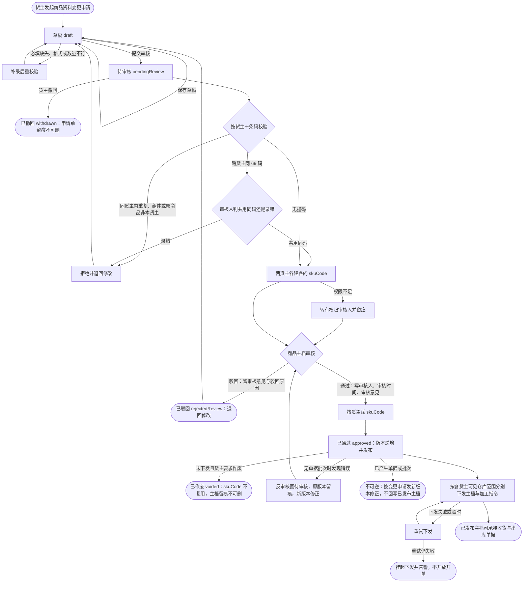

# 商品资料审核状态流转

**目标读者**：产品、研发、测试。
**核心目的**：定「货主创建商品 → 提交运营中台审核 → 赋码发布」链路的状态名、正向推进、异常处置与逆向回路，作为原型状态动作与开发状态机的依据。
**前提**：状态中文名与英文值逐字取 `.codebuddy/skills/huoling-proto/references/core/glossary.md` 第 3 节与 [商品资料变更申请单.md](../数据字典/商品资料变更申请单.md)；审核留痕字段取该字典第 2 节。独立部署、单一运营主体，货主是业务实体。

## 1. 状态流转图

## 2. 状态与动作

| 状态 | 进入条件 | 可做动作 | 留痕 | 可逆性 |
| --- | --- | --- | --- | --- |
| 草稿 `draft` | 货主新建或保存草稿 | 编辑、保存草稿、提交审核、删除草稿 | 保存草稿时间与操作轨迹 | 可撤回、可修改 |
| 待审核 `pendingReview` | 货主提交审核 | 货主撤回；运营中台校验、受理、审核 | 提交人、提交时间、操作轨迹 | 可撤回、可驳回 |
| 已通过 `approved` | 运营中台审核通过 | 赋 `skuCode`、版本递增并发布、按仓库下发 | 审核人、审核时间、审核意见、发布版本号 | 未下发可作废或反审核 |
| 已驳回 `rejectedReview` | 运营中台驳回 | 货主修改后重提 | 审核人、审核时间、驳回原因、操作轨迹 | 可重提回待审核 |
| 已撤回 `withdrawn` | 货主在待审核前撤回 | 查看、重新编辑后提交 | 撤回时间与操作轨迹 | 可重新提交，申请单不可删 |
| 已作废 `voided` | 审核通过但未下发且货主要求作废 | 查看 | 作废原因与时间、`skuCode` 不复用 | 终态，不复用编码 |

## 3. 异常场景

- 校验失败：必填缺失、格式或数量不符 → 补录后重校验，停留在草稿，不进待审核。
- 数据异常：同货主内条码重复、组套组件或换标原商品非本货主 → 拒绝并退回修改；跨货主同 69 码 → 审核人确认贴牌共用（各建各的 `skuCode`）还是录错（退回修改）。
- 依赖失败：审核人权限不足 → 转有权限审核人并留痕；下发失败或超时 → 重试下发，重试仍失败则挂起下发并告警，不开放开单。
- 结果处置：每条分支都写明触发条件、处理动作与归宿状态；审核留痕字段在通过或驳回时写入，不因后续状态变化被清空。

## 4. 逆向场景

- 撤回：草稿与待审核均可发起，申请单留痕不可删，回到草稿后可再提交。
- 驳回：审核不通过留审核意见与驳回原因，退回修改后重提，状态回待审核。
- 作废：审核通过但未下发时可作废，`skuCode` 不复用，主档与申请单留痕不可删。
- 反审核：无单据批次时发现错误，可反审核回待审核，原版本留痕，修正后发新版本。
- 不可逆：已产生单据或批次的发布不回写已发布主档，只能按变更申请发新版本；已出库交接后退货走逆向单据，同样不回写主档。

## 5. 原型对应

- 货灵ERP `base/sku-apply-list`：新增、保存草稿、提交审核、撤回、退回修改重提，审核留痕只读可见。
- 货灵运营中台管理端 `base/sku-audit-list`：审核通过、驳回留原因、反审核、作废；通过时赋 `skuCode` 并递增发布版本。
- 两端初始申请单取 `prototypes/shared/data/applies.json` 同一份共享主档，页签计数与状态胶囊随动作重算。
- 产物是独立自包含 HTML：状态动作只在本端内存与会话里生效，不写后端、不做跨文件通信；两端共享的是构建期的初始数据，不是运行时的实时联动。
