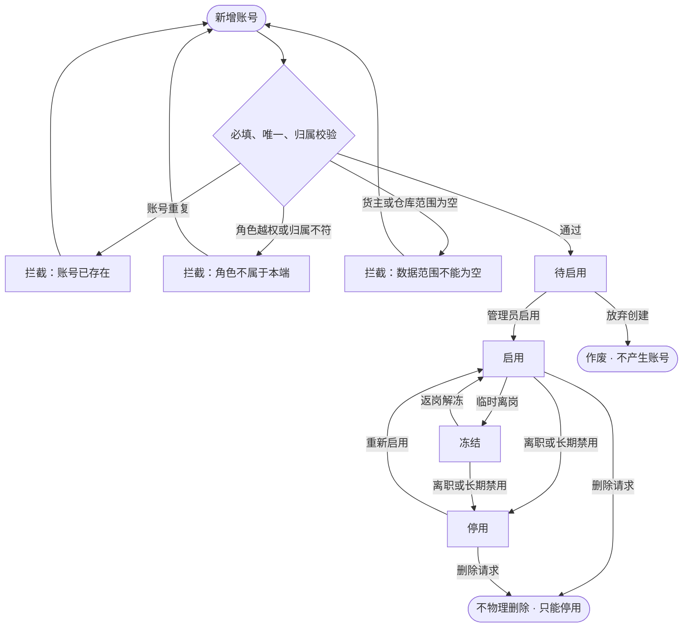
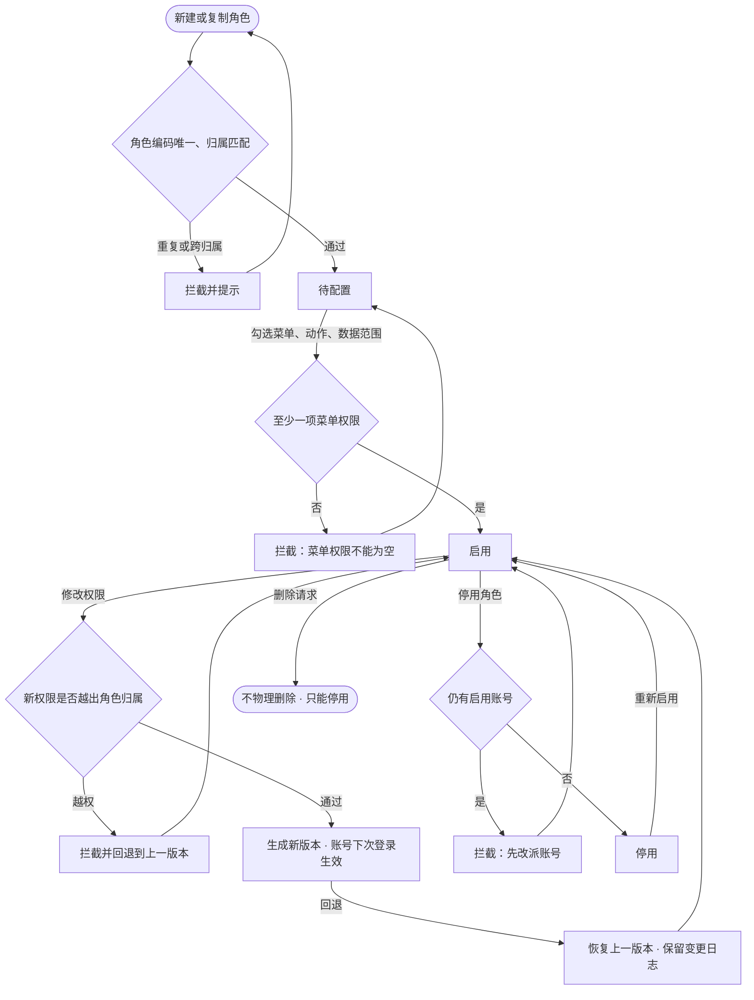

# 账号与权限方案

**目标读者**：产品、原型维护人。
**核心目的**：补齐货灵ERP货主域与货灵运营中台管理端运营域的账号、角色、权限与操作日志，明确五端分工与原型落点。
**前提**：单实例单主体，不做 SaaS 多租户；账号按域唯一（`accountDomain + accountId`），货主、仓库、组织都是数据范围。原型是自包含 HTML，不实现真实密码、SSO、审批流与登录校验。

## 1. 账号模型

账号按产品域分两套管理边界，同一部署内并存，但登录、账号、角色与日志互不越界：

| 权限域 | 账号类型 | 归属 | 管理端 | 数据范围 |
| --- | --- | --- | --- | --- |
| 货主域 | 货主账号 | 某一货主 | 货灵ERP | 本货主、授权仓库、指定业务 |
| 运营中台域 | 运营方账号 | 本部署运营主体 | 货灵运营中台管理端 | 全部货主、全部仓库，可按角色收窄 |
| 运营中台域 | 仓内账号 | 某一仓库 | 货灵运营中台管理端建，货灵WMS与 PDA 使用 | 本仓、本班组或岗位 |

规则：

- 账号按域唯一：`accountDomain` 取 `erp` 或 `network`，唯一性为 `accountDomain + accountId`；停用后不物理删除，只保留状态与操作日志。
- 货主账号只在货灵ERP建；运营方与仓内账号只在货灵运营中台管理端建；同一自然人如果两边都要用，开两个账号，不共享登录。
- 一个账号一个主角色，角色决定菜单、动作与数据范围；需要多角色时新建组合角色，不叠加多个角色。
- 货主账号的 `ownerCode` 必填，仓内账号的 `warehouseCode` 必填，运营方账号两者可为空。
- 货主账号不能跨货主，仓内账号不能跨仓库，运营方账号按角色的数据范围跨货主、跨仓库。
- 账号状态：待启用 / 启用 / 冻结 / 停用。待启用是新建未激活，冻结是临时停用，停用是离职或长期禁用。

## 2. 角色与权限

角色 = 菜单权限 + 动作权限 + 数据范围。

| 维度 | 取值 | 说明 |
| --- | --- | --- |
| 菜单权限 | 一级菜单 | 工作台 / 订单 / 履约 / 售后 / 仓储委托 / 库存 / 商品 / 商城店铺 / 平台接入 / 账单与服务 / 报表与设置；运营中台按自己的菜单段，含 ERP 运营 |
| 动作权限 | 查看、新增、编辑、停用、导出、审核、发货、退款、代维 | 页面内按钮与操作；代维只用于货主开通页 |
| 数据范围 | 货主范围、仓库范围、业务范围 | 全部或指定；货主账号的货主范围固定为本货主 |

角色归属与内置角色：

| 归属 | 内置角色 | 可管理方 |
| --- | --- | --- |
| 运营方 | 运营管理员、仓网调度、财务、客服 | 货灵运营中台管理端 |
| 货主 | 货主管理员、货主查询、委托经办、售后专员、货主财务 | 货灵ERP |
| 仓内 | 仓库主管、收货员、上架员、拣货员、复核员、盘点员 | 货灵运营中台管理端 |

规则：

- 角色分系统内置与自定义；内置角色不可删除，只能停用；自定义角色按归属创建，不能跨归属。
- 货主只能创建货主角色，不能创建运营方或仓内角色；运营中台可创建运营方与仓内角色。
- 角色停用前先改派所有启用账号，停用后不可再分配给新账号。
- 角色权限变更留痕，账号下次登录生效；已打开的会话不强制踢出。
- 页面级权限保留在数据字典，原型按一级菜单勾选，避免一次展示三十多个页面复选项。

## 3. 三端分工

| 端 | 账号管理 | 角色管理 | 日志 |
| --- | --- | --- | --- |
| 货灵运营中台管理端 | 运营方账号、仓内账号；新增、编辑、停用、重置密码 | 运营方角色、仓内角色；新建、复制、停用、配置权限 | 货灵运营中台管理端、货灵WMS、PDA 操作日志，可按端、模块、动作筛选；不含货灵ERP |
| 货灵ERP | 本货主账号；新增、编辑、停用、重置密码 | 本货主自定义角色；只能用货主菜单与业务范围 | 本货主账号操作日志 |
| 货灵WMS | 不建账号页；人员档案关联账号并显示账号状态 | 只读展示岗位与角色 | 不建日志页 |
| PDA | 复用仓内账号登录 | 只读展示角色 | 我的页展示角色、仓库范围与权限入口 |
| 货灵商城 | 不建账号体系；买家与店主共用货主账号，角色由是否开店派生 | 不适用 | 不适用 |

### 3.1 ERP 运营后台与货主权限域的边界

- 货灵运营中台管理端的「ERP 运营」是产品运营后台，只读货主开通、模块与版本、平台应用、同步健康与全局审计；不管理货主子账号与货主角色。
- 「ERP 运营 → 全局审计」是跨货主只读审计页，允许出现「货灵ERP」端；「账号与权限 → 操作日志」只保留货灵运营中台管理端、货灵WMS、PDA 日志，不出现货灵ERP。两页职责不同，不能合并。
- 代维入口只打开只读摘要并 toast，不进入货主业务页；代维动作写入审计。
- 货主账号的增删改仍只在货灵ERP；运营中台账号页看不到 `ow.*` 货主账号。

## 4. 账号生命周期

- 每次新增、启用、冻结、解冻、停用、重置密码都写操作日志。
- 停用账号不能登录，已产生的单据与操作记录保留。
- 待启用账号不计入角色账号数；启用后才计入。

## 5. 角色与权限变更

- 角色权限变更保留版本与操作日志，可回退到上一版本。
- 角色停用后不能再分配给新账号，已有账号保留原权限直到改派。
- 内置角色不能改编码与归属，只能改名称、权限与状态。

## 6. 操作日志

- 记录：登录、退出、新增账号、编辑账号、启用、冻结、解冻、停用、重置密码、角色新增、角色权限变更、角色停用、导出、审核、发货、退款。
- 字段：日志编号、时间、操作人、所属端、模块、动作、对象类型、对象编号、结果、IP、详情。
- 日志只追加，不提供删除与修改入口；失败动作也记录，结果写失败并带原因。
- 货主账号只能看本货主日志；运营中台可看全量；货灵WMS与 PDA 不建日志页。

## 7. 原型页面映射

| 页面 | 模块 / key | 端 | 说明 |
| --- | --- | --- | --- |
| 账号管理 | `system/user-list` | 货灵运营中台管理端 | 运营方与仓内账号；新增、编辑、停用、重置密码、查看日志 |
| 角色权限 | `system/role-list` | 货灵运营中台管理端 | 运营方与仓内角色；权限抽屉按菜单、动作、数据范围分组勾选 |
| 操作日志 | `system/audit-log` | 货灵运营中台管理端 | 运营中台、货灵WMS、PDA 日志，按端、模块、动作、时间筛选；不含货灵ERP |
| 全局审计 | `erp-ops/erp-global-audit` | 货灵运营中台管理端 | 跨货主只读审计，可出现货灵ERP端；与账号操作日志分开 |
| 子账号与权限 | `owner/account-list` | 货灵ERP | 本货主账号；补账号类型、角色、数据范围、操作 |
| 角色权限 | `owner/role-owner-list` | 货灵ERP | 本货主自定义角色；菜单只出现货主可用段 |
| 操作日志 | `owner/audit-owner-log` | 货灵ERP | 本货主账号日志 |
| 人员 | `resource/staff-list` | 货灵WMS | 补关联账号、账号状态、开通账号、查看权限 |
| 我的 | `task/pda-mine` | PDA | 补角色、仓库范围、我的权限入口 |

页面名、列名、角色名、状态与动作文案先登记 `glossary.md` 与 `docs/数据字典/`，再写页面源。

## 8. 分批与验收

1. 文档与文案：本方案、账号/角色/操作日志字典、`glossary.md`、`registry.md`、索引与日志。
2. 共享层：`FormField` 增加 `checks` 多选字段，`modules.json` 补页面归属与 nav。
3. 运营中台：账号管理、角色权限、操作日志三页。
4. 货灵ERP：子账号增强、角色权限、操作日志三页。
5. 货灵WMS与 PDA：人员关联账号、开通账号动作、我的权限入口。
6. 收尾：五端重建、全量验收、浏览器实测、`module.json` 与日志回填。

## 9. 边界

- 不建组织架构树、审批流、SSO、密码找回与真实登录校验；组织先用货主、仓库、班组表达。
- 不在货灵商城另建账号体系；买家与店主角色由货主与店铺派生。
- 不出现 SaaS 多租户、套餐、订阅、租户切换器；货主与仓库始终是数据范围，不是租户。
- 原型只演示账号状态、角色权限勾选、日志筛选与货主隔离，不做真实权限拦截。
